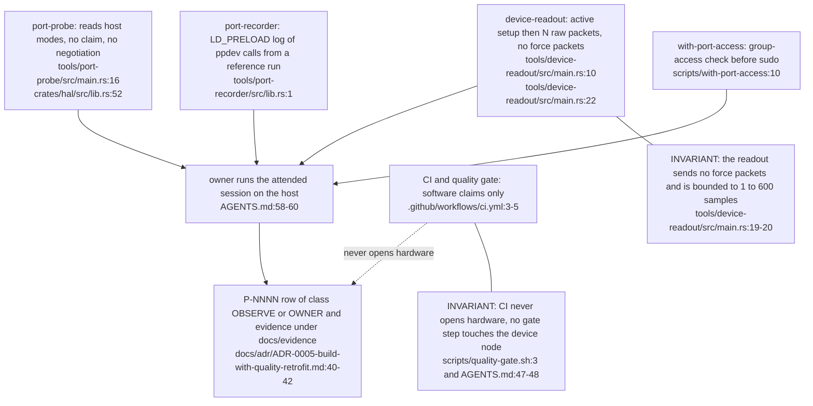
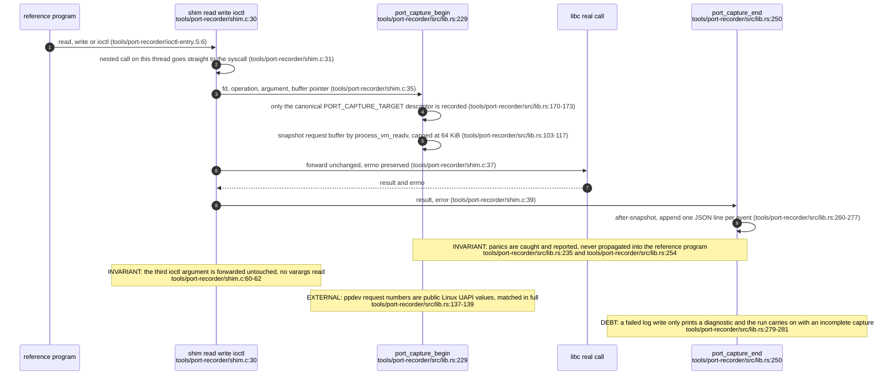
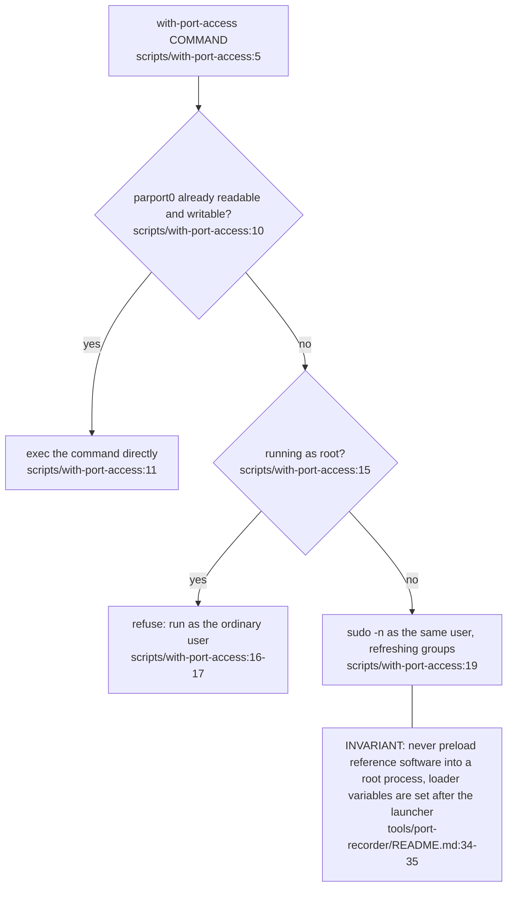
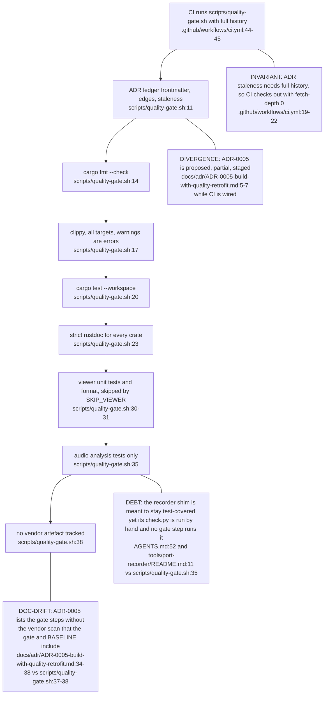

## For developers

Three small tools produce the evidence that the spec and provenance rows stand on: a capability probe that only reads host metadata, a bounded readout that performs the active setup and prints raw packets but never sends a force packet, and an LD_PRELOAD recorder that logs the ppdev calls a reference program makes. A launcher refreshes group membership for port access, and one script, `quality-gate.sh`, is both the local pre-commit check and the CI job. Physical tests happen on the owner's machine and come back as provenance rows. The Calibration Studio and its worker are not covered here.

## For the business

The software side can be checked by anyone, on any machine, in about the time it takes to build: formatting, lint, unit tests, documentation and a scan that no vendor file has crept in. None of that touches the arm, by design and by a comment at the top of the script. Anything that depends on the arm itself is done by the owner with the arm connected, and the result enters the repository as a dated evidence record rather than as a pass on a build server. A green build therefore says the code is tidy and consistent, and nothing at all about how the arm feels.

## VT-06.1 From tool to provenance row

The three tools are ordered by how much they do to the unit: the probe changes nothing, the readout performs one active setup write, and the recorder observes someone else's session.

## VT-06.2 Port recorder: one captured call

Capture files are named by session, process and thread and land under the ignored vendor-original directory, so the raw logs never enter the tree.

## VT-06.3 Port access without root

The launcher exists only because the owner's login session lacks the device group. It grants nothing the user did not already have.

## VT-06.4 Quality gate and CI

The gate is the same script locally and in CI, so a green run in one place means the same in the other.
