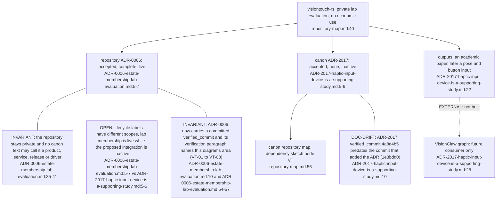
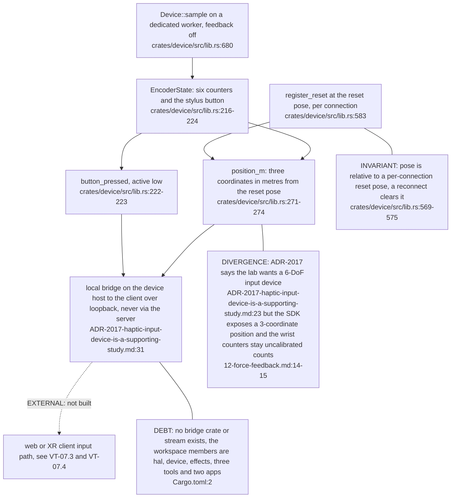
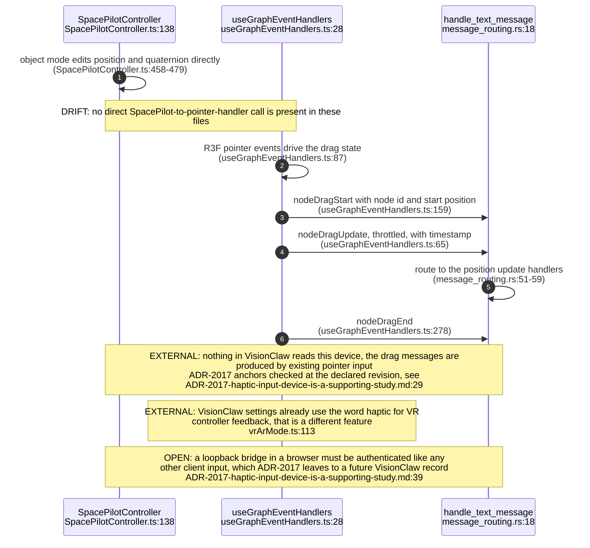
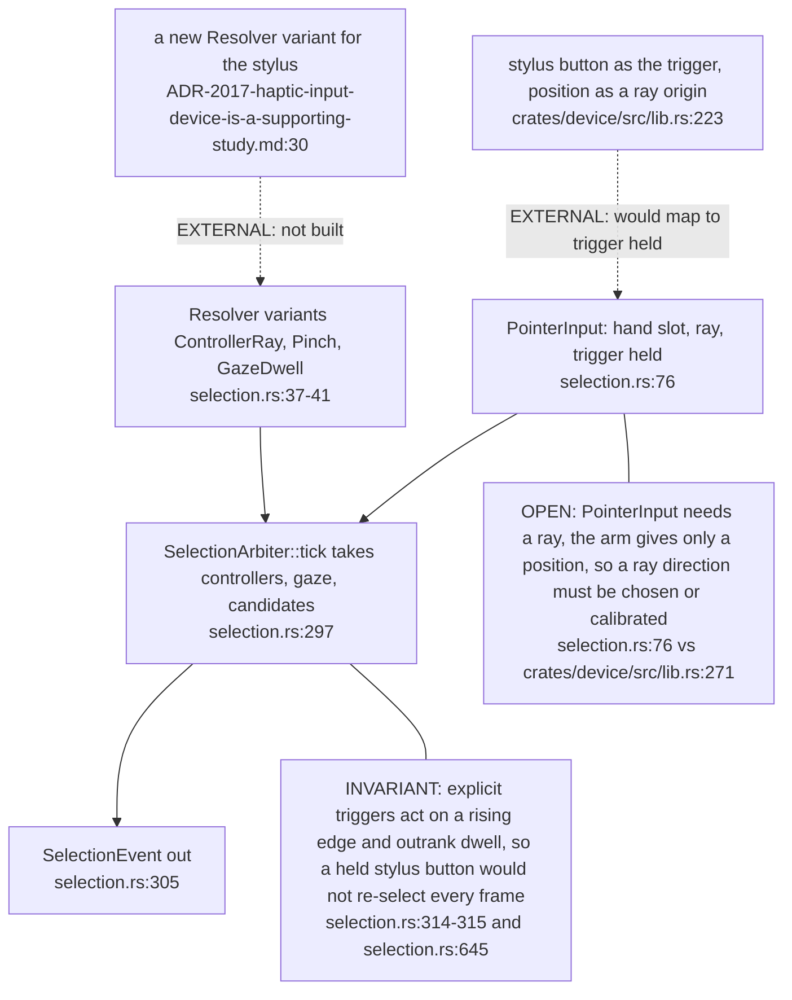

## For developers

Source review and qualifications: [1 November audit](../../estate-review/2026-11-01-visiontouch-software-boundaries.md). The source pins are retained; this review changes claims, not device behaviour.

visiontouch-rs is a private supporting study in the estate, not a substrate: the canon records it in the repository map and ADR-2017, and the repository records the same posture in ADR-0006. The only planned integration is a pose and stylus button entering VisionClaw by the same two paths as its other input devices, the web-client pointer handlers that produce node drag messages and an XR-client selection arbiter that takes pointer input. None of that is built; no VisionClaw file mentions this device, and the repository has no bridge crate. This topic is a map of the intended seams, so every VisionClaw claim is EXTERNAL at the declared VisionClaw revision. The five cited VisionClaw files were byte-identical at 75b72416bac176ca8fde715cac3bd7c77657b3e7 during the 1 November review.

## For the business

The lab wants a physical stylus that can pick up and drag nodes in the VisionClaw knowledge graph, as a study for its VisionFlow installation. Today that is an intention with a documented route, not a feature: the repository provides lab software with simulation coverage and owner-host input traces, the VisionClaw side has not been touched, and nothing here is a product, a release or a service. Pushing back on the user's hand (force return) is explicitly out of scope. If the route is ever started, it needs its own decision record in both repositories; any delivered-force claim separately needs physical verification, and any step towards publishing or demonstrating outside the lab reopens the legal review before anything else.

## VT-07.1 Where the study sits in the estate

Both records agree on the posture and on the integration being future work. Their lifecycle labels describe membership and future integration respectively; the labels alone do not establish a contradiction.

## VT-07.2 What the arm can supply today

Orientation is not available from the SDK, so a world-space ray from the stylus cannot be built without new calibration work. A position-only mapping is the realistic first step.

## VT-07.3 Web client route, EXTERNAL and not built

A device that produced the same ray-and-drag events would need no new server message type. The pointer handlers and server routes exist. SpacePilot object manipulation is a separate path; sharing a future adapter requires explicit integration.

## VT-07.4 XR client route, EXTERNAL and not built

The cited `selection.rs` anchors match the declared revision and are unchanged at the reviewed 75b72416 HEAD. The XR path would add a resolver, not a new server message.
