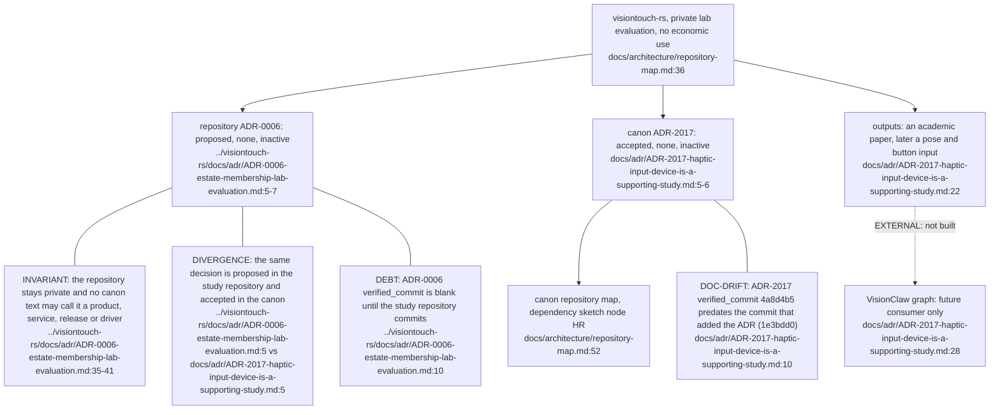
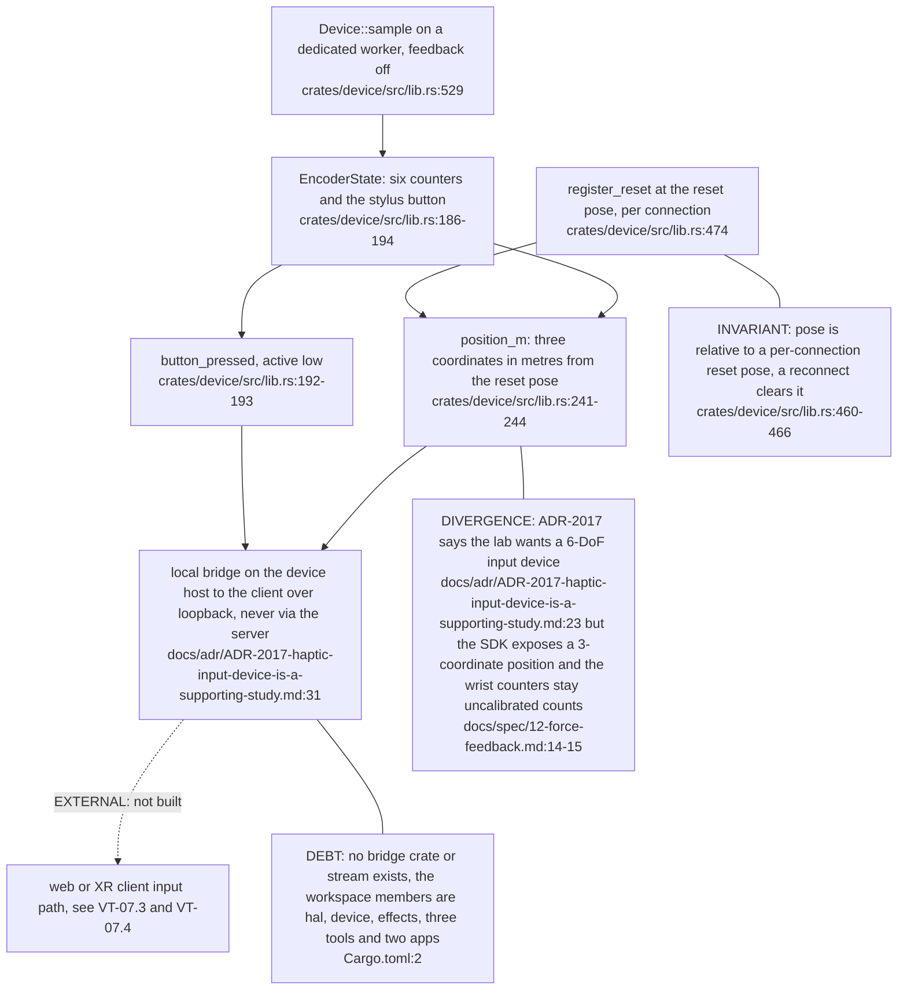
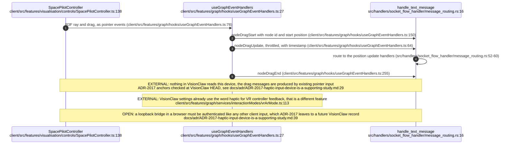
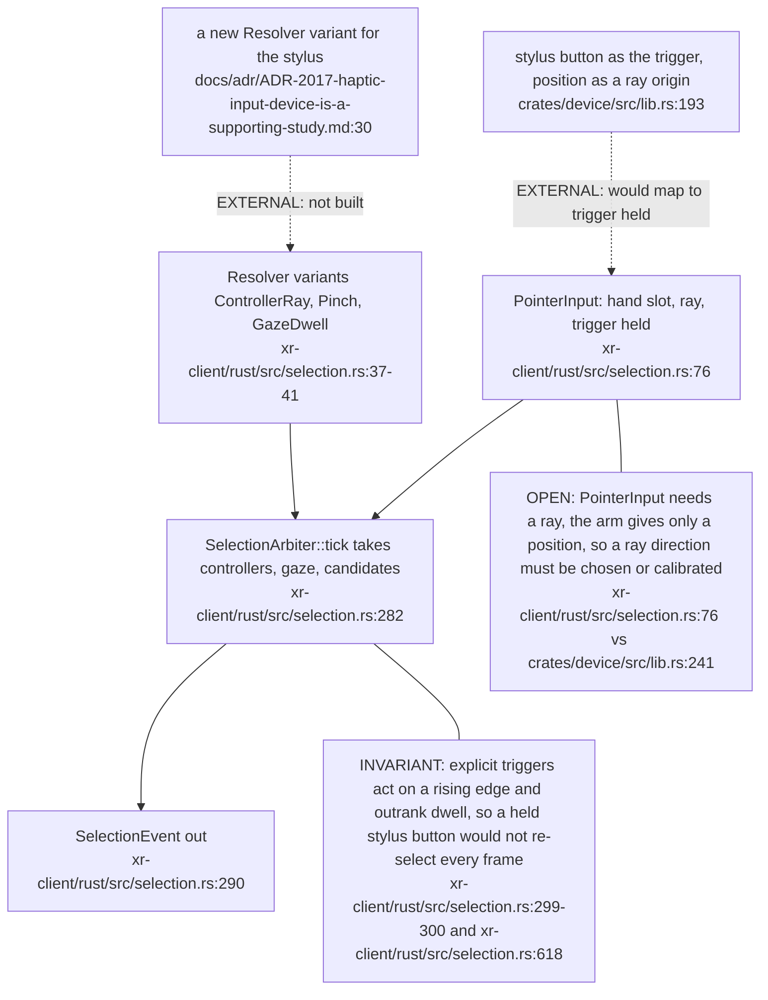

## For developers

visiontouch-rs is a private supporting study in the estate, not a substrate: the canon records it in the repository map and ADR-2017, and the repository records the same posture in ADR-0006. The only planned integration is a pose and stylus button entering VisionClaw by the same two paths as its other input devices, a web-client controller that already produces node drag messages and an XR-client selection arbiter that takes pointer input. None of that is built; no VisionClaw file mentions this device, and the repository has no bridge crate. This topic is a map of the intended seams, so every VisionClaw claim is EXTERNAL and read at VisionClaw HEAD.

## For the business

The lab wants a physical stylus that can pick up and drag nodes in the VisionClaw knowledge graph, as a study for its VisionFlow installation. Today that is an intention with a documented route, not a feature: the arm works as a lab instrument, the VisionClaw side has not been touched, and nothing here is a product, a release or a service. Pushing back on the user's hand (force return) is explicitly out of scope. If the route is ever started, it needs its own decision record in both repositories and a physical force verification first, and any step towards publishing or demonstrating outside the lab reopens the legal review before anything else.

## VT-07.1 Where the study sits in the estate

Both records agree on the posture and on the integration being future work. They disagree only in their lifecycle labels.

## VT-07.2 What the arm can supply today

Orientation is not available from the SDK, so a world-space ray from the stylus cannot be built without new calibration work. A position-only mapping is the realistic first step.

## VT-07.3 Web client route, EXTERNAL and not built

A device that produced the same ray-and-drag events would need no new server message type. Everything shown here exists and is used by mouse and SpacePilot input today.

## VT-07.4 XR client route, EXTERNAL and not built

Anchors in `selection.rs` were read at VisionClaw HEAD and match ADR-2017. The XR path would add a resolver, not a new server message.
