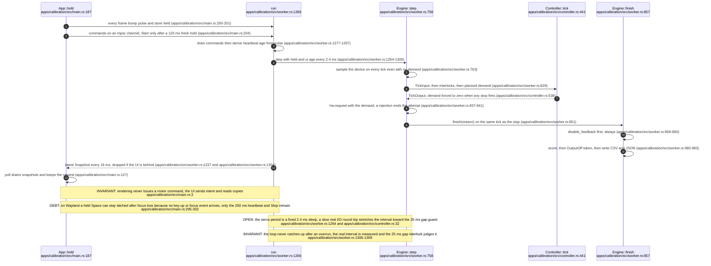
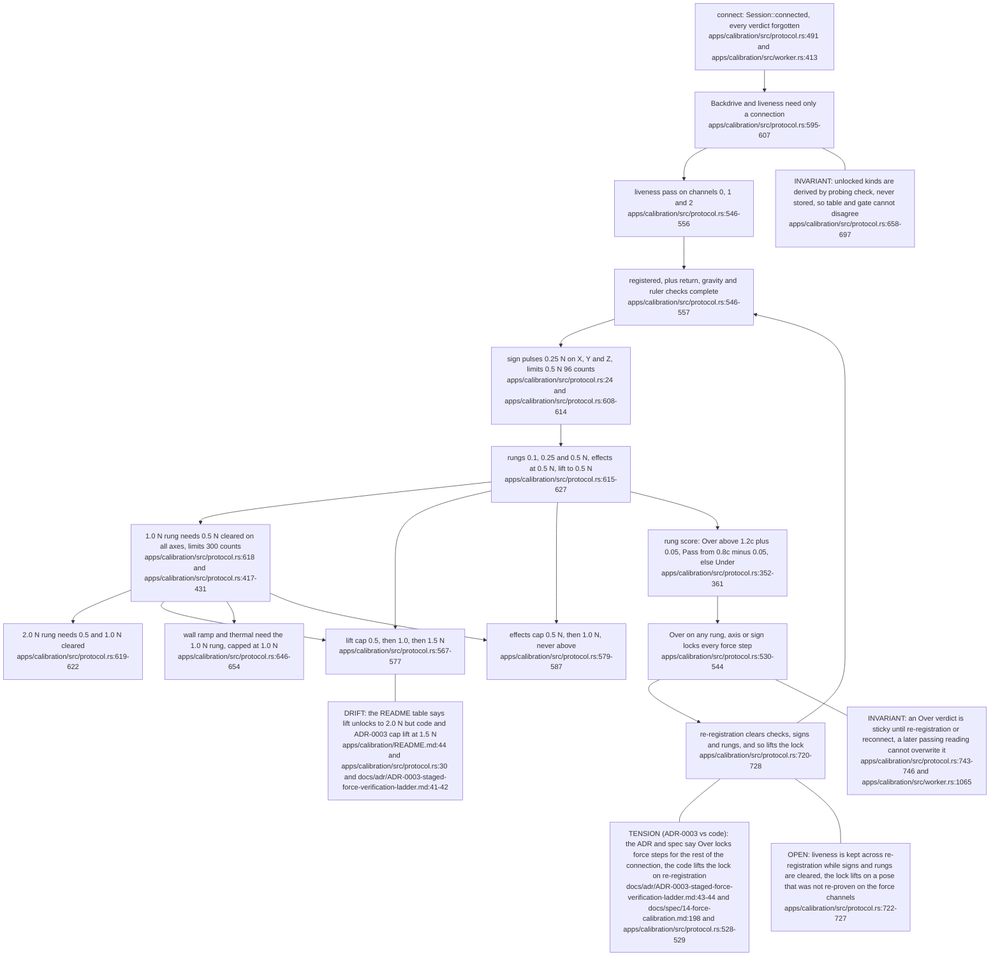
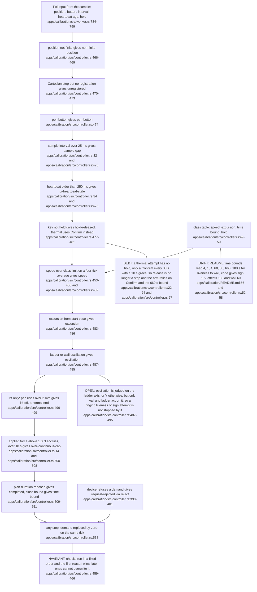
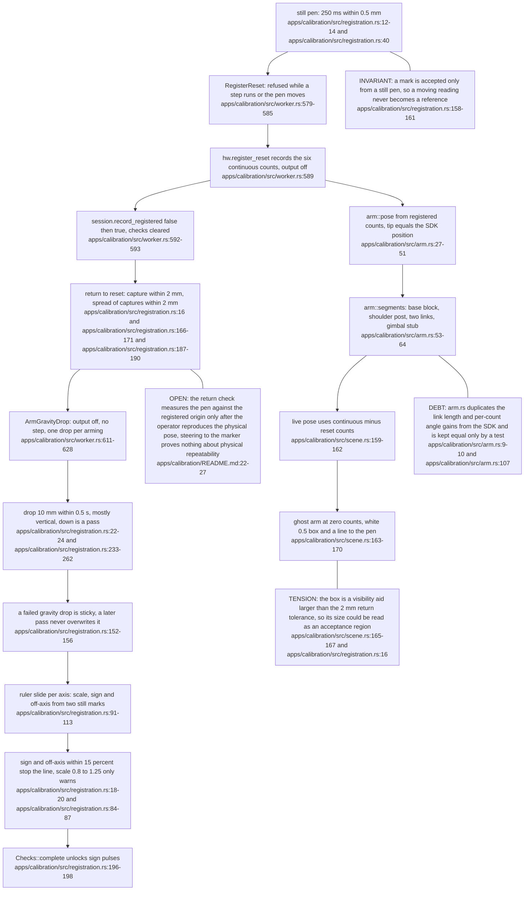
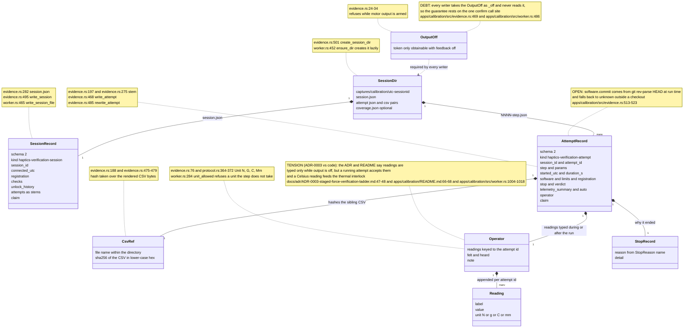
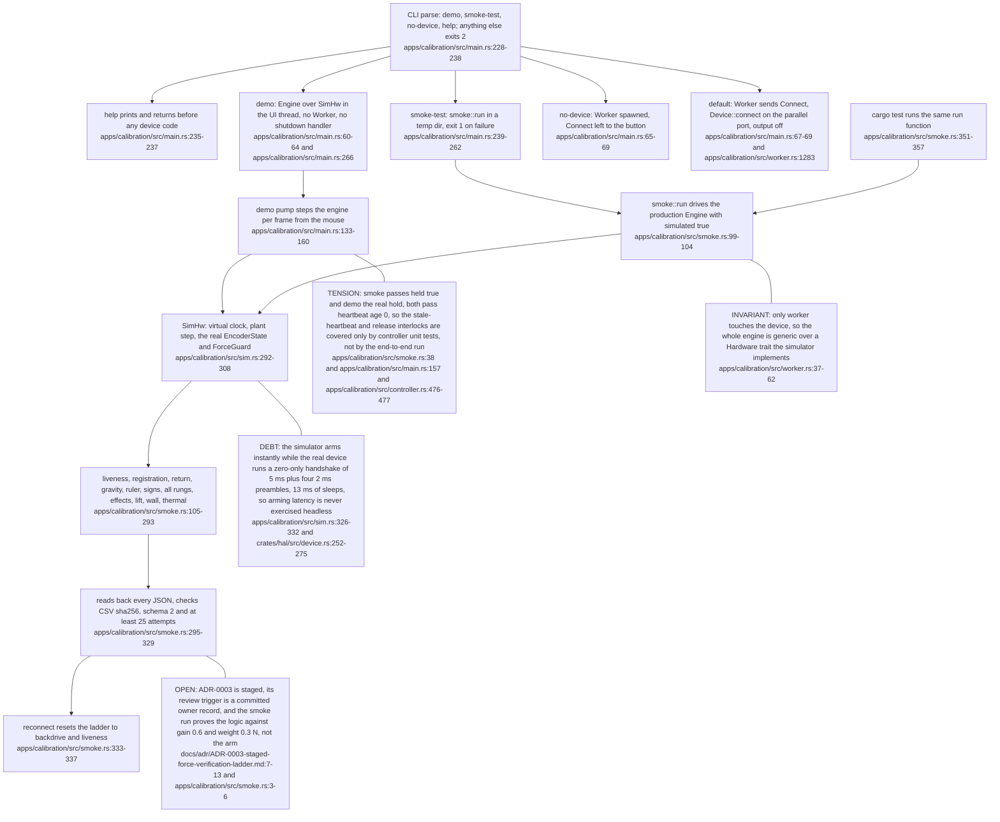

## For developers

The Calibration Studio is the one consumer of `visiontouch-device` that builds force limits above the SDK defaults, and it does so only inside fixed-dwell steps. It is two threads. The interface thread draws and sends intent, the servo thread owns `Device` and every motor request. Three pure modules decide what may happen: `protocol` (the per-connection unlock `Session`), `controller` (the per-tick interlocks) and `registration` (stillness, return, gravity, ruler). Only `worker` touches the device, so `sim` and `smoke` can drive the same `Engine` with no hardware and the whole ladder runs in `cargo test`. Every attempt ends the same way: demand zeroed on the stopping tick, output disarmed, and only then evidence written, with an `OutputOff` token making the order a type rule. ADR-0003 is accepted and complete but its activation is staged until an owner session exists, so everything below is verified against a simulated plant only. All newtons are model commands, not measured forces.

## For the business

This is the program the lab owner will run, attended, to find out whether the arm pushes back at all and by how much. It cannot be rushed: the operator must register the arm at its reset pose, prove each of the three motors responds, prove the directions are right, then climb a ladder of test forces from a tenth of a newton to two, with a gauge reading typed in at each step. A button press, a released key, a too-fast hand or a frozen screen stops that one attempt at once. A gauge reading that comes out much higher than the command locks every further force step until the arm is registered again. Disconnecting forgets everything, so each sitting starts from the bottom. The result is a folder per sitting holding every attempt as a table of numbers and a signed-off summary, which becomes the evidence for the first real force figures. Until that sitting happens, nothing in this program has been measured on the real arm.

## VT-08.1 UI thread and servo thread

**What it shows.** The interface can freeze or lose focus and the arm still stops, because hold and heartbeat are shared atomics the servo thread reads every tick, and snapshots flow back through a channel of depth one.
**Why it is this way.** ADR-0003 requires held attempts with operator interlocks, and the focus-loss comment records a rejected alternative: a recent-key-down fallback needs autorepeat, whose delay exceeds any safe timeout.

## VT-08.2 The per-connection unlock ladder

**What it shows.** Each Start is judged by `Session::check`, which names the first missing prerequisite, and every attempt sets explicit limits (disarm, set, arm) so nothing is inherited. Under-delivery is recorded with its slope but never blocks, only Over does.
**Why it is this way.** Three powered sessions on 2026-10-16 produced no perceptible force, so ADR-0003 (accepted 2026-10-17) replaced hold-and-feel with discriminating steps, and only a completed dwell is scored (apps/calibration/src/worker.rs:915-920).

## VT-08.3 Interlocks per attempt class

**What it shows.** Every interlock reduces to a named `StopReason` written into the evidence, and the 1.0 N budget counts cumulative time above one newton across the attempt, which is what lets the 2.0 N rung exist.
**Why it is this way.** Limits come from design section 3.2 and are restated in docs/spec/14-force-calibration.md:128-139, where the table agrees with the code and the README does not.

## VT-08.4 Registration at the reset pose

**What it shows.** Registration records where the arm physically was at the reset pose, then four independent checks follow: repeatable return, gravity toward -Y, ruler sign on three axes, and a straight slide.
**Why it is this way.** ADR-0004 (accepted, live) replaced bottom-reference workflows with a published reset pose, and a reconnect clears it because it is a new device (docs/adr/ADR-0004-reset-pose-registration.md:36-37).

## VT-08.5 Evidence schema 2

**What it shows.** A session directory is created lazily, `session.json` is rewritten after each change, and each attempt is a CSV plus a JSON whose `csv.sha256` binds the pair. Operator readings are keyed by attempt id, arrive mostly after the attempt ends, and trigger a rewrite of that JSON, where a ladder rung is finally scored.
**Why it is this way.** ADR-0003 wants output off for readings, and what the code enforces is the weaker rule that `OutputOff` must be held to write a file (apps/calibration/src/evidence.rs:24-34).

## VT-08.6 Headless path and CLI modes that never open hardware

**What it shows.** The demo and the smoke run are the production `Engine` over a different `Hardware`, so a regression in unlocks, interlocks or evidence fails `cargo test` before anyone stands at the arm, though nothing about real timing or force.
**Why it is this way.** The baseline keeps force claims in operator rows only, so the headless path protects logic and never stands in for the owner session (docs/BASELINE-visiontouch-rs.md:84).

