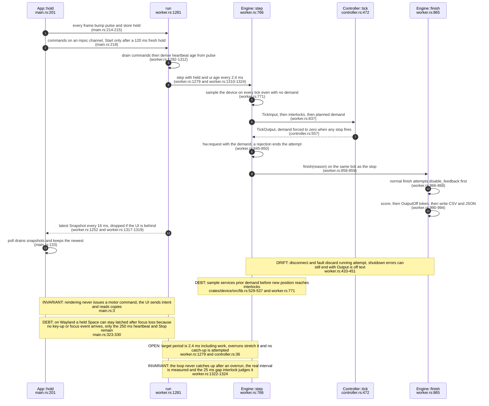
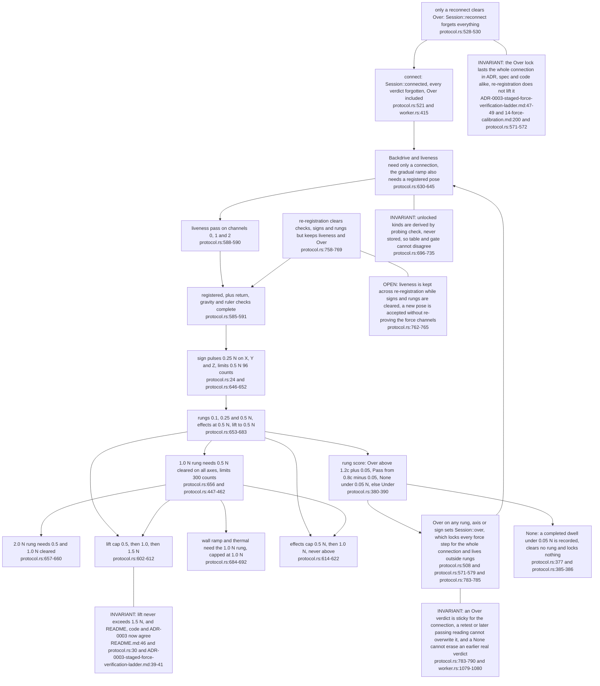
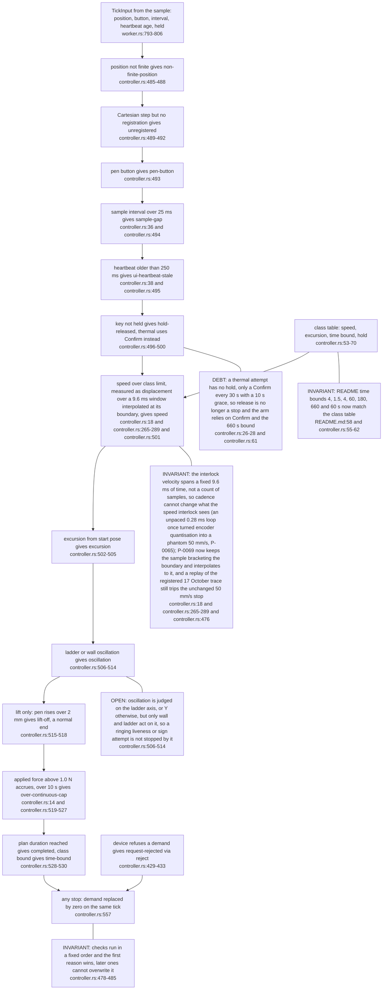
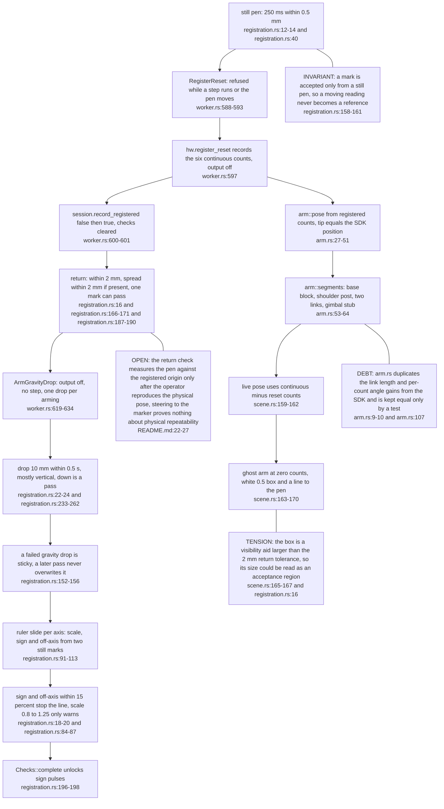
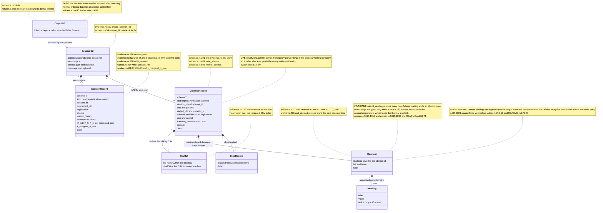
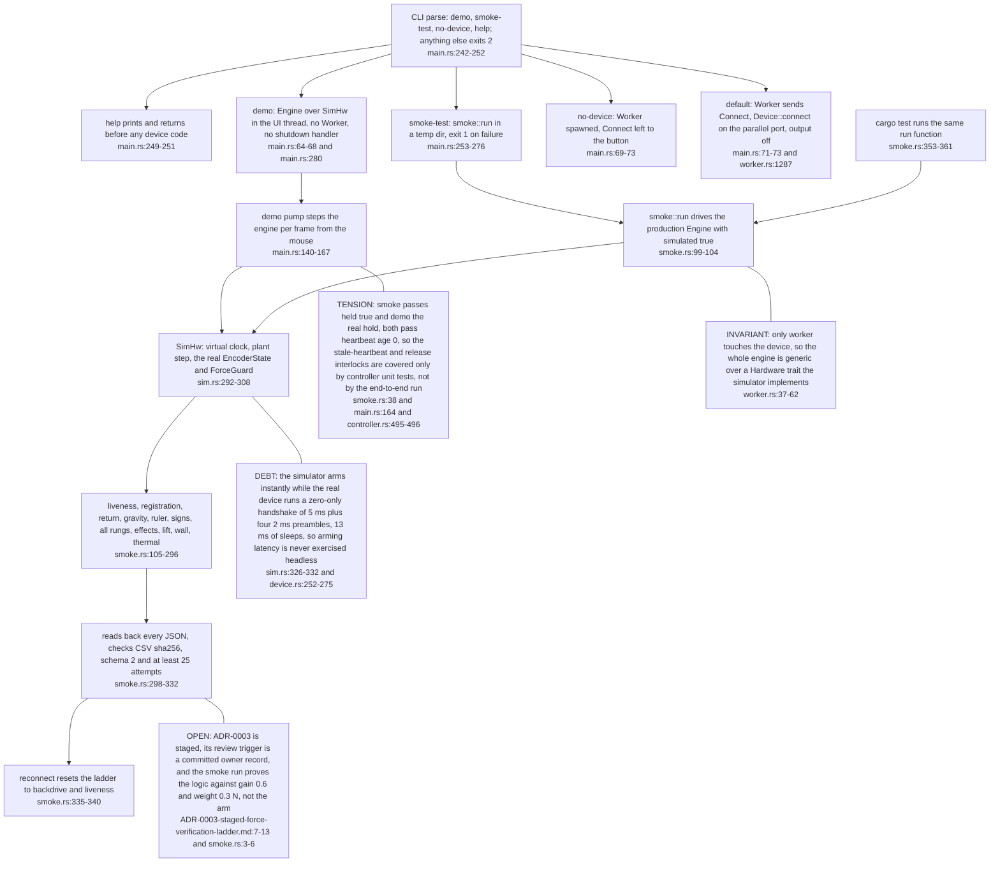
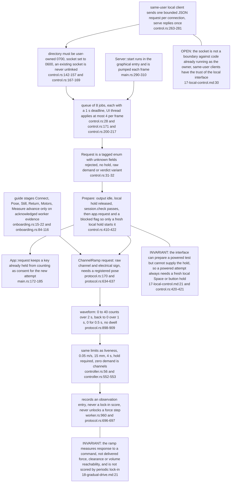

## For developers

Source review and qualifications: [1 November audit](../../estate-review/2026-11-01-visiontouch-software-boundaries.md). The source pins are retained; this review changes claims, not device behaviour.

The Calibration Studio is the one consumer of `visiontouch-device` that builds force limits above the SDK defaults, with continuous content capped at 1.0 model N and commands above 1.0 N restricted to bounded verification steps. It is two threads. The interface thread draws and sends intent, the servo thread owns `Device` and every motor request. Three pure modules decide what may happen: `protocol` (the per-connection unlock `Session`), `controller` (the per-tick interlocks) and `registration` (stillness, return, gravity, ruler). Only `worker` touches the device, so `sim` and `smoke` can drive the same `Engine` with no hardware and the whole ladder runs in `cargo test`. On a normal controller stop, the worker requests zero, attempts shutdown and then writes evidence. Disconnect and transport-fault paths instead discard the running attempt. `OutputOff` checks a supplied Boolean and can be retained after rearming; it does not enforce device state through its type. ADR-0003 is accepted and complete but its activation is staged until an owner session exists, so the full force ladder has simulation evidence rather than physical acceptance. Existing owner-host input and liveness traces are distinct from delivered-force calibration. All newtons are model commands, not measured forces. Since the October 2026 additions Studio also opens a private local control socket (`control`), presents a guided workflow (`onboarding`), interpolates the velocity-window boundary (P-0069) and offers a fixed 40-count channel ramp that never unlocks a force step; VT-08.7 maps those.

## For the business

This is the program the lab owner will run, attended, to find out whether the arm pushes back at all and by how much. It cannot be rushed: the operator must register the arm at its reset pose, prove each of the three motors responds, prove the directions are right, then climb a ladder of test forces from a tenth of a newton to two, with a gauge reading typed in at each step. The controller checks the button, hold, motion and heartbeat when its worker runs. The preceding device sample can already have serviced the previous demand. A gauge reading that comes out much higher than the command locks every further force step for the rest of the connection, and registering the arm again does not lift it. A reading of almost nothing (under 0.05 N) is recorded as nothing delivered: it neither unlocks the next rung nor locks anything. Disconnecting forgets everything, so each sitting starts from the bottom. The result is a folder per sitting holding normally completed or controller-stopped attempts as tables and summaries, which becomes the evidence for the first real force figures. Owner-host input traces exist; they do not establish delivered force or completion of the force ladder. Since the October update the program can also be driven locally for everything except the hold: a helper script can prepare a test, but only a fresh press of the key starts the motor.

## VT-08.1 UI thread and servo thread

**What it shows.** A stale heartbeat or released hold requests a stop on the next serviced controller tick. Wayland focus loss may leave the hold latched while heartbeat updates continue; focus loss alone is not a guaranteed stop. Snapshots use a channel of depth one.
**Why it is this way.** ADR-0003 requires held attempts with operator interlocks, and the focus-loss comment records a rejected alternative: a recent-key-down fallback needs autorepeat, whose delay exceeds any safe timeout.

## VT-08.2 The per-connection unlock ladder

**What it shows.** Each Start is judged by `Session::check`, which names the first missing prerequisite, and every attempt sets explicit limits (disarm, set, arm) so nothing is inherited. Under-delivery is recorded with its slope but never blocks, only Over does, and Over is the one verdict held outside the per-rung table so that re-registration cannot clear it.
**Why it is this way.** Three powered sessions on 2026-10-16 produced no perceptible force, so ADR-0003 (accepted 2026-10-17) replaced hold-and-feel with discriminating steps, and only a completed dwell is scored (apps/calibration/src/worker.rs:923-928).

## VT-08.3 Interlocks per attempt class

**What it shows.** Every interlock reduces to a named `StopReason` written into the evidence, and the 1.0 N budget counts cumulative time above one newton across the attempt, which is what lets the 2.0 N rung exist.
**Why it is this way.** Limits come from design section 3.2 and are restated in docs/spec/14-force-calibration.md:128-138, where the table now agrees with both the code and the README.

## VT-08.4 Registration at the reset pose

**What it shows.** Registration records where the arm physically was at the reset pose, then four independent checks follow: repeatable return, gravity toward -Y, ruler sign on three axes, and a straight slide.
**Why it is this way.** ADR-0004 (accepted, live) replaced bottom-reference workflows with a published reset pose, and a reconnect clears it because it is a new device (docs/adr/ADR-0004-reset-pose-registration.md:36-37).

## VT-08.5 Evidence schema 2

**What it shows.** A session directory is created lazily, `session.json` is rewritten after each change (it now also carries the lift results, with the gain `m g / (F_m - F_0)`, and the last stable wall stiffness `k_marginal_n_mm`), and each attempt is a CSV plus a JSON whose `csv.sha256` binds the pair. Operator readings are keyed by attempt id, arrive mostly after the attempt ends, and trigger a rewrite of that JSON, where a ladder rung is finally scored.
**Why it is this way.** ADR-0003 wants output off for readings, and the code enforces it for running attempts in `submit_reading` (apps/calibration/src/worker.rs:1014-1018) The `OutputOff` parameter expresses intent but does not prevent a stale token being used after rearming (apps/calibration/src/evidence.rs:24-34).

## VT-08.6 Headless path and CLI connection modes

**What it shows.** The demo and the smoke run are the production `Engine` over a different `Hardware`, so a regression in unlocks, interlocks or evidence fails `cargo test` before anyone stands at the arm, though nothing about real timing or force.
**Why it is this way.** The baseline keeps force claims in operator rows only, so the headless path protects logic and never stands in for the owner session (docs/BASELINE-visiontouch-rs.md:84).

## VT-08.7 Local control socket, guided onboarding and the gradual channel diagnostic

**What it shows.** Studio now has a second way in besides the mouse: a private Unix socket whose requests become the same `app.request` calls a button press makes, with a guide that sequences connection, registration, return and one-motor-at-a-time checks, and a fixed 40-count ramp that sits beside liveness rather than replacing it.
**Why it is this way.** P-0066 to P-0068 change presentation and add restrictions only, so interlocks, SDK limits and the verdict path stay authoritative (docs/spec/16-guided-onboarding.md:14-16). The gradual diagnostic is deliberately unscored, because a ramp has no periodic content for the lock-in to judge (docs/spec/18-gradual-drive.md:21).
