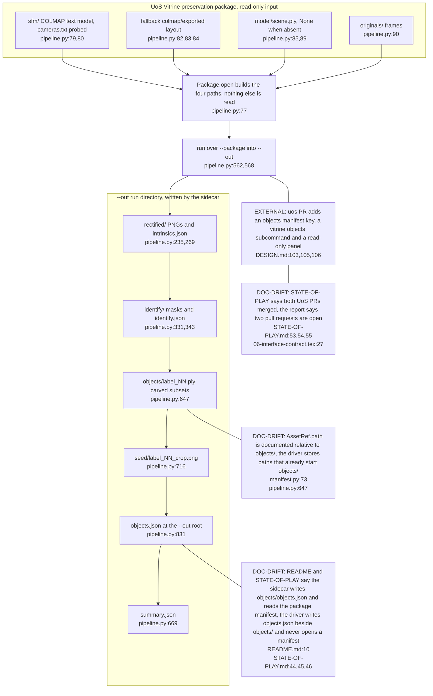
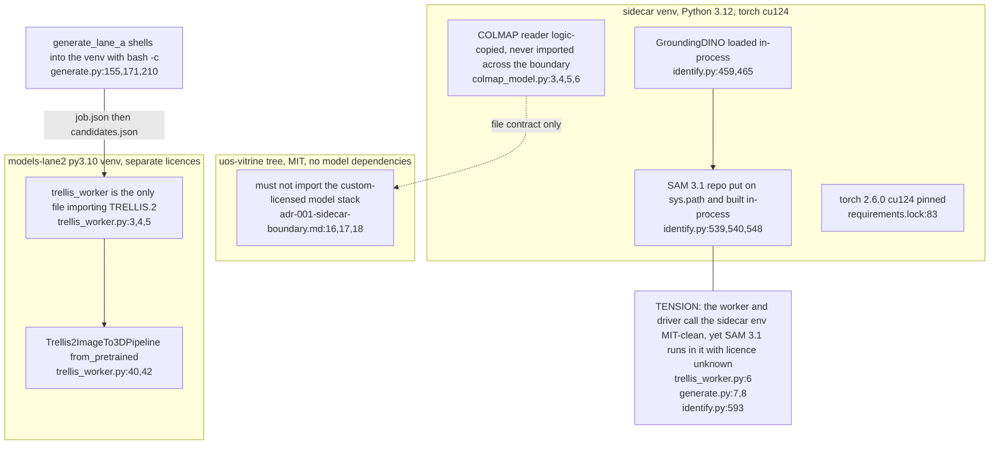
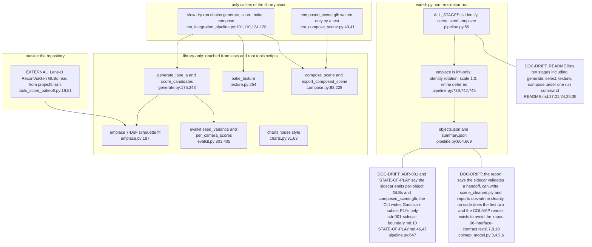

## VO-01.1 The two systems meet at the filesystem

**What it shows.** The package is consumed read-only through four paths; everything the driver writes lands under the `--out` directory, never inside the package (`ddd-001-domain-model.md:15`).

## VO-01.2 Three environments and the licence fence

**What it shows.** Only TRELLIS.2 is fenced off by a process boundary; the identify models run inside the sidecar's own interpreter (`pipeline.py:597,598`).

## VO-01.3 Wired by the CLI, library-only, or outside the repository

**What it shows.** Four stages are wired; generation, refinement, texture and composition exist as tested functions with no tracked production caller, and Lane B has no code here.
