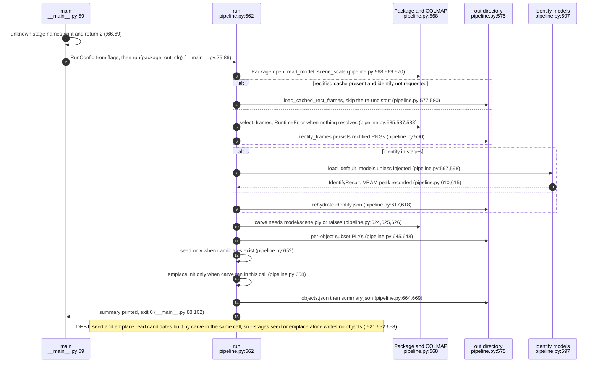
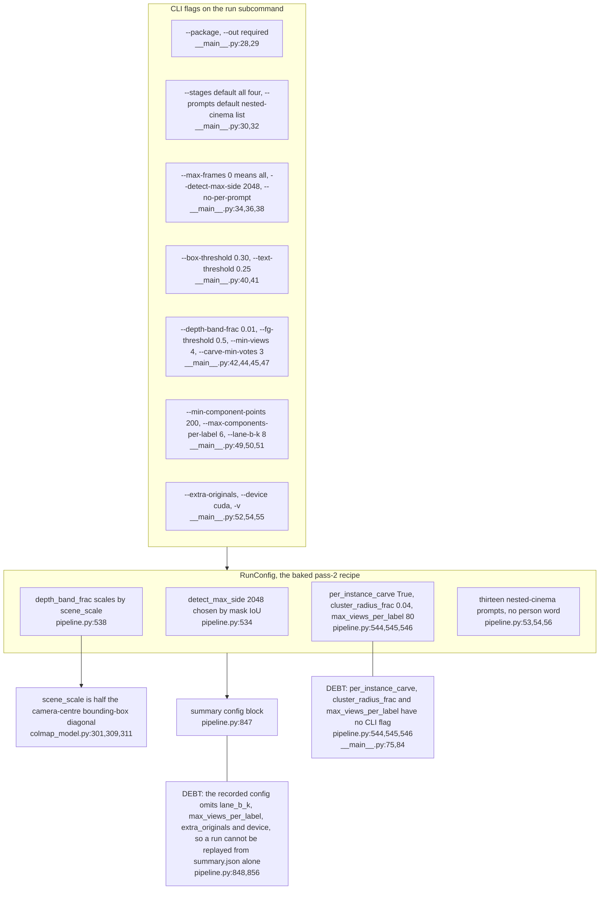
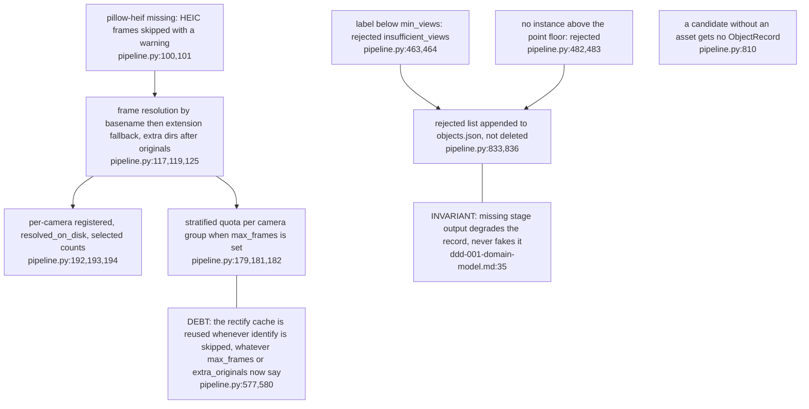

## VO-02.1 One run from the command line to summary.json

**What it shows.** Stage re-runs reuse cached rectified frames and `identify.json`, but carve is the only producer of candidates, so the later stages cannot run without it.

## VO-02.2 Flags, RunConfig defaults and what reaches summary.json

**What it shows.** Every carve threshold is relative to `scene_scale`, and three of the baked carve settings can be changed only in code.

## VO-02.3 Degrade, never fake: what is recorded instead of invented

**What it shows.** Missing frames, sparse labels and empty carves surface as counts and `rejected` entries in the outputs rather than as silent drops.
