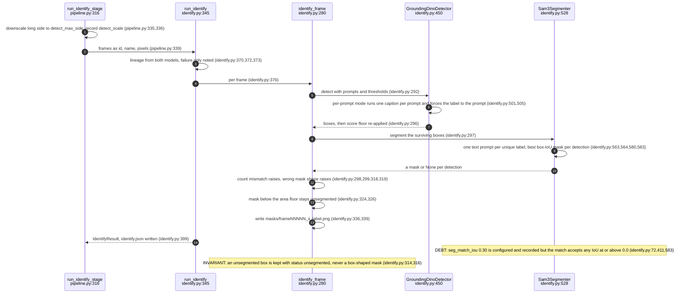
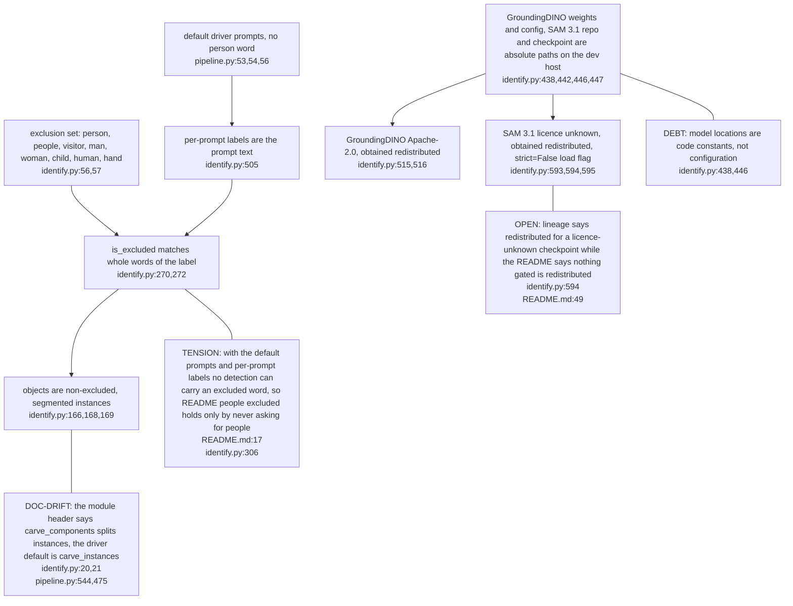
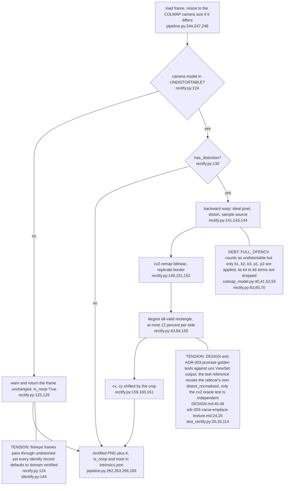

## VO-03.1 Detect, segment and record one frame

**What it shows.** GroundingDINO decides what and where, SAM 3.1 supplies the silhouette, and boxes and masks are matched only by box IoU.

## VO-03.2 People exclusion, model paths and lineage

**What it shows.** The lineage entries written here are copied into every `objects.json` record (`pipeline.py:767,776`).

## VO-03.3 Rectify contract: distorted frame to a K-only pinhole domain

**What it shows.** All masks, crops and carve views downstream live in this rectified domain; the cache in VO-02.1 stores exactly these outputs.
