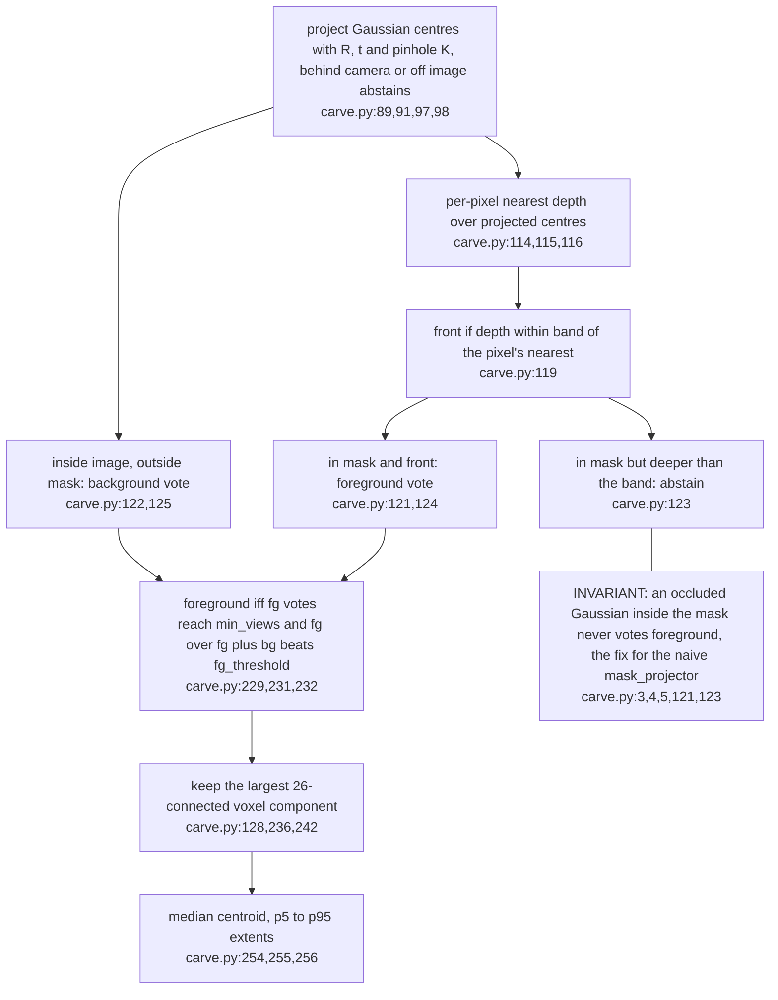
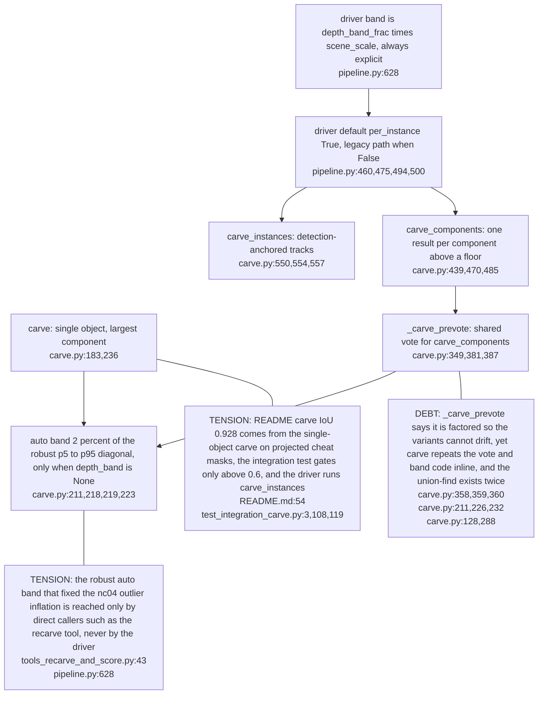
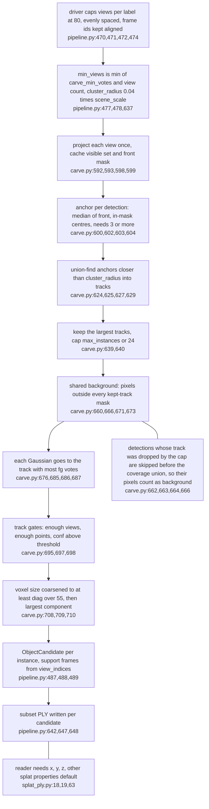

## VO-04.1 One view's vote and the aggregate label

**What it shows.** The depth band is what separates the visible surface from what sits behind it along the same ray; robust extents keep a few stray Gaussians from inflating the object's scale.

## VO-04.2 Three entry points, one used by the driver

**What it shows.** Only `carve_instances` runs in a default pass; the other two serve the legacy flag, the tests and the root tools.

## VO-04.3 carve_instances as the driver calls it

**What it shows.** Instances are separated by clustering per-detection 3D anchors before voting, so two touching objects with one label each carve from their own masks.
