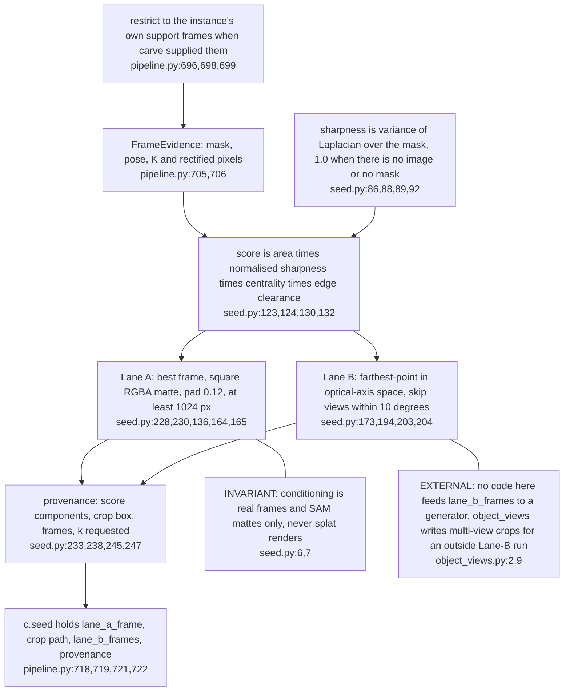
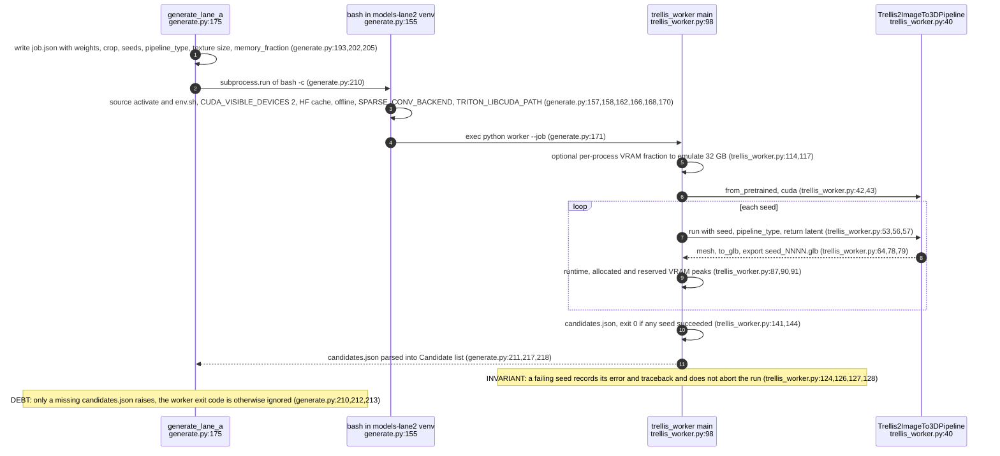
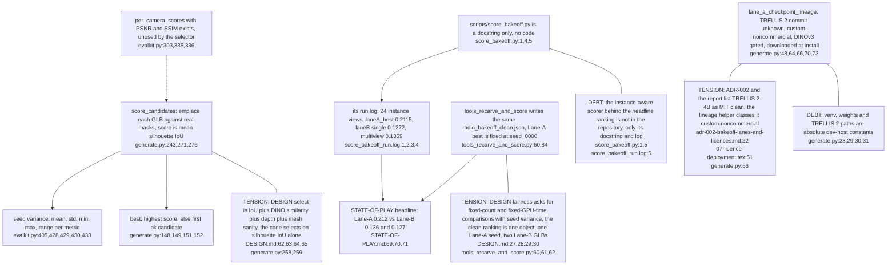

## VO-05.1 Seed: evidence-scored frames for both lanes

**What it shows.** Seeding runs inside the CLI pass; its outputs are a crop file per object and a recorded Lane-B frame list.

## VO-05.2 generate_lane_a and the TRELLIS.2 worker contract

**What it shows.** The model environment is reached only through two JSON files and one subprocess; the sidecar never imports TRELLIS.2.

## VO-05.3 Candidate selection and the bake-off result

**What it shows.** Selection exists as a library call; the published ranking was produced by root tools and an uncommitted scorer, on one object.
