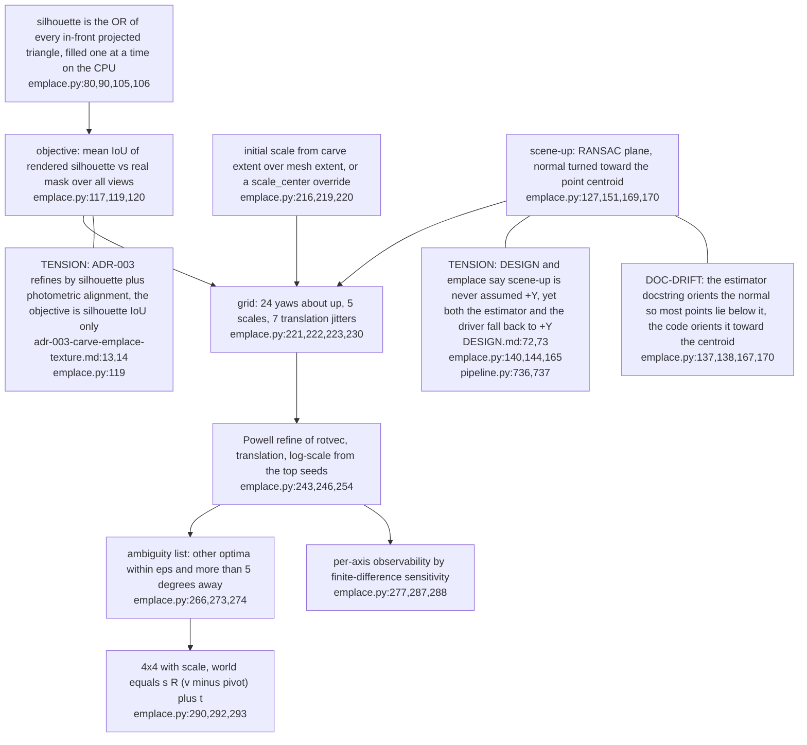
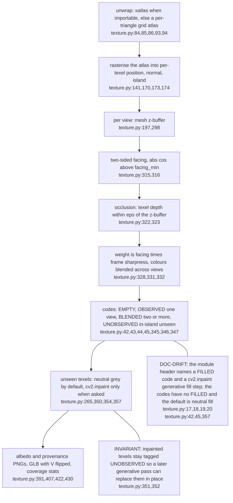
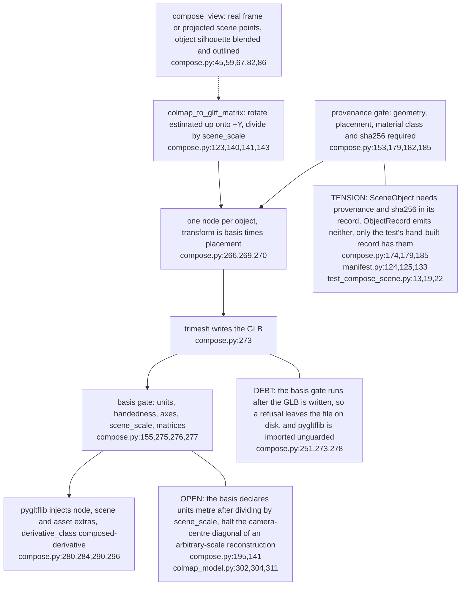

## VO-06.1 7-DoF silhouette emplacement and scene-up

**What it shows.** The CLI never calls this fit; its placement stays the carve centroid with identity rotation (`pipeline.py:739,740,745`), so these transforms exist only where a tool or test runs `emplace`.

## VO-06.2 Projective texture bake and per-texel provenance

**What it shows.** Observed colour comes only from real rectified frames; anything no camera saw is flagged, never painted as if observed.

## VO-06.3 Proof renders and composed_scene.glb

**What it shows.** The composed scene keeps COLMAP-world placement recoverable by inverting the declared basis; no tracked code outside the tests calls the exporter (see VO-01.3).
