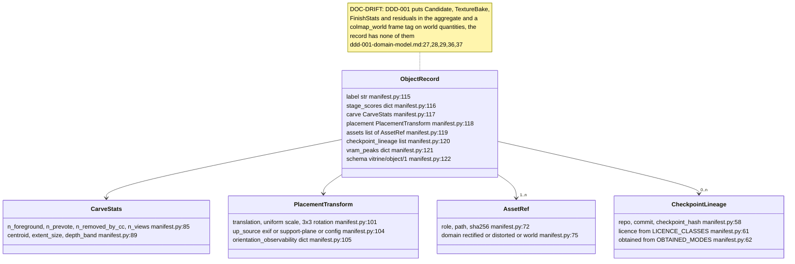
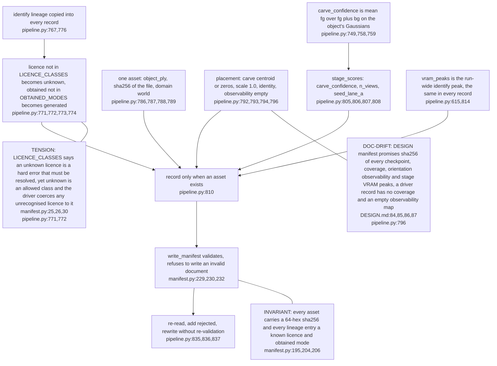
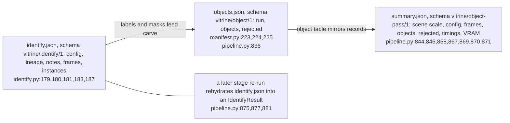

## VO-07.1 The record model

**What it shows.** The schema is plain JSON checked by a hand-written validator with no third-party dependency (`manifest.py:11,12,13`).

## VO-07.2 How the driver fills and writes objects.json

**What it shows.** The validator gates shape and hashes, not truth: a record's placement in a CLI run is the carve initialisation, and its lineage is whatever the identify models reported.

## VO-07.3 The three JSON documents a run leaves

**What it shows.** Only `summary.json` records the scene scale every threshold depended on (`pipeline.py:846`); `objects.json` does not.
