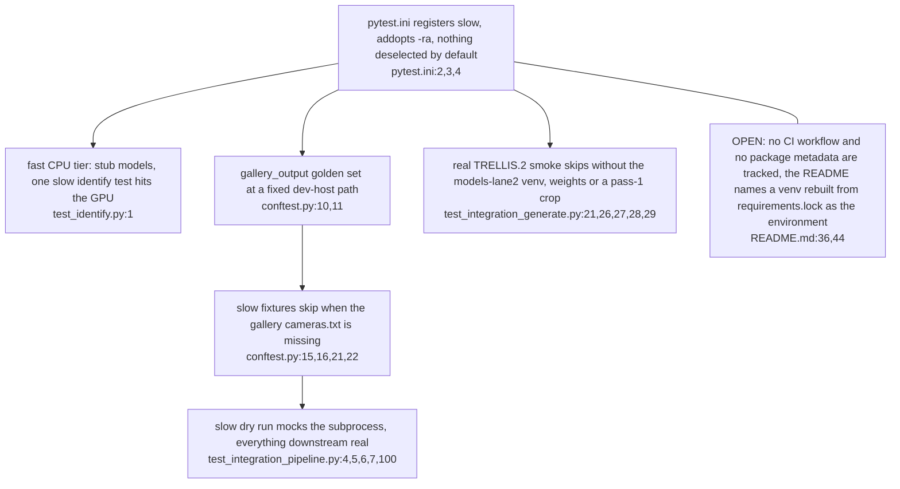
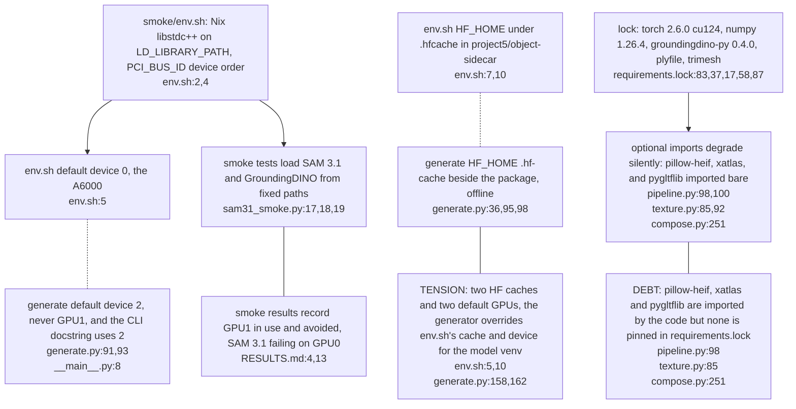
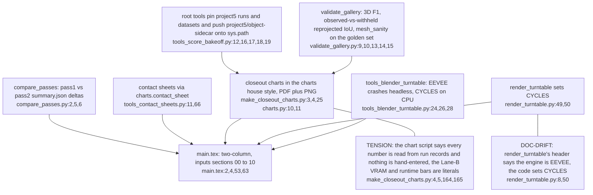
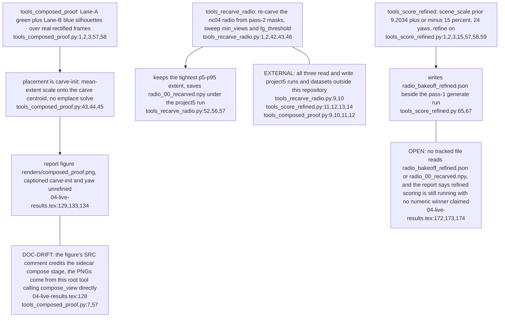

## VO-08.1 Two test tiers and what makes the slow tier skip

**What it shows.** On a machine without the dev host's datasets and model venv, every real-data test skips and only the stubbed CPU tier runs.

## VO-08.2 The dev-host environment the code assumes

**What it shows.** Paths, devices and caches are written for one container; the README's environment note (`README.md:44,45,46`) is the only portability guidance.

## VO-08.3 From run JSON to the closeout PDF

**What it shows.** Every reported number passes through root tools pinned to `project5` paths outside this repository; the report sources then build with `latexmk` from the report Makefile.

## VO-08.4 Root tools behind the recarve, refined scores and composed-scene figure

**What it shows.** The recarve, refined-scoring and composed-proof evidence are produced by root scripts outside the CLI; only the composed-proof PNG reaches the report, and the report's section text is otherwise covered only through `main.tex` (VO-08.3) and the interface-contract section (VO-01).

