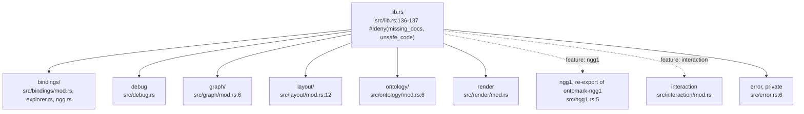
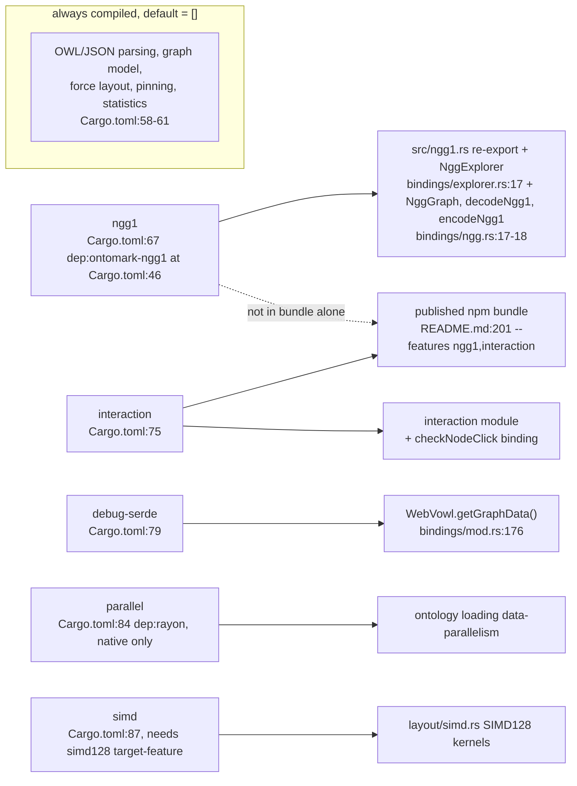
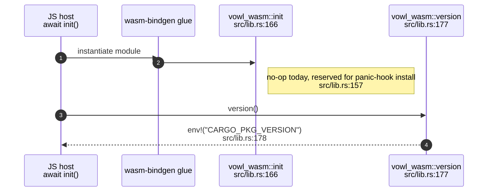
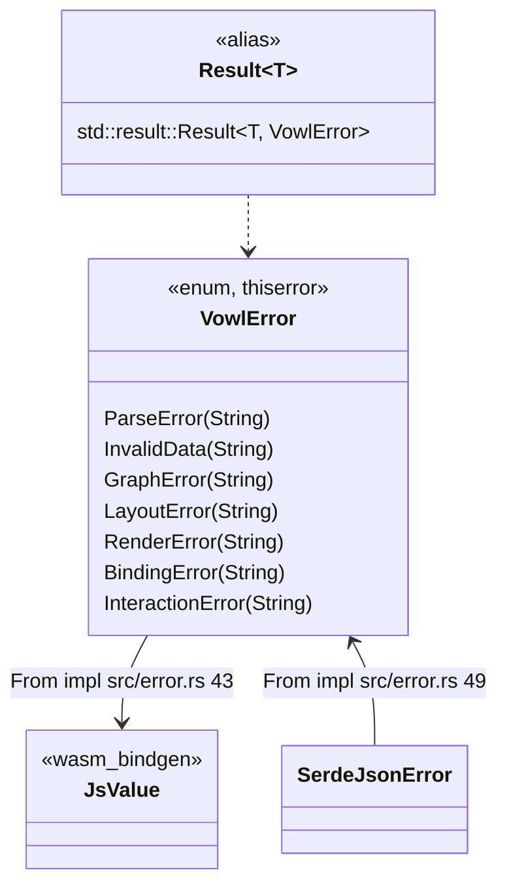
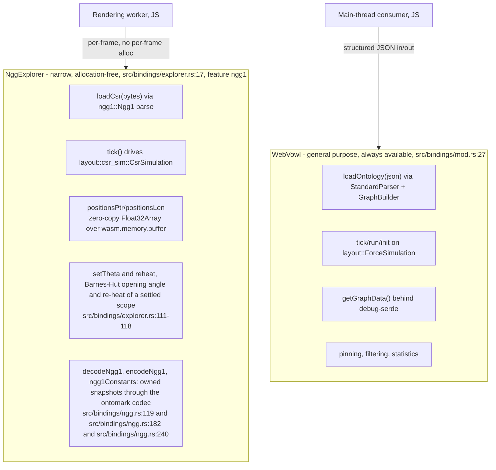
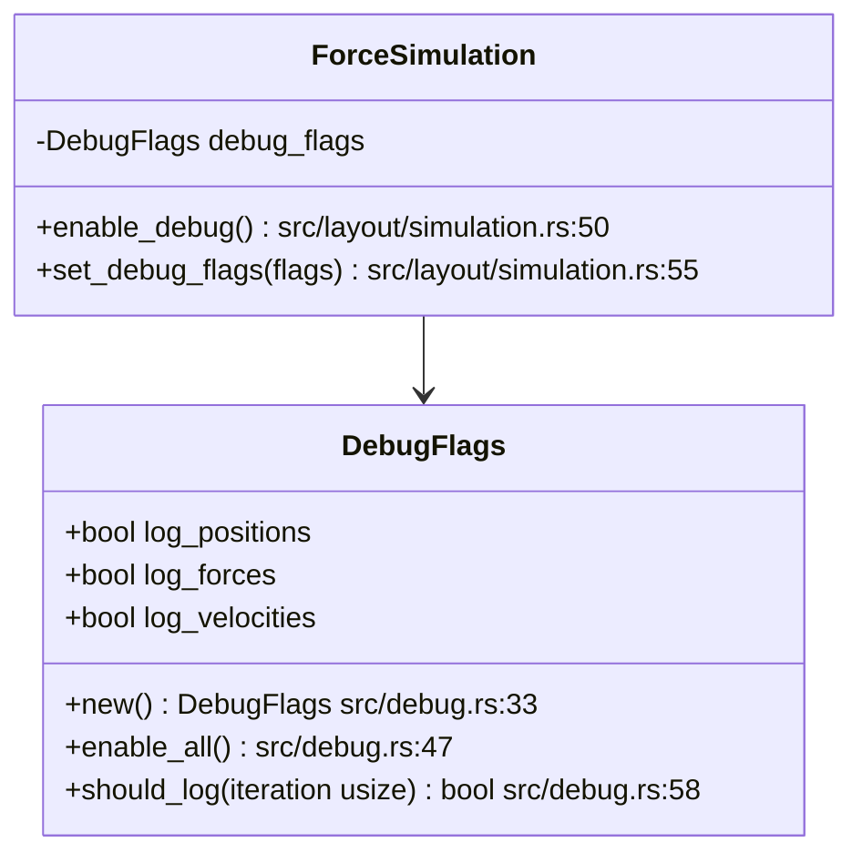

## VW-01.1 Top-level module tree

- `error` is not re-exported as `pub mod`; only `Result`/`VowlError` are re-exported at the crate root (`src/lib.rs:157`).
- `render::SvgRenderer` (src/render/mod.rs:20) exists but is not wired to any `#[wasm_bindgen]` binding — a native-only diagnostic path, not referenced from `bindings/mod.rs`, so unreachable from the published JS API (see vowl-wasm/04-js-api-examples-and-consumers.md).
- All five `graph::` submodules (`src/graph/mod.rs`) and all five `layout::` submodules (`src/layout/mod.rs`) are always compiled — neither file carries a `#[cfg(feature = ...)]` gate, and `ontology::` is now always compiled too (`src/ontology/mod.rs:6-7`: only `model` and `parser`; the `markdown-ontology` feature with its parser, validator and loader was deleted, see `docs/adr/ADR-001-shared-ontology-rendering-contract.md:25`). Only `bindings::explorer` and `bindings::ngg` are gated, both on `ngg1` (`src/bindings/mod.rs:3-9`); the feature mapping is detailed in VW-01.4.

## VW-01.4 Feature flags and what they gate

- INVARIANT: `default = []` (Cargo.toml:61) — nothing optional compiles unless asked for.
- The `markdown-ontology` feature and its `regex` dependency no longer exist: the manifest has no `regex` and no such feature (Cargo.toml:26-46, Cargo.toml:57-84), and the README records the removal, with Markdown parsing left to `ontomark-parse` (README.md:204-205). The NGG1 codec is `ontomark-ngg1` 0.1.0 from crates.io, optional behind `ngg1` (Cargo.toml:45-46).

## VW-01.5 `init()` and `version()` — module entry, called once by wasm-bindgen

## VW-01.6 `VowlError` to `JsValue` at every fallible binding

- Every `#[wasm_bindgen]` method on `WebVowl` returns `std::result::Result<T, JsValue>` (e.g. `load_ontology` src/bindings/mod.rs:56) — the crate's typed `VowlError` never crosses the boundary, only its rendered message.

## VW-01.7 Two entry points: `WebVowl` vs `NggExplorer`

- INVARIANT: `NggExplorer` never allocates across the WASM boundary per frame — only the position pointer crosses (src/bindings/explorer.rs:9).

## VW-01.8 `DebugFlags` — opt-in console tracing

- Native builds log via `web_sys::console` only under `#[cfg(target_arch = "wasm32")]` (src/debug.rs:71); non-wasm32 builds compile the same call sites to no-ops (src/debug.rs:171-183).

Audit qualification — 2026-09-07, re-read at 89d1a0a on 2026-10-29: the repository now has one local record, ADR-001 (accepted, implemented for NGG1 ownership, active: `docs/adr/ADR-001-shared-ontology-rendering-contract.md:4-6`), whose own caveat is that the plugin, the TypeScript reader consolidation and the wider acceptance evidence are not claimed. Its `Cargo.toml` and code are the implementation evidence; WasmVOWL and embedded explorer copies have separate governance and source identities. `cargo test --locked --offline --lib` passed 136 default-feature tests at the earlier stamp; that count was not re-run at 89d1a0a and the removed markdown and validator tests are no longer in it. That run covers native logic, not optional `ngg1`, `interaction`, browser loading or a deployed consumer.
