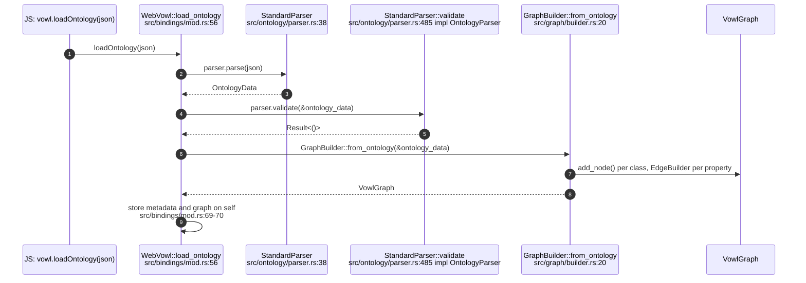
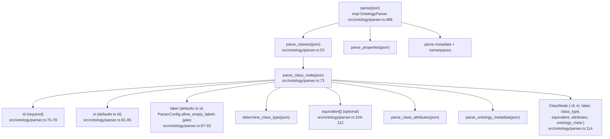
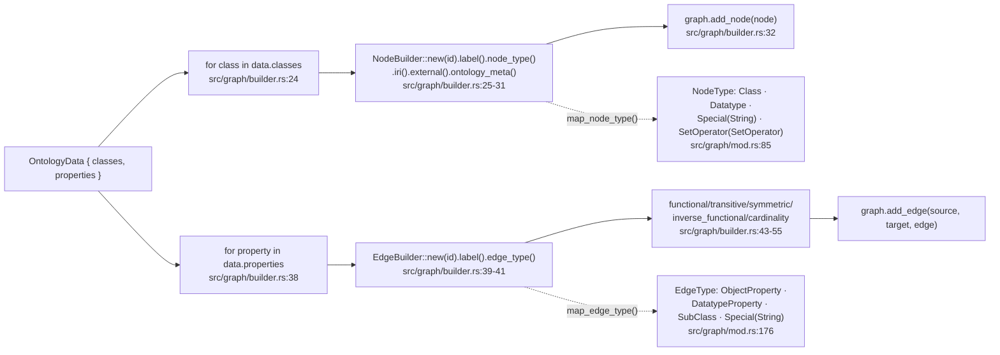
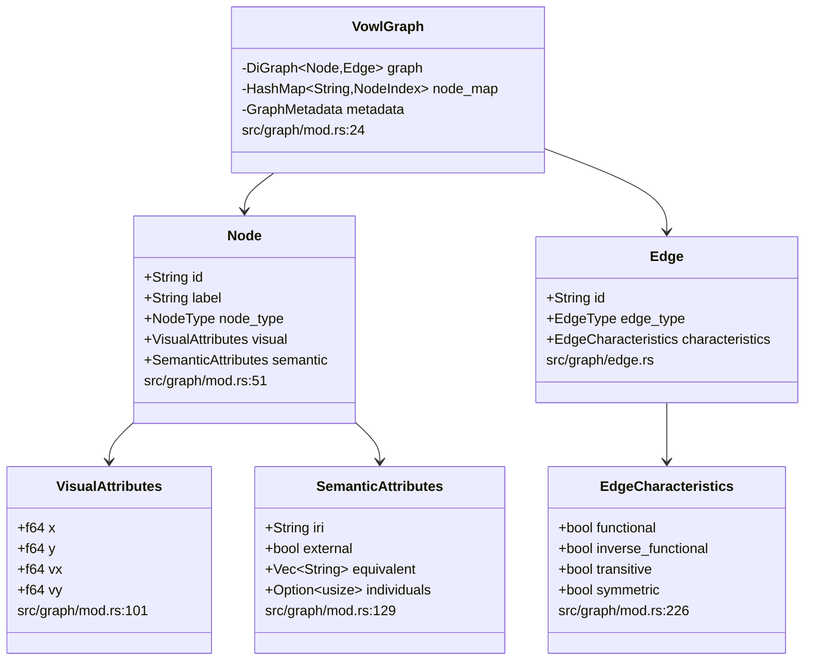
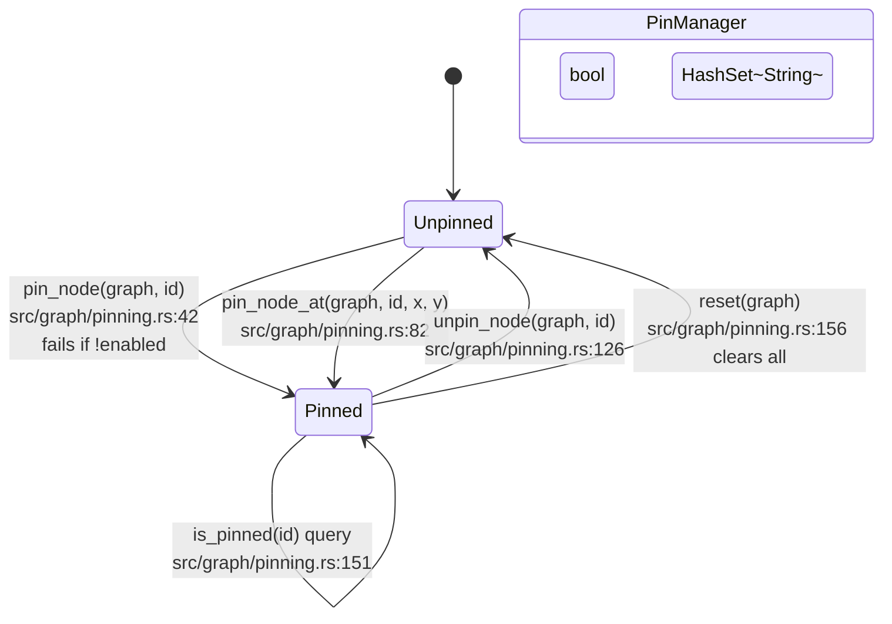

## VW-02.1 `loadOntology()` — JSON string to `VowlGraph`

- Every stage's `VowlError` is mapped to `JsValue::from_str` before returning to JS (src/bindings/mod.rs:58,62,66) — see VW-01.4.

## VW-02.2 `StandardParser` — classes, properties, metadata

- `ParserConfig` (src/ontology/parser.rs:17) has a `max_classes` cutoff enforced at src/ontology/parser.rs:62-64: a `class` array longer than the configured cap is silently truncated, not rejected.
- `StandardParser` is the only ingest path: it reads WebVOWL-shaped JSON (`class`/`property` arrays) into `OntologyData` (src/ontology/mod.rs:6-7, src/ontology/mod.rs:24). The second path that existed at the earlier stamp, a feature-gated `MarkdownParser` over DreamLab `### OntologyBlock` markdown with an `OntologyLoader` filesystem driver and an `OWL2Validator`, was deleted together with the `markdown-ontology` feature and the `Domain` and `OntologyBlock` types (docs/adr/ADR-001-shared-ontology-rendering-contract.md:26, README.md:204-205). Parsing Markdown vaults is left to `ontomark-parse` (README.md:205).
- Class metadata now accepts caller-supplied domain strings, or none, and the renderer holds no domain registry (README.md:210-212).

## VW-02.3 `GraphBuilder::from_ontology` — class/property to node/edge

## VW-02.4 `VowlGraph` node/edge model

- `GraphStatistics.calculate` density is defined as `0.0` when `node_count <= 1` (src/graph/statistics.rs:239-243), avoiding a divide-by-zero on `max_edges`.

## VW-02.8 `PinManager` — node pin lifecycle

- `pin_node` returns `VowlError::InteractionError("Pinning is disabled")` when `self.enabled == false` (src/graph/pinning.rs:43-46), independent of graph state.
- A pinned node's `visual.fixed = true` is what `ForceSimulation::apply_forces` reads to skip velocity/position integration (see VW-03.1).
