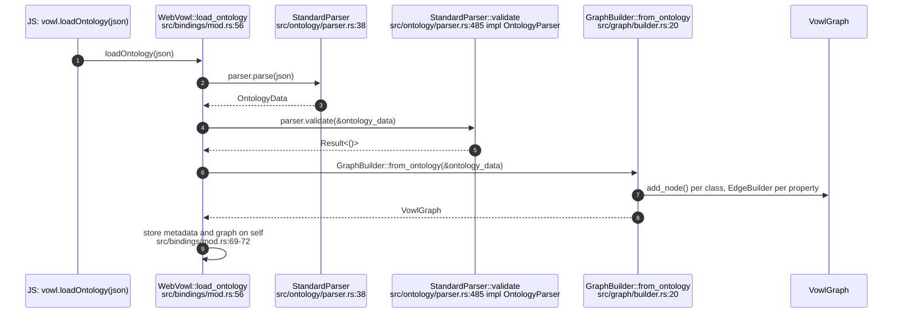
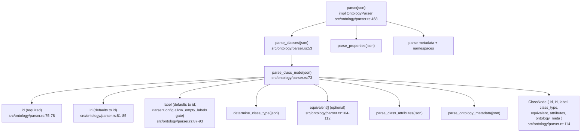
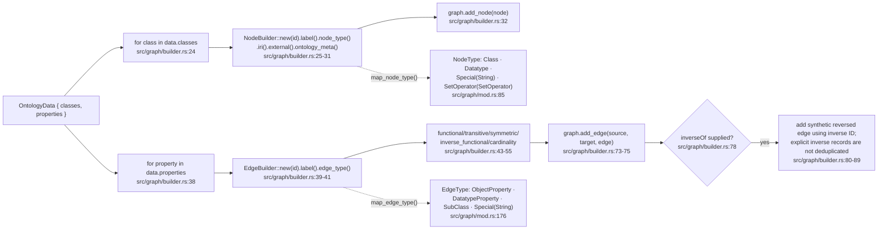
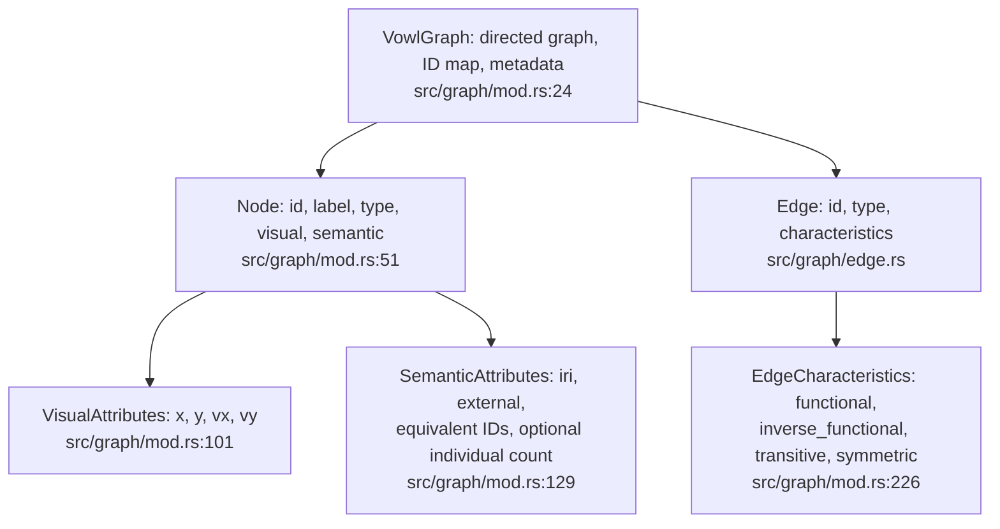
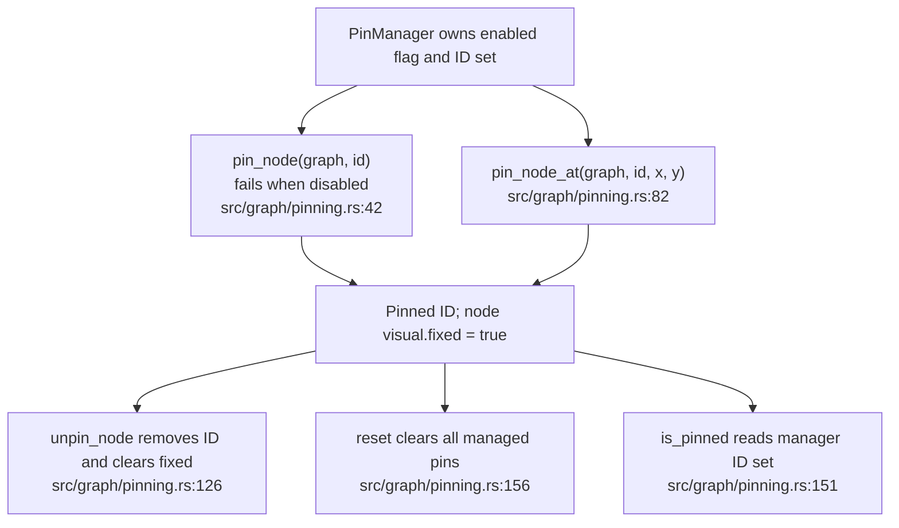

## VW-02.1 `loadOntology()` — JSON string to `VowlGraph`

- Every stage's `VowlError` is mapped to `JsValue::from_str` before returning to JS (src/bindings/mod.rs:58,62,66) — see VW-01.6. Validation checks domains but permits absent datatype ranges; the builder still requires both endpoints (src/ontology/parser.rs:485-507, src/graph/mod.rs:271-285).

## VW-02.2 `StandardParser` — classes, properties, metadata

- `ParserConfig` (src/ontology/parser.rs:17) has a `max_classes` cutoff enforced at src/ontology/parser.rs:62-64: a `class` array longer than the configured cap is silently truncated, not rejected.
- `StandardParser` is the JSON ingest path: it reads an inline subset of WebVOWL-shaped JSON (`class`/`property` arrays) into `OntologyData` (src/ontology/mod.rs:6-7, src/ontology/mod.rs:24). The second path that existed at the earlier stamp, a feature-gated `MarkdownParser` over DreamLab `### OntologyBlock` markdown with an `OntologyLoader` filesystem driver and an `OWL2Validator`, was deleted together with the `markdown-ontology` feature and the `Domain` and `OntologyBlock` types (docs/adr/ADR-001-shared-ontology-rendering-contract.md:36, README.md:204-205). Parsing Markdown vaults is left to `ontomark-parse` (README.md:205).
- Root `classAttribute`/`propertyAttribute` tables are not joined, labels must be strings, and `validate_iris` has no implementation (src/ontology/parser.rs:17-25, src/ontology/parser.rs:53-114, src/ontology/parser.rs:485-507). Class metadata now accepts caller-supplied domain strings, or none, and the renderer holds no domain registry (README.md:210-212).

## VW-02.3 `GraphBuilder::from_ontology` — class/property to node/edge

- **Semantic loss:** parsed class equivalences/individuals are not copied to nodes (src/graph/builder.rs:24-31); exact cardinality is discarded when only min/max reach the edge (src/graph/builder.rs:59-60). Bounds without a `cardinality` key are ignored and u64 values narrow to u32 unchecked (src/ontology/parser.rs:389-413). `rdfs:subClassOf` misses the case-sensitive substring mapping (src/graph/builder.rs:121-128).

## VW-02.4 `VowlGraph` node/edge model

- `GraphStatistics.calculate` density is defined as `0.0` when `node_count <= 1` (src/graph/statistics.rs:240-243), avoiding a divide-by-zero on `max_edges`. Parallel/synthetic edges can still make density exceed one. Component DFS follows outgoing neighbours, so component and isolation counts depend on node insertion order (src/graph/statistics.rs:371-399, src/graph/mod.rs:326-339).

## VW-02.8 `PinManager` — node pin lifecycle

- `pin_node` returns `VowlError::InteractionError("Pinning is disabled")` when `self.enabled == false` (src/graph/pinning.rs:43-46), independent of graph state.
- Pin IDs are separate manager state: graph replacement does not reset them, and `pin_node_at` accepts non-finite coordinates (src/bindings/mod.rs:56-72, src/graph/pinning.rs:82-105). A pinned node's `visual.fixed = true` is what `ForceSimulation::apply_forces` reads to skip velocity/position integration (see VW-03.1).
