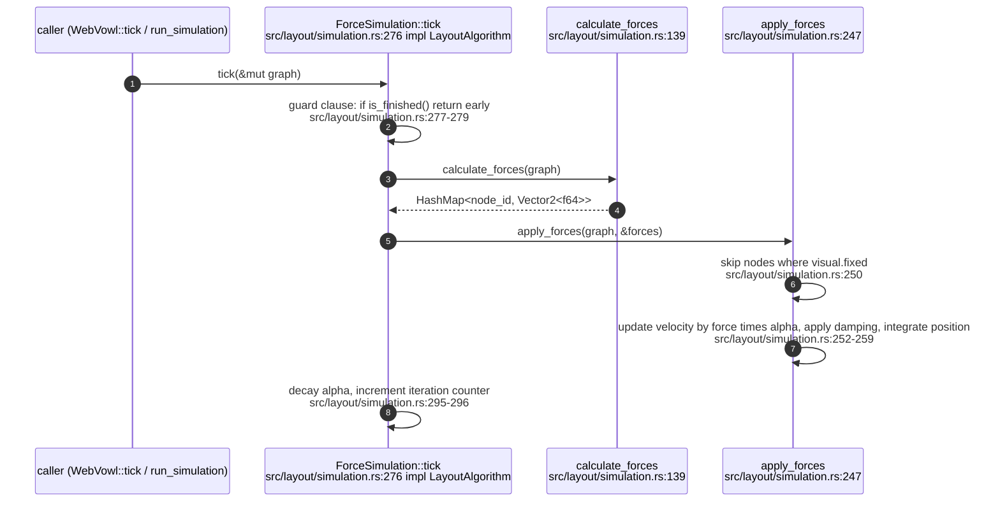
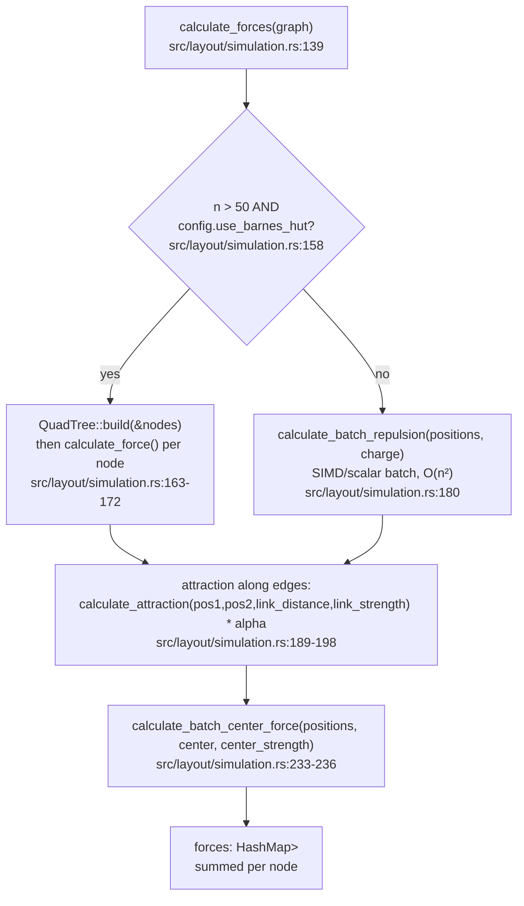
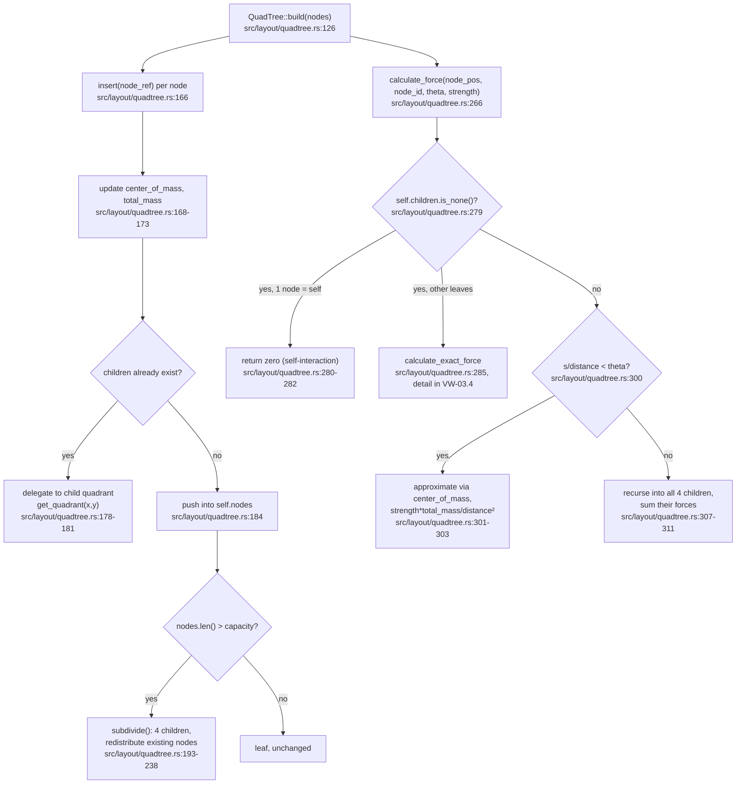
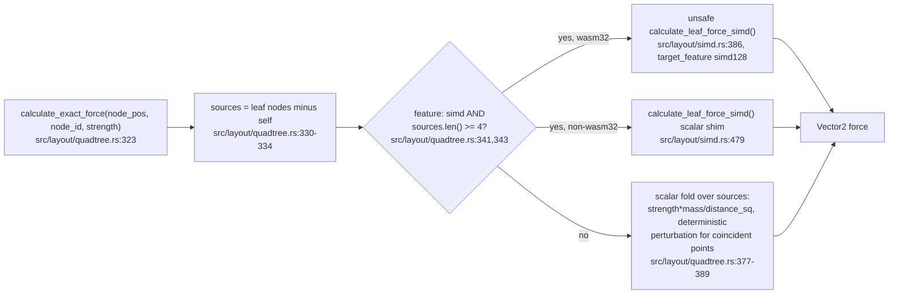
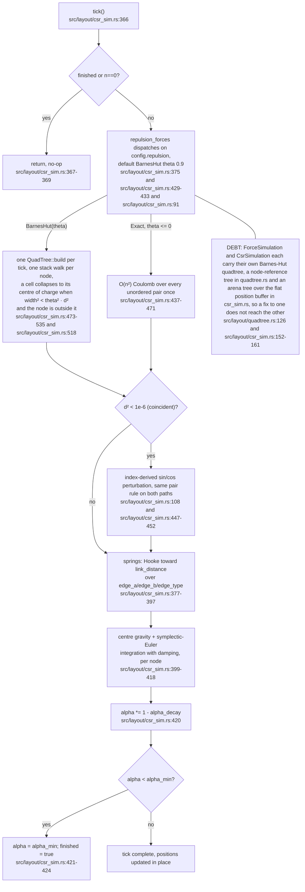
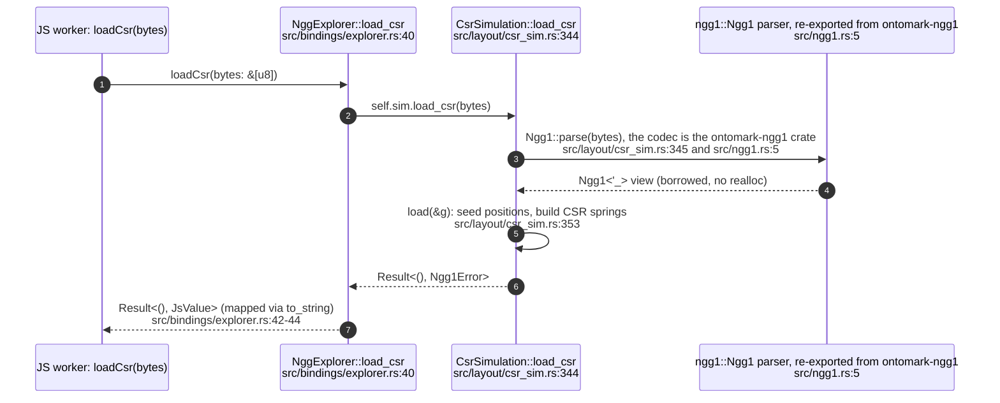
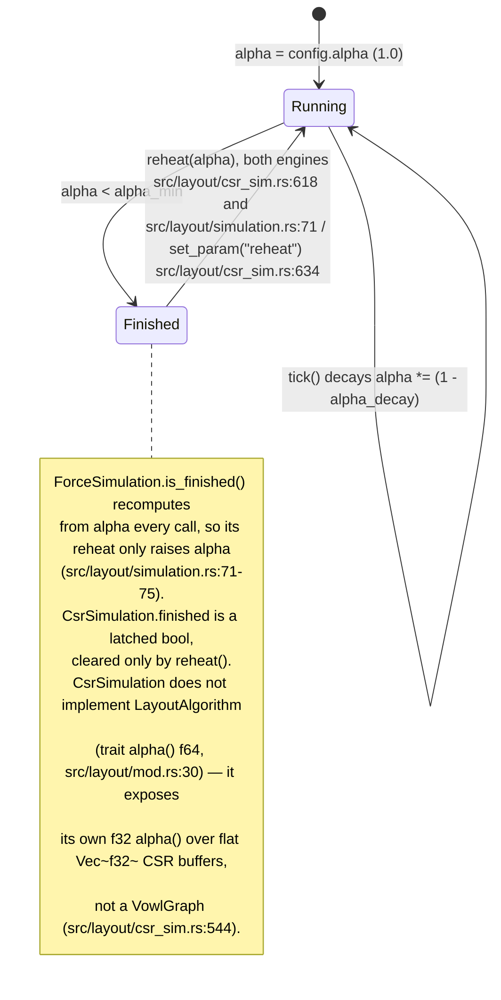
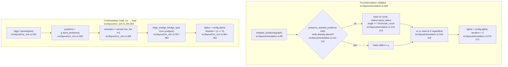
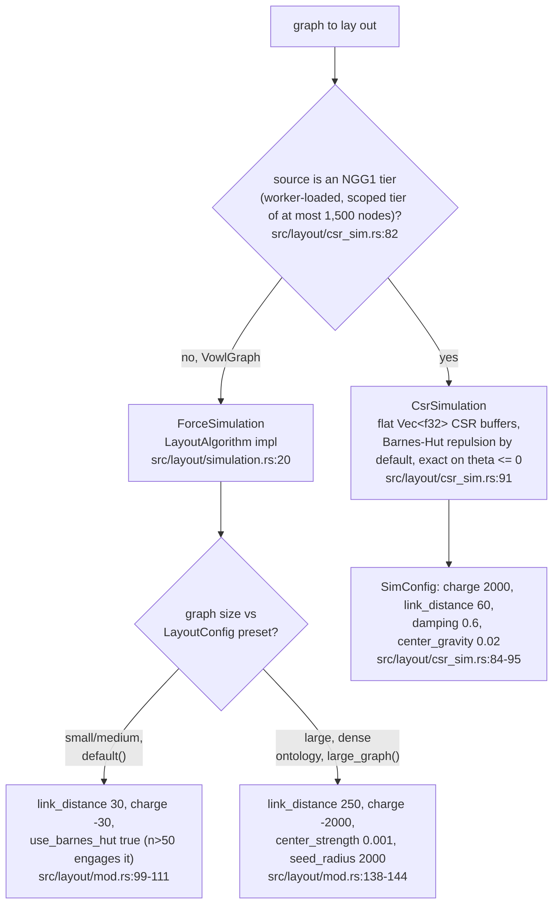

## VW-03.1 `ForceSimulation` one tick — `LayoutAlgorithm` impl

- `run(graph, iterations)` (src/layout/simulation.rs:326) calls `initialize` at src/layout/simulation.rs:327 once then loops `tick` up to `iterations` times, breaking early on `is_finished()` (src/layout/simulation.rs:330-331).
- `is_finished()` is `alpha < config.alpha_min` (src/layout/simulation.rs:340) — a pure read, not a latched flag (contrast with `CsrSimulation`, VW-03.5).

## VW-03.2 `calculate_forces` — repulsion / attraction / centring

- Barnes-Hut only engages above the `n > 50` threshold (src/layout/simulation.rs:158) — small graphs always take the O(n²) batch path.

## VW-03.3 `QuadTree` — build, insert/subdivide, Barnes-Hut recursion

- `theta` (typical 0.5–0.9, doc comment src/layout/quadtree.rs:261) trades layout accuracy for speed: smaller theta forces more recursion (exact), larger theta approximates more aggressively.

## VW-03.4 Leaf-force SIMD/scalar dispatch

- INVARIANT: coincident nodes (`distance_sq < 0.0001`) never divide by zero — both the scalar leaf path (src/layout/quadtree.rs:384-387) and the CSR tick (VW-03.5) substitute a deterministic sine/cosine-derived nudge.
- `is_simd_available()` differs by target: `#[cfg(target_arch = "wasm32")]` (src/layout/simd.rs:516) probes the runtime feature; the non-wasm32 stub (src/layout/simd.rs:525) always returns `false`.

## VW-03.5 `CsrSimulation::tick` — deterministic worker physics, Barnes-Hut by default

- Since ER-20 `CsrSimulation` is no longer always O(n²): the module doc now states Barnes-Hut is the default and `Repulsion::Exact`, `set_theta(0.0)` or `set_param("theta", 0.0)` select the exact loop, which runs unchanged for comparison (src/layout/csr_sim.rs:9-17, src/layout/csr_sim.rs:605, src/layout/csr_sim.rs:633). The default `SimConfig` is still described as tuned for a scoped tier of at most 1,500 nodes (src/layout/csr_sim.rs:82).
- `finished` is a latched `bool` (src/layout/csr_sim.rs:245,538) set once the alpha floor is hit — `tick()` after that point is a guaranteed no-op, not merely a small-alpha update.

## VW-03.6 NGG1 tier load — bytes to seeded simulation

- The reader is no longer in this repository: `src/ngg1.rs` is one `pub use ontomark_ngg1::*;` so the `vowl_wasm::ngg1` path and every public name keep working (src/ngg1.rs:1-5), and the crate depends on `ontomark-ngg1` 0.1.0 from crates.io behind the `ngg1` feature (Cargo.toml:45-46, Cargo.toml:67). Header size, node stride, field offsets and the specification are therefore owned by ontomark, not by `vowl-wasm` (docs/adr/ADR-001-shared-ontology-rendering-contract.md:26).
- **Open:** the byte layout this diagram used to cite (32-byte header, 24-byte node record, `N_DEGREE` at offset 20) cannot be re-read from this repository at 89d1a0a; it is not confirmed here and the VW-03 stamp makes no claim about it.
- `CsrSimulation::load_csr` maps a parse failure to `Ngg1Error` and `NggExplorer::load_csr` maps that to a string for JS (src/layout/csr_sim.rs:344, src/bindings/explorer.rs:40-44).

## VW-03.7 Alpha annealing — shared shape, two independent implementations

- Both engines can now be re-annealed from JS: `ForceSimulation::reheat` clamps alpha to `(0, 1]` and ignores a non-finite or non-positive value (src/layout/simulation.rs:71-75), `CsrSimulation::reheat` raises alpha to at least `alpha_min` and clears `finished` (src/layout/csr_sim.rs:618-621); the `WebVowl` binding exposes `reheat` (src/bindings/mod.rs:133-136) and `NggExplorer` exposes `reheat` and `setTheta` (src/bindings/explorer.rs:111-118). This closes the earlier gap where a settled `WebVowl` graph could only restart through a fresh `initSimulation()`.
- `ForceSimulation` implements `LayoutAlgorithm` (src/layout/mod.rs:17); `CsrSimulation` deliberately does not — the two engines share a design (annealing, Hooke springs, Coulomb repulsion) but not a common Rust interface.

## VW-03.9 Seeding — `ForceSimulation::initialize` vs `CsrSimulation::load`

- `ForceSimulation` seeds a fresh circular layout unless a caller opted into `preserve_seeded_positions`; `CsrSimulation` always takes its seed positions straight from the NGG1 tier's own `seed_positions()` — there is no circular-seed path on the CSR side.
- Both zero velocity/alpha state on entry, so a re-`initialize`/re-`load` is a clean restart, not a resume (contrast `reheat`, VW-03.7).

## VW-03.10 Engine and tuning-preset choice

- `large_graph()`'s doc comment (src/layout/mod.rs:118-121) records it was tuned empirically on a 1,155-node ontology and deliberately over-spreads a small graph, which is why it is a named preset rather than the default; Barnes-Hut engagement above `n > 50` is detailed in VW-03.2.
- `CsrSimulation` has no size-tiered preset — its `SimConfig::default()` is the only configuration, commented as tuned for the scoped tier of at most 1,500 nodes (src/layout/csr_sim.rs:82-95); its repulsion strategy is the one field a caller can switch at run time (src/layout/csr_sim.rs:70-71, src/layout/csr_sim.rs:605-611).
