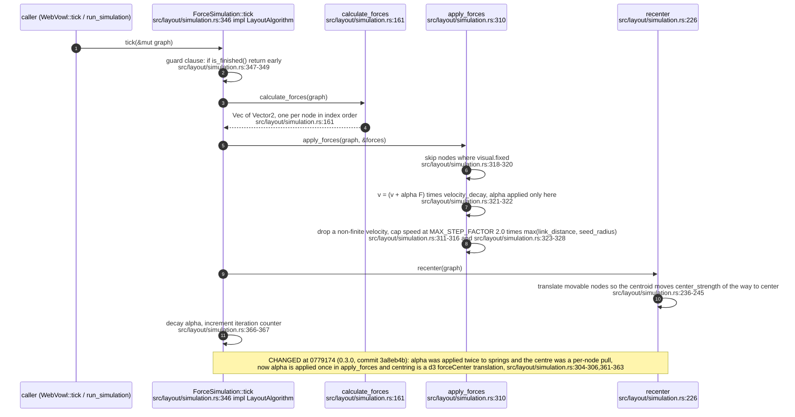
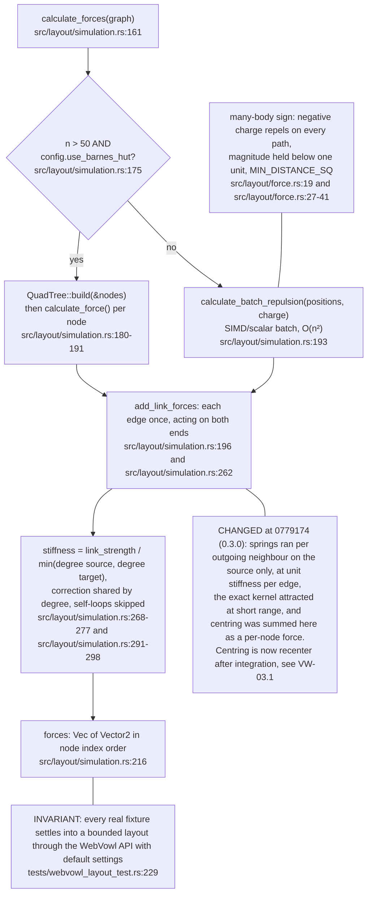
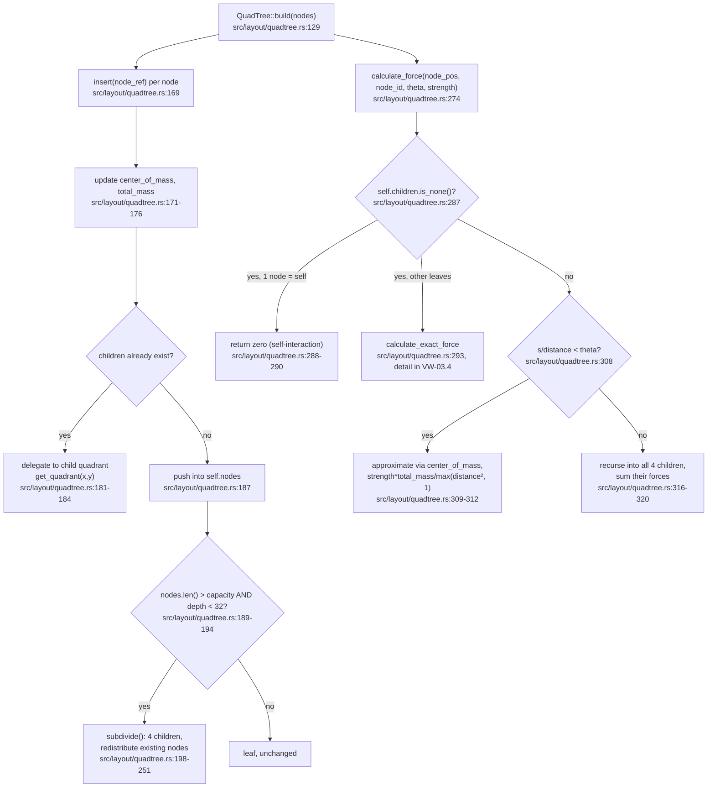
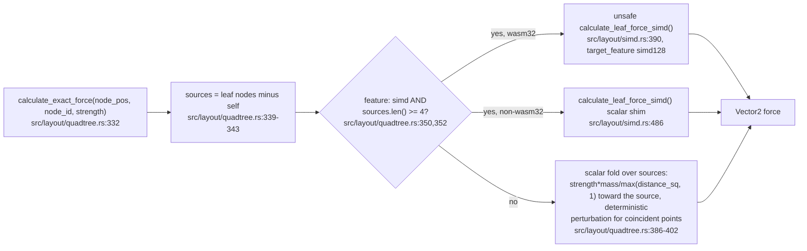
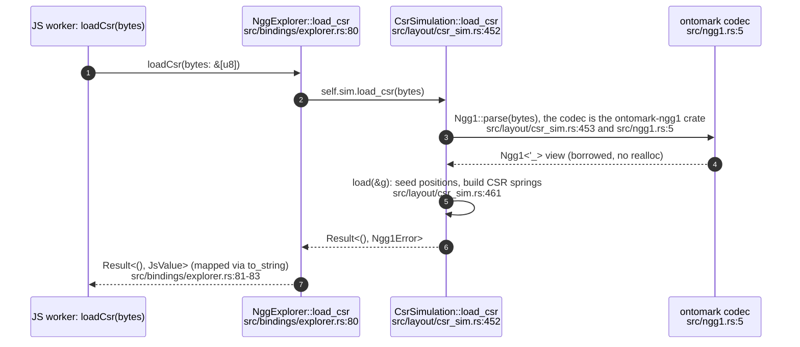
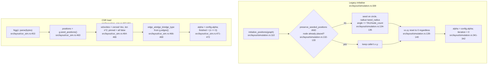
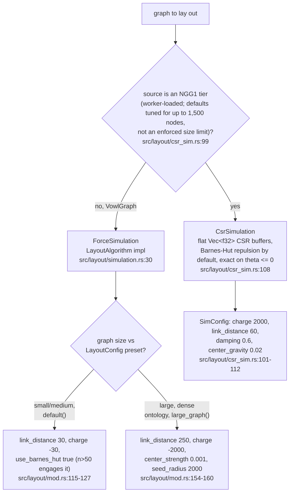
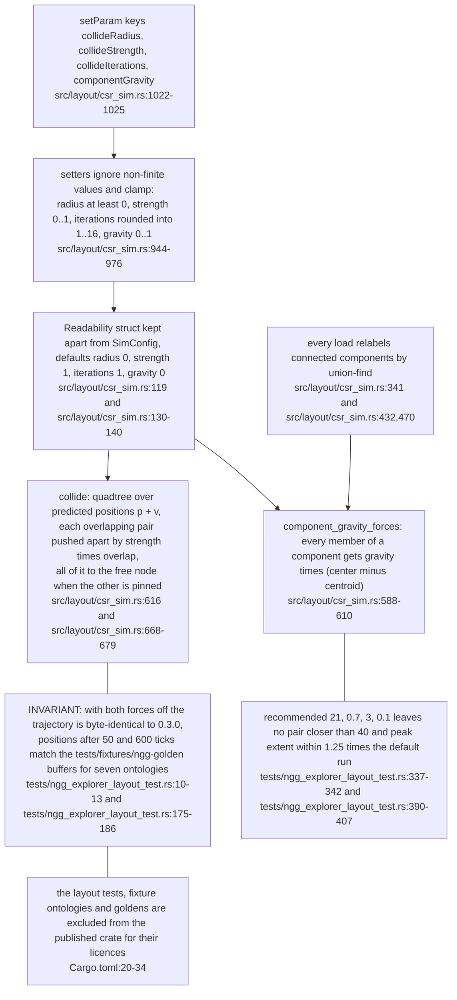

**Repair note — 2026-11-03:** selected counterexamples below have a [scoped successor verification](06-layout-and-release-repairs.md). Historical probe receipts retain their original revisions; source references were refreshed on 14 November 2026 after reviewing the plain-array loader, documentation and lint changes. The successor states the repaired contracts and acceptance boundaries.

## VW-03.1 `ForceSimulation` one tick — `LayoutAlgorithm` impl

- `run(graph, iterations)` (src/layout/simulation.rs:397) calls `initialize` at src/layout/simulation.rs:398 once then loops `tick` up to `iterations` times, breaking early on `is_finished()` (src/layout/simulation.rs:401-402). Every call reseeds, including fixed nodes unless the native preservation option applies; repeated `runSimulation(n)` is not a continuation API (src/layout/simulation.rs:110-140).
- `is_finished()` is `alpha < config.alpha_min` (src/layout/simulation.rs:411) — a pure read, not a latched flag (contrast with `CsrSimulation`, VW-03.5). `reset()` returns alpha and the iteration count to their start values but keeps the configuration (src/layout/simulation.rs:87-96); `WebVowl::loadOntology` calls it (VW-03.7, VW-04.1).

## VW-03.2 `calculate_forces` — repulsion and degree-normalised springs

- Barnes-Hut only engages above the `n > 50` threshold (src/layout/simulation.rs:175) — small graphs always take the O(n²) batch path. `runSimulation` settles every fixture too (tests/webvowl_layout_test.rs:263).

## VW-03.3 `QuadTree` — build, insert/subdivide, Barnes-Hut recursion

- **Failure boundary:** RESOLVED at vowl-wasm 2aff199 — insertion used to have no depth or minimum-cell guard, so 51 nodes pinned at one coordinate trapped `WebVowl.tick()` during repeated subdivision. Each cell now records its depth and stops subdividing at depth 32, keeping coincident points in a bounded leaf (src/layout/quadtree.rs:189-194, src/layout/quadtree.rs:240-242), and a test covers 51 coincident nodes (src/layout/quadtree.rs:660). The separate CSR tree has a maximum depth of 40 (src/layout/csr_sim.rs:156, src/layout/csr_sim.rs:259).
- `theta` (typical 0.5–0.9, doc comment src/layout/quadtree.rs:269) trades layout accuracy for speed: smaller theta forces more recursion (exact), larger theta approximates more aggressively.

## VW-03.4 Leaf-force SIMD/scalar dispatch

- INVARIANT: coincident nodes (`distance_sq < 0.0001`) never divide by zero — both the scalar leaf path (src/layout/quadtree.rs:395-398) and the CSR tick (VW-03.5) substitute a deterministic sine/cosine-derived nudge.
- `is_simd_available()` differs by target: `#[cfg(target_arch = "wasm32")]` (src/layout/simd.rs:523) returns the compile-time `cfg!(feature = "simd")`; it does not probe browser support; the non-wasm32 stub (src/layout/simd.rs:532) always returns `false`.

## VW-03.5 `CsrSimulation::tick` — deterministic worker physics, Barnes-Hut by default

```mermaid
flowchart TB
    T["tick()<br/>src/layout/csr_sim.rs:476"] --> FIN{"finished or n==0?"}
    FIN -->|yes| RET["return, no-op<br/>src/layout/csr_sim.rs:477-479"]
    FIN -->|no| REP["repulsion_forces dispatches on config.repulsion,<br/>default BarnesHut theta 0.9<br/>src/layout/csr_sim.rs:485 and src/layout/csr_sim.rs:687-692 and src/layout/csr_sim.rs:108"]
    REP -->|"BarnesHut(theta)"| BH["one QuadTree::build per tick, one stack walk per node,<br/>a cell collapses to its centre of charge when width² &lt; theta² · d²<br/>and the node is outside it; both magnitudes use d².max(soft2) at src/layout/csr_sim.rs:765 and src/layout/csr_sim.rs:780<br/>src/layout/csr_sim.rs:732-794 and src/layout/csr_sim.rs:778"]
    REP -->|"Exact, theta &lt;= 0"| EX["O(n²) Coulomb over every unordered pair once, magnitude charge / d².max(soft2)<br/>src/layout/csr_sim.rs:695-729 and src/layout/csr_sim.rs:720"]
    BH --> COIN{"d² < 1e-6 (coincident)?"}
    EX --> COIN
    COIN -->|yes| NUDGE["index-derived sin/cos perturbation, same pair rule on both paths<br/>src/layout/csr_sim.rs:162 and src/layout/csr_sim.rs:706-711"]
    COIN -->|no| SPRING
    NUDGE --> SPRING["springs: Hooke toward link_distance<br/>over edge_a/edge_b/edge_type<br/>src/layout/csr_sim.rs:487-507"]
    SPRING --> CG{"componentGravity > 0?<br/>src/layout/csr_sim.rs:511"}
    CG -->|yes| CGF["component_gravity_forces: rigid pull of each connected component toward center<br/>src/layout/csr_sim.rs:512 and src/layout/csr_sim.rs:588, see VW-03.11"]
    CG -->|no| INTEG
    CGF --> INTEG["centre gravity + damped velocity update per node; a pinned node is skipped (src/layout/csr_sim.rs:522-524)<br/>and speed is clamped to MAX_STEP_FACTOR times link_distance (src/layout/csr_sim.rs:534-539)<br/>src/layout/csr_sim.rs:515-542"]
    INTEG --> COL{"collideRadius > 0?<br/>src/layout/csr_sim.rs:546"}
    COL -->|yes| COLF["collide() collideIterations times on predicted positions, then the same speed cap<br/>src/layout/csr_sim.rs:547-560, see VW-03.11"]
    COL -->|no| POS
    COLF --> POS["integrate: positions += velocities, pinned skipped<br/>src/layout/csr_sim.rs:562-568"]
    N2["CHANGED at 0779174 (0.4.0, PR #6): velocity update and position integration were one loop,<br/>they are now split so collision can act between them. Both new branches are skipped, not zeroed, when off<br/>src/layout/csr_sim.rs:509-510"]
    COL --- N2
    POS --> DECAY["alpha *= 1 - alpha_decay<br/>src/layout/csr_sim.rs:570"]
    DECAY --> FLOOR{"alpha < alpha_min?"}
    FLOOR -->|yes| LATCH["alpha = alpha_min; finished = true<br/>src/layout/csr_sim.rs:571-574"]
    FLOOR -->|no| DONE["tick complete, positions updated in place"]
    N1["DEBT: ForceSimulation and CsrSimulation each carry their own Barnes-Hut quadtree, a node-reference tree in quadtree.rs and an arena tree over the flat position buffer in csr_sim.rs, so a fix to one does not reach the other<br/>src/layout/quadtree.rs:129 and src/layout/csr_sim.rs:206-215"]
    REP --- N1
```

- Since ER-20 `CsrSimulation` is no longer always O(n²): the module doc now states Barnes-Hut is the default and `Repulsion::Exact`, `set_theta(0.0)` or `set_param("theta", 0.0)` select the exact loop, which runs unchanged for comparison (src/layout/csr_sim.rs:9-17, src/layout/csr_sim.rs:880, src/layout/csr_sim.rs:1020). The default `SimConfig` is still described as tuned for a scoped tier of at most 1,500 nodes (src/layout/csr_sim.rs:99).
- `finished` is a latched `bool` (src/layout/csr_sim.rs:308,573) set once the alpha floor is hit — `tick()` after that point is a guaranteed no-op, not merely a small-alpha update.
- For valid finite configuration, two guards bound motion in a tick since the 0.2.2 pin. Repulsion is softened: below a radius of `SOFTENING_FRACTION` (0.25) times `link_distance` the magnitude is held at its value at that radius (`softening_sq`, src/layout/csr_sim.rs:579-582, constants src/layout/csr_sim.rs:148-150), so a near-coincident seed pair is not flung thousands of units in one tick; and each node's per-tick displacement is capped at `MAX_STEP_FACTOR` (2.0) times `link_distance` (src/layout/csr_sim.rs:520, src/layout/csr_sim.rs:534-539). The test `near_coincident_seeds_stay_in_bounds` pins both for the exact and the Barnes-Hut path (src/layout/csr_sim.rs:1332).
- Drag pinning: `pin(i, x, y)` writes the position, zeroes the velocity and sets `pinned[i]`; a pinned node still exerts forces but is skipped at integration (src/layout/csr_sim.rs:522-524, src/layout/csr_sim.rs:902-913). It returns `false`, changing nothing, for an index outside the scope or a non-finite coordinate. `unpin` and `is_pinned` follow (src/layout/csr_sim.rs:916-929), `NggExplorer` exposes them as `pinNode` and `unpinNode` (src/bindings/explorer.rs:225-233), and every load clears the pins (src/layout/csr_sim.rs:427, src/layout/csr_sim.rs:465). `pin` does not reheat, so a caller pairs it with `reheat` (src/layout/csr_sim.rs:933).

## VW-03.6 NGG1 tier load — bytes to seeded simulation

- The reader is no longer in this repository: `src/ngg1.rs` is one `pub use ontomark_ngg1::*;` so the `vowl_wasm::ngg1` path and every public name keep working (src/ngg1.rs:1-5), and the crate depends on `ontomark-ngg1` 0.1.0 from crates.io behind the `ngg1` feature (Cargo.toml:59-60, Cargo.toml:81). Header size, node stride, field offsets and the specification are therefore owned by ontomark, not by `vowl-wasm` (docs/adr/ADR-001-shared-ontology-rendering-contract.md:36).
- The external codec owns byte-layout details. Current native migration tests and the built-WASM golden test exercise compatibility rather than duplicating those constants here (tests/ontomark_ngg1_migration.rs:501-509, tests/ngg1_wasm.test.mjs:24).
- `CsrSimulation::load_csr` maps a parse failure to `Ngg1Error` and `NggExplorer::load_csr` maps that to a string for JS (src/layout/csr_sim.rs:452, src/bindings/explorer.rs:80-83).

## VW-03.7 Alpha annealing — shared shape, two independent implementations

```mermaid
stateDiagram-v2
    [*] --> Running: alpha = config.alpha (1.0)
    Running --> Running: tick() decays alpha *= (1 - alpha_decay)
    Running --> Finished: alpha < alpha_min
    Finished --> Running: reheat(alpha), both engines<br/>src/layout/csr_sim.rs:933 and src/layout/simulation.rs:81 / set_param("reheat") src/layout/csr_sim.rs:1021
    note right of Finished
      Legacy: recomputes from alpha.
      Reheat validates then assigns alpha.
      src/layout/simulation.rs:81-85
      CSR: latched flag; reheat or a
      non-empty load clears it.
      src/layout/csr_sim.rs:471-472
      src/layout/csr_sim.rs:933-939
    end note
```

- Both engines can now be re-annealed from JS: `ForceSimulation::reheat` clamps alpha to `(0, 1]` and ignores a non-finite or non-positive value (src/layout/simulation.rs:81-85), `CsrSimulation::reheat` ignores a non-finite value, assigns `max(value, alpha_min)` and sets `finished` only for an empty graph (src/layout/csr_sim.rs:933-939); the `WebVowl` binding exposes `reheat` (src/bindings/mod.rs:144-147) and `NggExplorer` exposes `reheat` and `setTheta` (src/bindings/explorer.rs:216-239). This closes the earlier gap where a settled `WebVowl` graph could only restart through a fresh `initSimulation()`.
- **Input boundary:** RESOLVED at vowl-wasm 2aff199 for non-finite input — every CSR parameter setter and `reheat` now returns early on a non-finite value, so an infinite reheat no longer produces non-finite positions (src/layout/csr_sim.rs:844-896, src/layout/csr_sim.rs:933-936, dispatch src/layout/csr_sim.rs:1012-1027). Finite out-of-range values are still accepted: the earlier probe showed a negative `alphaMin` prevents settling in 10,000 ticks, and `set_alpha_min` checks only finiteness (src/layout/csr_sim.rs:891-895).
- `ForceSimulation` implements `LayoutAlgorithm` (src/layout/mod.rs:17); `CsrSimulation` deliberately does not — the two engines share a design (annealing, Hooke springs, Coulomb repulsion) but not a common Rust interface.

## VW-03.9 Seeding — `ForceSimulation::initialize` vs `CsrSimulation::load`

- `ForceSimulation` seeds a fresh circular layout unless a caller opted into `preserve_seeded_positions`; `CsrSimulation` always takes its seed positions straight from the NGG1 tier's own `seed_positions()` — there is no circular-seed path on the CSR side.
- Both zero velocities and restore configured alpha on entry, so re-`initialize`/re-`load` restarts annealing rather than resuming (contrast `reheat`, VW-03.7).

## VW-03.10 Engine and tuning-preset choice

- `large_graph()`'s doc comment (src/layout/mod.rs:134-137) records it was tuned empirically on a 1,155-node ontology and deliberately over-spreads a small graph, which is why it is a named preset rather than the default; Barnes-Hut engagement above `n > 50` is detailed in VW-03.2.
- `CsrSimulation` has no size-tiered preset — its `SimConfig::default()` is the only named preset, commented as tuned for the scoped tier of at most 1,500 nodes (src/layout/csr_sim.rs:99-112); callers can change repulsion and numeric force parameters at run time (src/layout/csr_sim.rs:844-885, src/layout/csr_sim.rs:1012-1027).

## VW-03.11 Opt-in readability forces on `CsrSimulation` — collision and component gravity

- New in 0.4.0 (PR #6). `NggExplorer::setParam` documents the same keys and the starting values for hosts drawing nodes up to 12 px (src/bindings/explorer.rs:189-206); consumers that turn them on are VW-04.6. The legacy `ForceSimulation` has no collision or component force.
