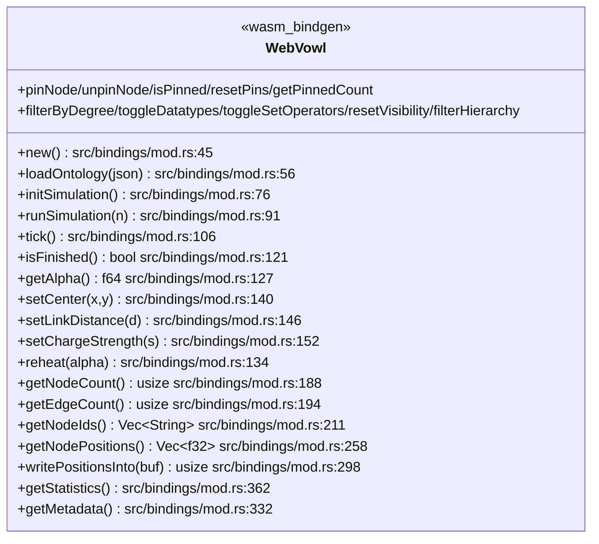
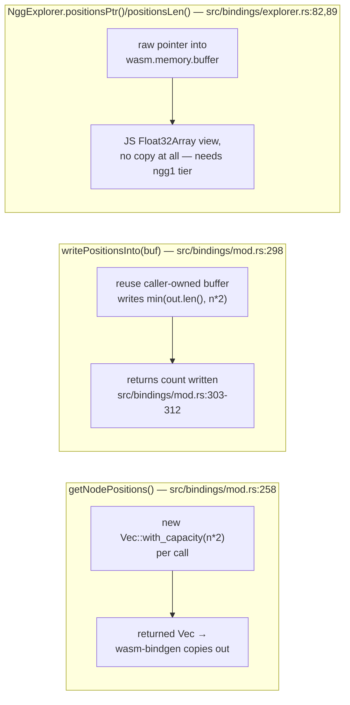
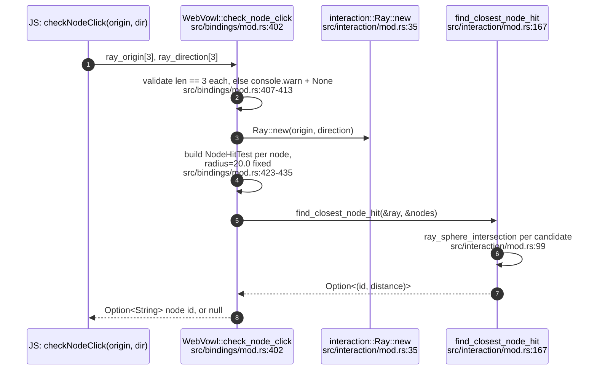
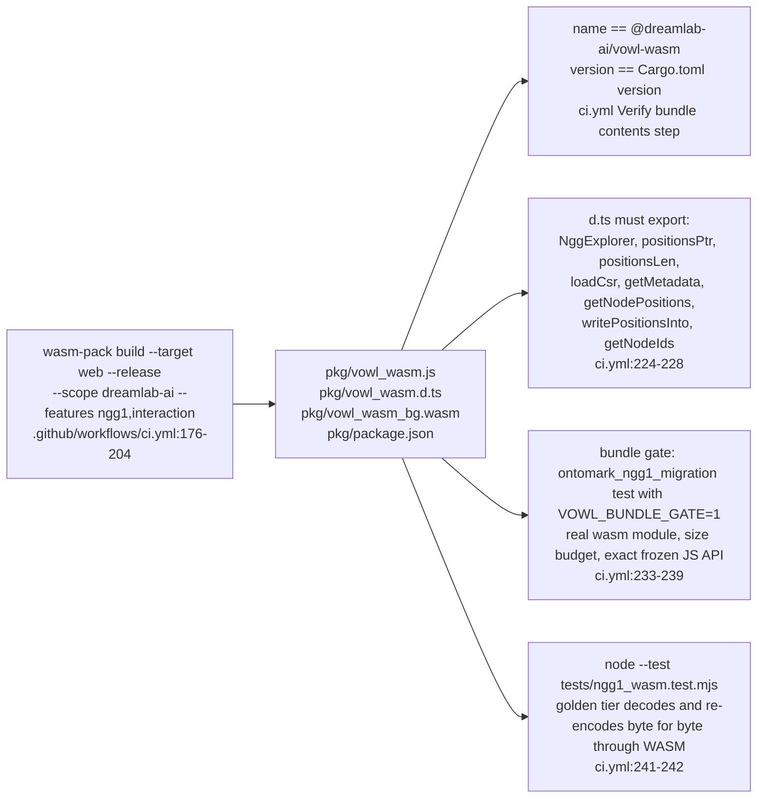
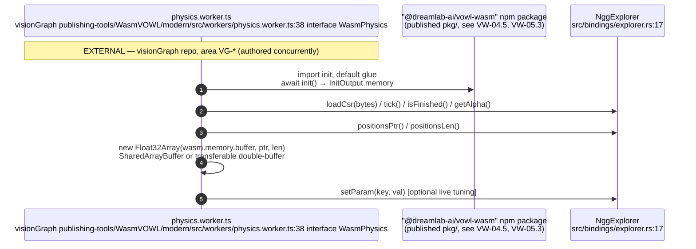
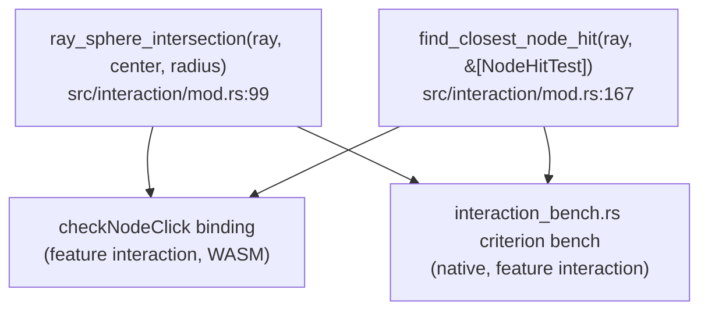
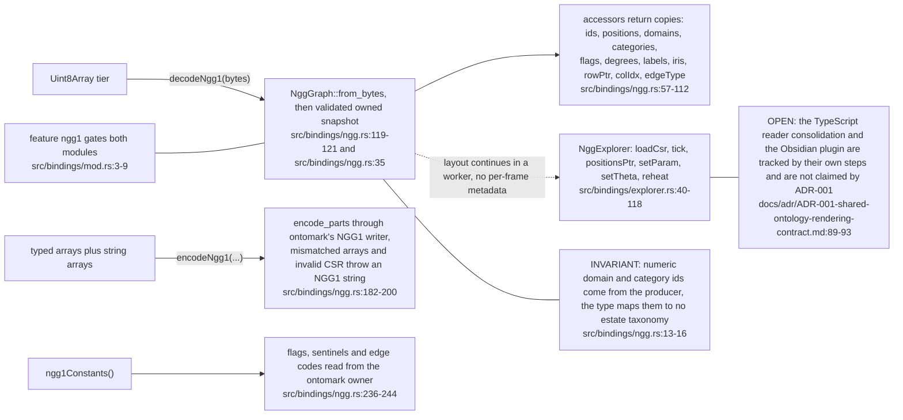

## VW-04.1 `WebVowl` — the frozen 0.1.0 JS surface

- INVARIANT (README.md:148-149): this is the frozen 0.1.0 surface — names/signatures do not change without a major bump; later releases only add (`getNodeIds`/`getNodePositions`/`writePositionsInto` arrived in 0.1.1, per src/lib.rs crate doc, and `reheat` is now on the binding, src/bindings/mod.rs:131-136).
- `getNodeIds()`/`getNodePositions()` pair is index-stable: ticking, pinning, filtering and folding never reorder or remove nodes (src/bindings/mod.rs:210-256 doc comments), so JS zips `ids[i] <-> xy[2i], xy[2i+1]` once per load.

## VW-04.2 `writePositionsInto` vs `getNodePositions` — allocation trade-off

- The doc comment is explicit: `writePositionsInto` saves the per-frame *allocation* over `getNodePositions`, not the copy — `NggExplorer::positions_ptr` is the only genuinely copy-free path, and it requires the `ngg1` binary-tier format (src/bindings/mod.rs:291-296).

## VW-04.3 `checkNodeClick` — ray/sphere hit testing (feature `interaction`)

- The 20.0 hit-test radius is a fixed constant in the binding, not read from per-node visual size (src/bindings/mod.rs:425-426 comment: "In a real implementation, this could be configurable or per-node").

## VW-04.5 Bundle contents contract, verified in CI

- INVARIANT: CI fails the build if any of those eight zero-copy-path symbols vanish from `pkg/vowl_wasm.d.ts` — "the explorer breaks at runtime rather than at build" (.github/workflows/ci.yml:222-223).

## VW-04.6 EXTERNAL: visionGraph's `physics.worker.ts` drives `NggExplorer`

- The worker resolves exported names "permissively (snake_case per Rust, with camelCase fallbacks)" (physics.worker.ts:33-35 comment) — it does not assume `wasm-bindgen`'s `js_name` renaming is exhaustive, a defensive stance against this crate's binding surface.
- Cross-repo dependency direction: visionGraph depends on the *published* `@dreamlab-ai/vowl-wasm` npm bundle (pinned in its `package.json`/`package-lock.json`, per VisionFlow estate map), never on this crate's source — see VW-05.3 for the publish path that produces that bundle.

## VW-04.7 `interaction` module — always-native benches vs the WASM binding

- Both entry points share the same pure functions; the WASM binding adds only input validation and `NodeHitTest` construction from `VowlGraph` (VW-04.3), so a change to hit-test geometry is exercised by the native bench before it ever reaches JS.

## VW-04.8 `ngg1` browser bindings — owned decode and encode beside the zero-copy explorer

**What it shows.** Version 0.2.0 adds an owned, copying way to read and write NGG1 tiers in the browser, next to the existing zero-copy explorer: the codec is ontomark's, the binding only wraps it, and a worker keeps laying out through `NggExplorer` without serialising metadata per frame (src/bindings/ngg.rs:1-6, README.md:216-233).
**Why it is this way.** ADR-001 wants one owner per graph format, so `vowl-wasm` delegates every binary read and write to ontomark and keeps only the browser surface, with a JavaScript test that round-trips the golden fixture through the built wasm (docs/adr/ADR-001-shared-ontology-rendering-contract.md:26, tests/ngg1_wasm.test.mjs:1-3).
