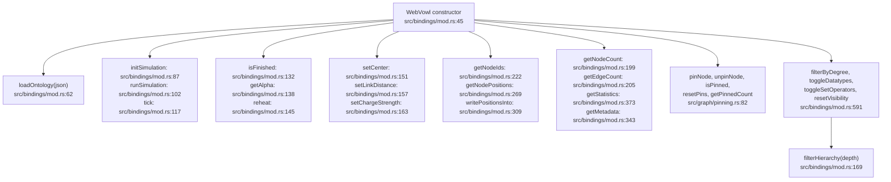
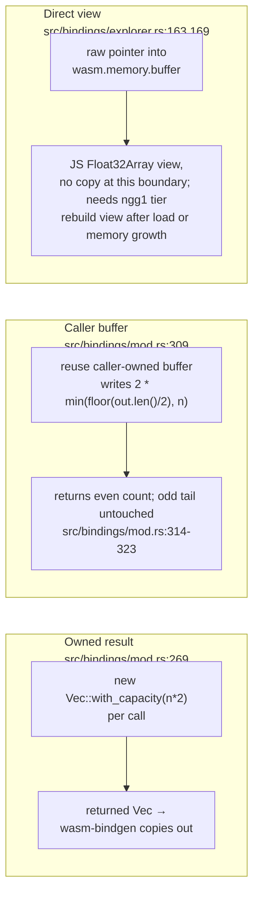
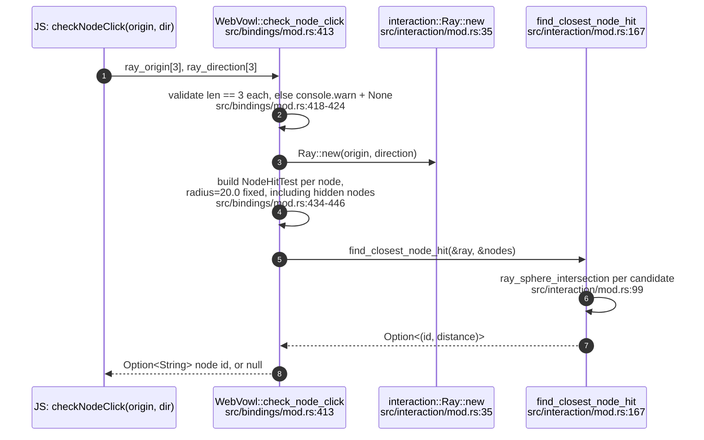
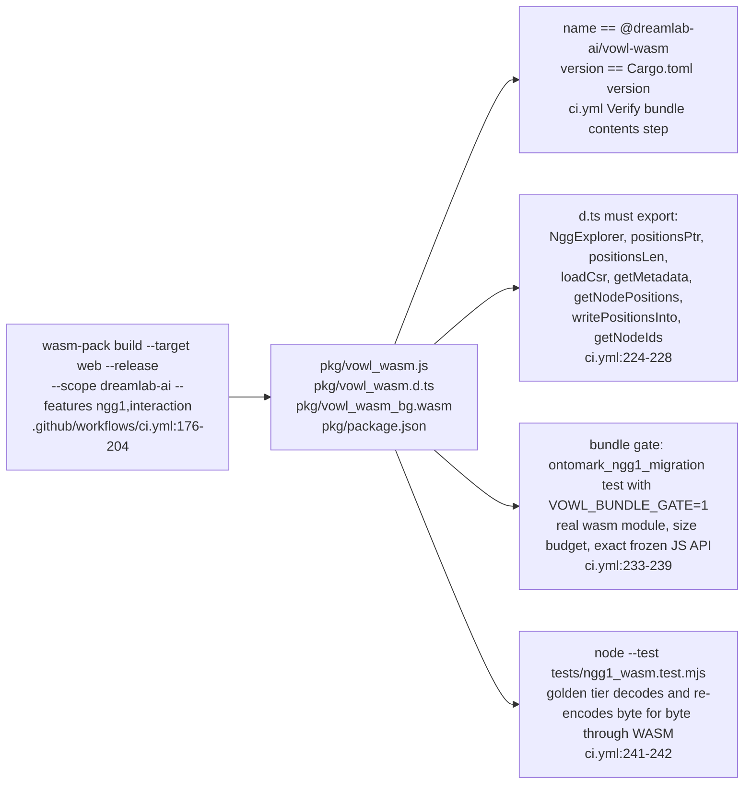
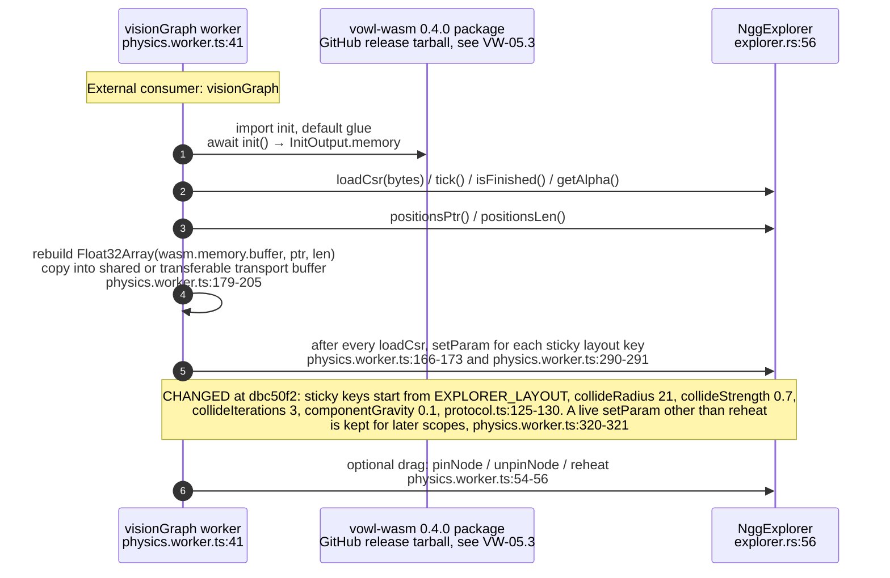
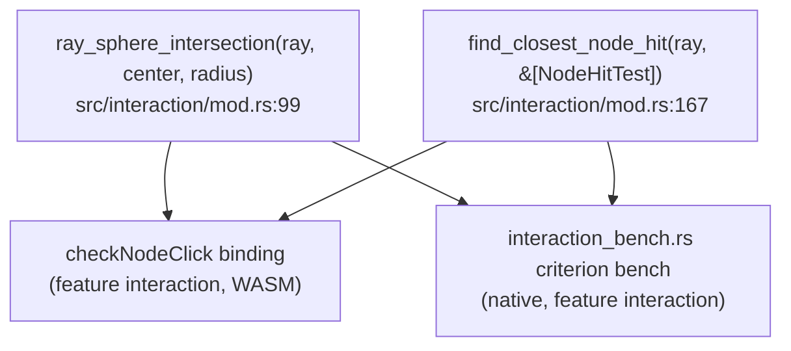
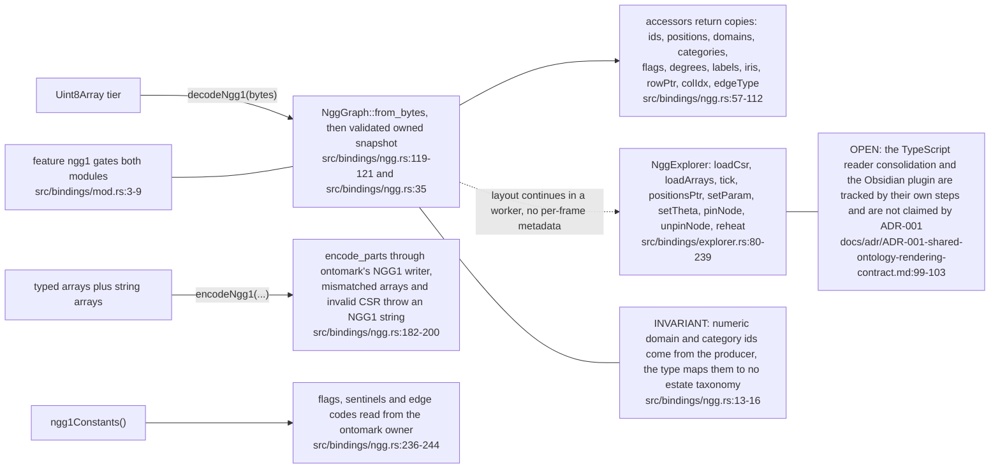
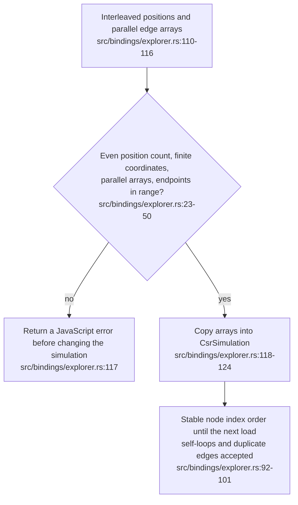
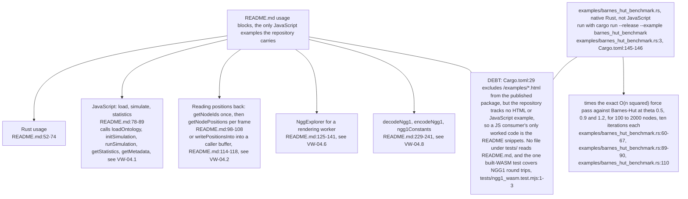
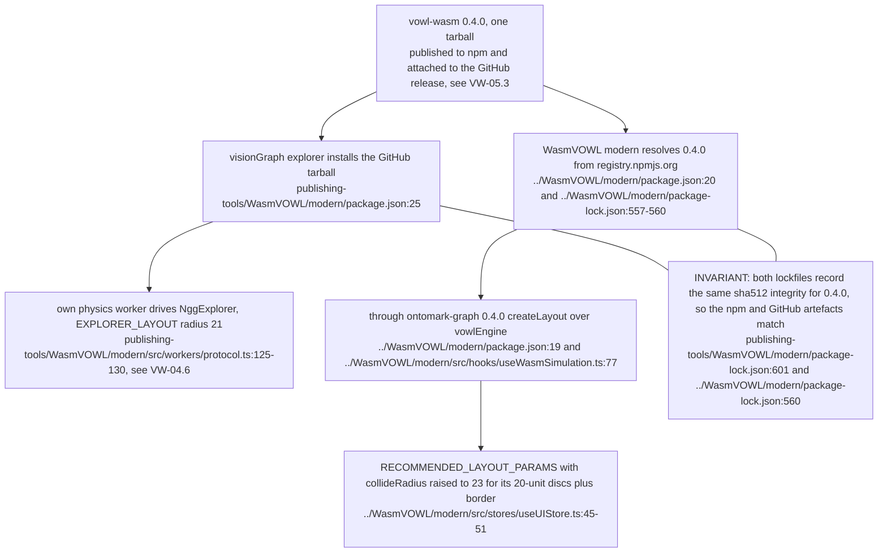

**Repair note — 2026-11-03:** selected counterexamples below have a [scoped successor verification](06-layout-and-release-repairs.md). Historical probe receipts retain their original revisions; source references were refreshed on 14 November 2026 after reviewing the plain-array loader, documentation and lint changes. The successor states the repaired contracts and acceptance boundaries.

## VW-04.1 `WebVowl` — the frozen 0.1.0 JS surface

- INVARIANT (README.md:154-155): this is the frozen 0.1.0 surface — names/signatures do not change without a major bump; later releases only add (`getNodeIds`/`getNodePositions`/`writePositionsInto` arrived in 0.1.1, per src/lib.rs crate doc, and `reheat` is now on the binding, src/bindings/mod.rs:142-147).
- `getNodeIds()`/`getNodePositions()` pair is index-stable: ticking, pinning, filtering and folding never reorder or remove nodes (src/bindings/mod.rs:221-267 doc comments), so JS zips `ids[i] <-> xy[2i], xy[2i+1]` once per load.

- **Replacement boundary:** `loadOntology` replaces graph and metadata, installs an empty `PinManager` and calls `simulation.reset()`, which restarts alpha but keeps link distance, charge and centre; CHANGED at 0779174 (0.3.0), which stopped replacing the simulation with a default one (src/bindings/mod.rs:54-60, src/bindings/mod.rs:75-81). `pinNode` accepts non-finite positions through the legacy manager (src/graph/pinning.rs:82-102); CSR pinning rejects them.

## VW-04.2 `writePositionsInto` vs `getNodePositions` — allocation trade-off

- The Rust method avoids creating a result vector, but the allocation claim in its doc comment is too broad (src/bindings/mod.rs:302-307): freshly generated wasm-bindgen 0.2.128 glue allocates a temporary WASM array for each `writePositionsInto` call and copies it back. Caller buffer reuse is not allocation-free across the ABI. `NggExplorer::positions_ptr` is the direct-view alternative (src/bindings/explorer.rs:157-170); the downstream worker still copies that view into its transport buffer. CSR `writePositionsInto` copies individual floats, including an odd last element, unlike the legacy pair-only method (src/layout/csr_sim.rs:836-840).

## VW-04.3 `checkNodeClick` — ray/sphere hit testing (feature `interaction`)

- The 20.0 hit-test radius is a fixed constant in the binding, not read from per-node visual size (src/bindings/mod.rs:436-437 comment: "In a real implementation, this could be configurable or per-node").

## VW-04.5 Bundle contents contract, verified in CI

- CI checks that those eight API symbols exist, while the native bundle gate checks the exact declaration surface. They are not all zero-copy APIs. The build fails if a required symbol vanishes from `pkg/vowl_wasm.d.ts` (.github/workflows/ci.yml:222-239). A stale local `pkg/` failed the gate in this audit; current source was tested through a separately generated bundle.

## VW-04.6 EXTERNAL: visionGraph's `physics.worker.ts` drives `NggExplorer`

- The worker resolves exported names "permissively (snake_case per Rust, with camelCase fallbacks)" (physics.worker.ts:35-39 comment) — it does not assume `wasm-bindgen`'s `js_name` renaming is exhaustive, a defensive stance against this crate's binding surface.
- Drag pinning is optional on the worker side: `pinNode`, `unpinNode` and `reheat` are bound with `optionalMethod` (physics.worker.ts:129-131) and the message handlers return silently when the loaded package lacks them. The package supplies them from 0.2.2 (the worker's own comment says `vowl-wasm ≥ 0.2.2`, physics.worker.ts:53); a pin that succeeds wakes the layout to `DRAG_ALPHA` 0.3 and an unpin to `RELEASE_ALPHA` 0.1 (physics.worker.ts:226-239, physics.worker.ts:325-337).
- Both known consumers now run 0.4.0 and turn the collision forces on; the second one, the standalone WasmVOWL viewer, is VW-04.11. visionGraph still installs the GitHub release tarball rather than the npm version (publishing-tools/WasmVOWL/modern/package.json:25, publishing-tools/WasmVOWL/modern/package-lock.json:598-603).

- **Failure boundary:** `loadScope` changes generation/count before validating bytes (physics.worker.ts:282-305). After a rejected tier, a later Start can publish old positions under the new generation. Caller `nodeCount` is not checked against the loaded tier. `isMainToWorker` only checks an object with a string `type` (protocol.ts:234-236), so unchecked non-finite parameter messages reach CSR configuration. These are host-adapter gaps, not guarantees supplied by the codec.

## VW-04.7 `interaction` module — native benches and the WASM binding

- Both entry points share pure geometry functions; the WASM binding additionally chooses candidates and validates array lengths (VW-04.3). A native benchmark measures the cases it runs; it does not establish that hidden-node selection or JavaScript argument handling is correct.

## VW-04.8 `ngg1` browser bindings — owned decode and encode beside the zero-copy explorer

**What it shows.** Version 0.2.0 adds an owned, copying way to read and write NGG1 tiers in the browser, next to the existing zero-copy explorer: the codec is ontomark's, the binding only wraps it, and a worker keeps laying out through `NggExplorer` without serialising metadata per frame (src/bindings/ngg.rs:1-6, README.md:222-239).
**Why it is this way.** ADR-001 wants one owner per graph format, so `vowl-wasm` delegates every binary read and write to ontomark and keeps only the browser surface, with a JavaScript test that round-trips the golden fixture through the built wasm (docs/adr/ADR-001-shared-ontology-rendering-contract.md:36, tests/ngg1_wasm.test.mjs:1-3).

## VW-04.9 Plain-array loading keeps the old graph on validation failure

**What it shows.** `loadArrays` accepts a graph already held in memory without NGG1 encoding. Invalid input leaves the preceding graph intact; the built-WASM regression checks both the error and retained counts (`tests/ngg1_wasm.test.mjs:100-130`).

**Why it is this way.** Validation happens before the array copies and simulation replacement, so malformed input produces a JavaScript exception instead of reaching a simulation assertion (`src/bindings/explorer.rs:105-124`). This source review does not establish which downstream deployment includes the new export.

## VW-04.10 Where the usage examples live — README snippets and one native Rust example

**What it shows.** The topic's examples are README code blocks plus one Cargo example. The Cargo example is a native benchmark of the layout force pass and exercises none of the JavaScript surface drawn in VW-04.1.
**Why it is this way.** The crate documents its frozen JS surface through README snippets (README.md:154-155) and keeps its one `examples/` file as a layout benchmark. Why no JavaScript example was added is not recorded in the files cited here.

## VW-04.11 EXTERNAL: the two consumers on 0.4.0 and where their layout values live

**What it shows.** CHANGED since the earlier stamp, when WasmVOWL pinned the v0.1.1 tarball and visionGraph 0.2.3: both now take 0.4.0 and both set collision values close to the crate's recommendation (src/bindings/explorer.rs:202-206).
**Why it is this way.** Each consumer chooses the radius for the discs it draws; WasmVOWL's are larger, so it overrides one value of the shared preset. Its layout path is drawn in the wasmvowl area.
