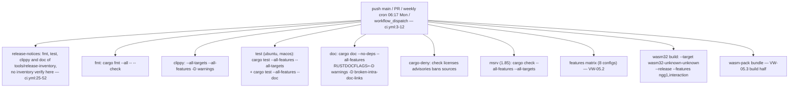
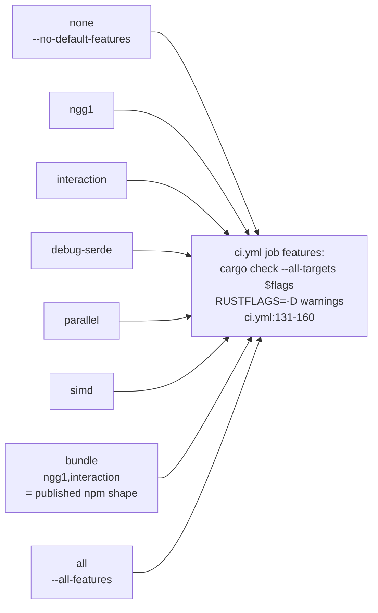
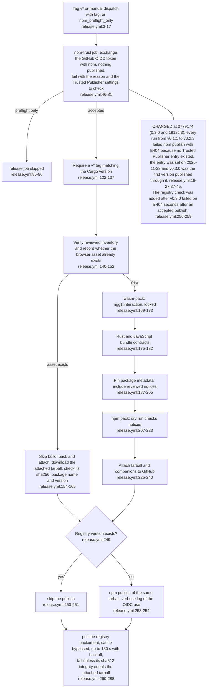
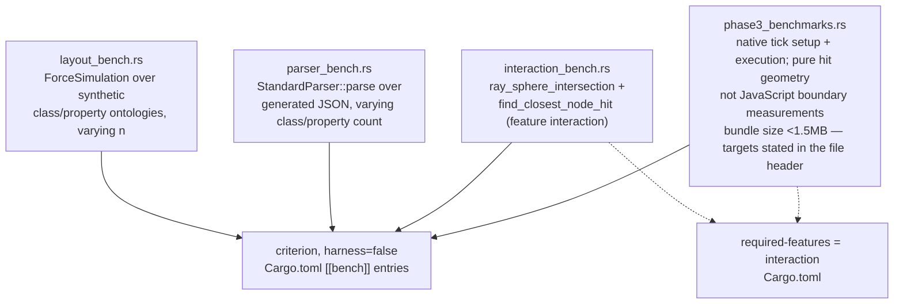
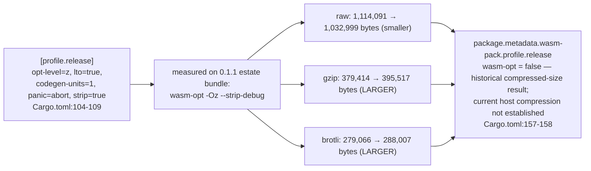
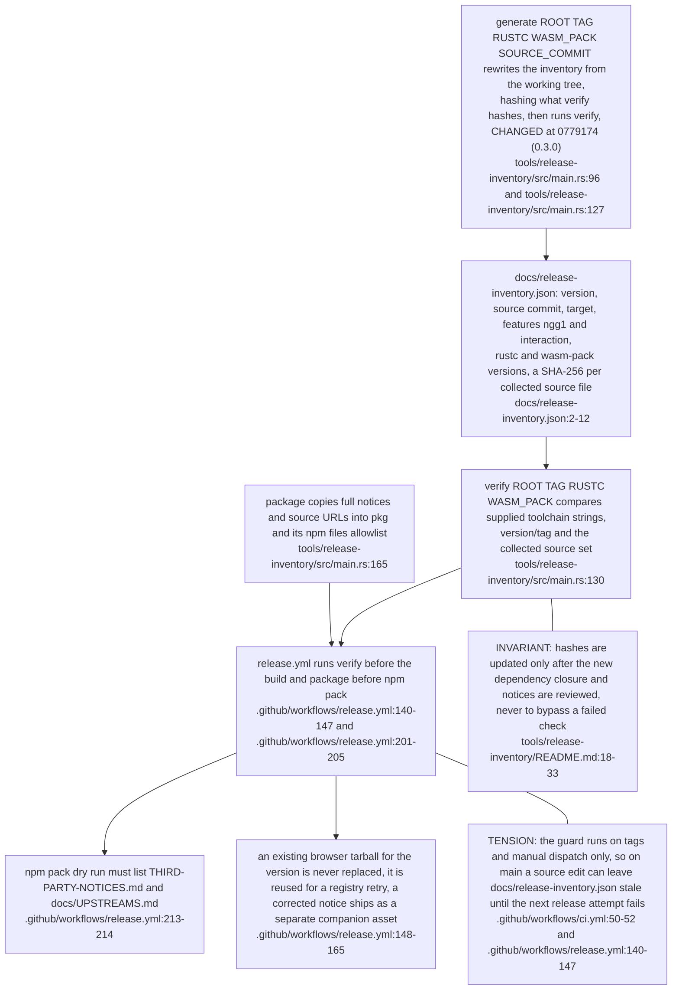

**Repair note — 2026-11-03:** selected counterexamples below have a [scoped successor verification](06-layout-and-release-repairs.md). Historical probe receipts retain their original revisions; source references were refreshed on 14 November 2026 after reviewing the plain-array loader, documentation and lint changes. The successor states the repaired contracts and acceptance boundaries.

## VW-05.1 CI — job graph on push/PR/weekly cron

- `concurrency: cancel-in-progress` scoped to `${{ github.workflow }}-${{ github.ref }}` (ci.yml:14-16) — a new push on the same ref cancels an in-flight CI run.
- The `release-notices` job checks the release guard crate itself (fmt, tests, clippy, rustdoc with warnings denied) but deliberately does not run its `verify` against the reviewed sources: that runs in `release.yml`, because on `main` it could only fail between a source change and the next licence review (ci.yml:44-52).
- `cargo-deny` is scheduled weekly independent of code changes (ci.yml:11) because it checks a live advisory database — "a green build can go red without a code change" (ci.yml:10 comment).

## VW-05.2 Feature matrix — every optional feature compiles standalone

- `RUSTFLAGS: -D warnings` is set specifically in this job, separate from the `clippy` job — "an import or item that is unused in one feature configuration is invisible to an --all-features run" (ci.yml:156-157 comment). The earlier `markdown-ontology` and `estate-source` rows are gone with the feature (ci.yml:139-147).
- `Cargo.toml` ties one test to its feature with `required-features`: `ngg1_explorer_test` needs `ngg1` (Cargo.toml:123-125), so a plain `cargo test` without that flag silently skips it; the markdown and OWL 2 validator test targets were deleted with their code, and `ontomark_ngg1_migration` runs as the bundle gate instead (.github/workflows/ci.yml:233-239).
- `[lib] crate-type = ["cdylib", "rlib"]` (Cargo.toml:38) — the crate ships both as a WASM-loadable `cdylib` for `wasm-pack` and as an `rlib` for native Rust consumers (tests, benches, the `docs.rs` build with `all-features`).

## VW-05.3 Release — npm trust preflight, tag build, GitHub attachment, npm publication and registry check

- `id-token: write` permits the OIDC flow; the workflow supplies no explicit npm token (release.yml:28-30). The preflight job declares only `contents: read` and `id-token: write` and masks the exchanged token (release.yml:49-51, release.yml:62, release.yml:70).
- Integrity is now compared on both branches: the registry check runs after a skipped publish too, so an already published version must also match the attached tarball byte for byte (release.yml:260-279).
- A re-run against an existing tag (`workflow_dispatch` with `tag` input, release.yml:7-12) no longer stops at the immutable-asset check: RESOLVED at vowl-wasm 2aff199 — when the tarball is already attached the workflow skips the build, pack and attach steps, downloads the attached tarball and verifies its checksum, package name and version (release.yml:148-165), then reaches the registry check and publish (release.yml:246-254). The registry state is outside this repository; `WasmVOWL` resolving 0.4.0 from registry.npmjs.org is VW-04.11.
- The release installs wasm-pack 0.15.0 from a checksum-verified release tarball and builds on rustc 1.99.0 (release.yml:95, release.yml:102-111).

## VW-05.4 Benches — what each measures

- `phase3_benchmarks.rs` is the only bench file that states explicit numeric targets in its own header comment (benches/phase3_benchmarks.rs:1-6): tick <10ms (8ms target), `getGraphData()` serialisation <5ms, `checkNodeClick` <1ms for 1,000 nodes, bundle <1.5MB — these are aspirational annotations in the source, not enforced by any CI assertion (contrast with the bundle-symbol check in VW-04.5, which is enforced). The tick benchmark includes cloning and initialisation, serialisation measures `graph.nodes()` rather than the JS method, and `wasm_tick_operation` reuses a settling instance so later calls are no-ops (benches/phase3_benchmarks.rs:80-87, benches/phase3_benchmarks.rs:110, benches/phase3_benchmarks.rs:240-250).

## VW-05.5 Release profile — why `wasm-opt` stays off

- `strip = true` already removes the ~190 KB `name` section (Cargo.toml:148-156, the comment above `[package.metadata.wasm-pack.profile.release]`); running binaryen on top of that opt-level-z + LTO build is what produced the gzip/brotli regression above.
- The decision also notes a portability cost: validating rustc's bulk-memory output needs binaryen's `-all` flag, which "ties the build to a binaryen version" — a second reason to leave it off (Cargo.toml:154-155).

## VW-05.6 Reviewed release inventory — the guard between a source change and a browser tarball

**What it shows.** A private Rust tool compares version, tag, features, supplied toolchain strings and hashes of collected sources/notices with a reviewed inventory. It checks source-commit syntax, not commit resolution, and excludes the release workflow and guard implementation from its source hash set. Packaging adds the recorded notices; this does not establish the completeness of the dependency review or publication to both destinations.
**Why it is this way.** New packages include notices and also attach a separate companion asset; historical tarballs are not overwritten, and existing frozen assets stay tied to their original source and digest (docs/UPSTREAMS.md:3, tools/release-inventory/README.md:18-33). The inventory now binds the 0.4.0 release: tag `v0.4.0`, layout source `e27b567cddab3977c5adb6795f6315818d59aa29` plus the release stamp, whose reviewed document states that the diff since 0.3.0 changes only this crate's version in Cargo.lock and adds no third-party source, so the package table and notices carry forward from 0.3.0 (docs/UPSTREAMS.md:3, docs/release-inventory.json:2-3). The earlier statement that the 0.2.0 tarball carried only the project and WebVOWL licences is not restated at this pin and is not confirmed here.
