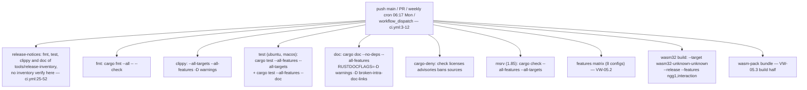
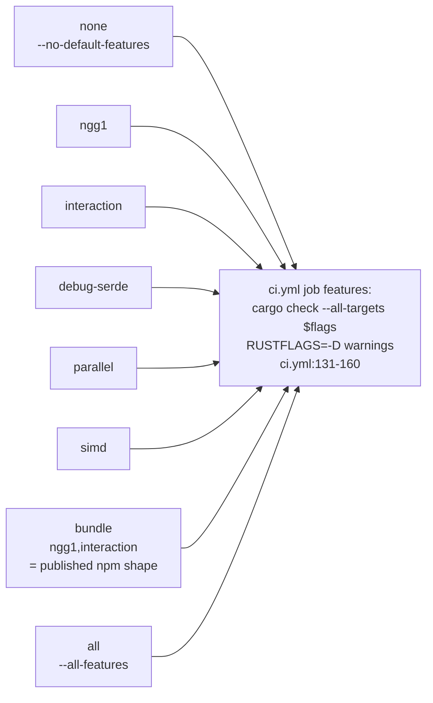
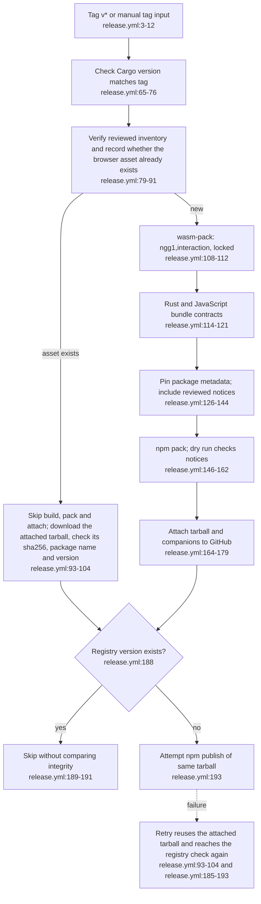
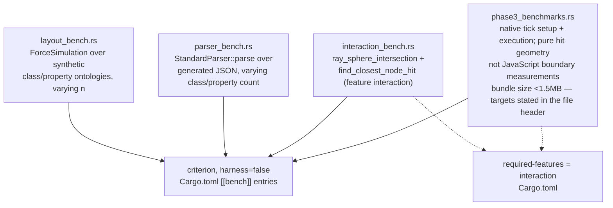
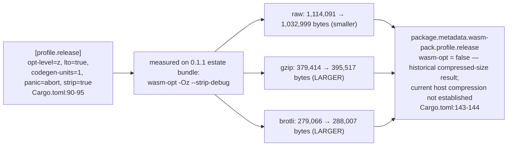
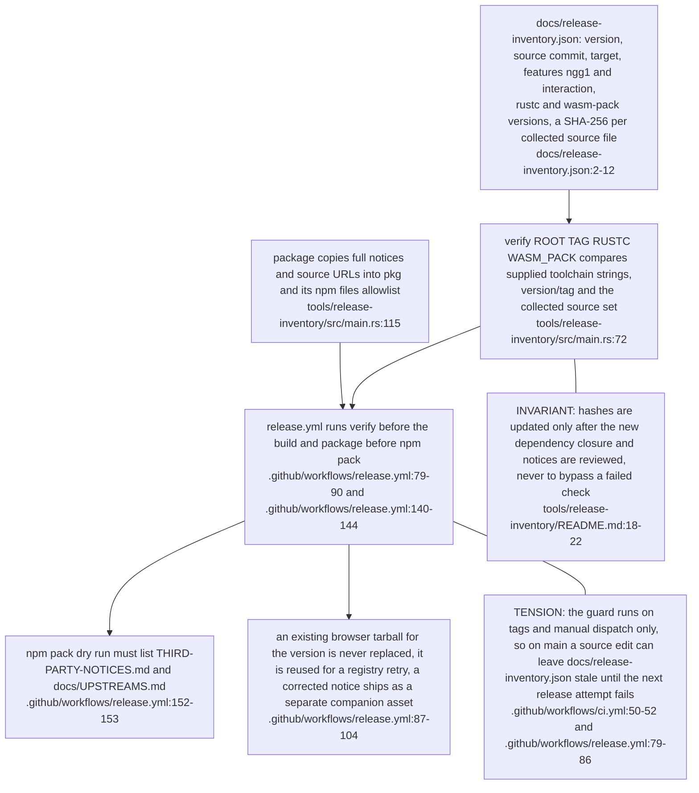

**Repair note — 2026-11-03:** selected counterexamples below have a [scoped successor verification](06-layout-and-release-repairs.md). This historical topic retains its declared source revision; the successor states the repaired contracts and acceptance boundaries.

## VW-05.1 CI — job graph on push/PR/weekly cron

- `concurrency: cancel-in-progress` scoped to `${{ github.workflow }}-${{ github.ref }}` (ci.yml:14-16) — a new push on the same ref cancels an in-flight CI run.
- The `release-notices` job checks the release guard crate itself (fmt, tests, clippy, rustdoc with warnings denied) but deliberately does not run its `verify` against the reviewed sources: that runs in `release.yml`, because on `main` it could only fail between a source change and the next licence review (ci.yml:44-52).
- `cargo-deny` is scheduled weekly independent of code changes (ci.yml:11) because it checks a live advisory database — "a green build can go red without a code change" (ci.yml:10 comment).

## VW-05.2 Feature matrix — every optional feature compiles standalone

- `RUSTFLAGS: -D warnings` is set specifically in this job, separate from the `clippy` job — "an import or item that is unused in one feature configuration is invisible to an --all-features run" (ci.yml:156-157 comment). The earlier `markdown-ontology` and `estate-source` rows are gone with the feature (ci.yml:139-147).
- `Cargo.toml` ties one test to its feature with `required-features`: `ngg1_explorer_test` needs `ngg1` (Cargo.toml:109-111), so a plain `cargo test` without that flag silently skips it; the markdown and OWL 2 validator test targets were deleted with their code, and `ontomark_ngg1_migration` runs as the bundle gate instead (.github/workflows/ci.yml:233-239).
- `[lib] crate-type = ["cdylib", "rlib"]` (Cargo.toml:24) — the crate ships both as a WASM-loadable `cdylib` for `wasm-pack` and as an `rlib` for native Rust consumers (tests, benches, the `docs.rs` build with `all-features`).

## VW-05.3 Release — tag build, GitHub attachment and attempted npm publication

- `id-token: write` permits the OIDC flow; the workflow supplies no explicit npm token (release.yml:14-21). Matching registry-side trust and permission are external prerequisites, not proved by this YAML.
- A successful new npm publish uses the same local tarball as the GitHub upload (release.yml:181-193). Existing registry versions are skipped without comparing integrity; the workflow does not establish byte parity on that branch.
- A re-run against an existing tag (`workflow_dispatch` with `tag` input, release.yml:7-12) no longer stops at the immutable-asset check: RESOLVED at vowl-wasm 2aff199 — when the tarball is already attached the workflow skips the build, pack and attach steps, downloads the attached tarball and verifies its checksum, package name and version (release.yml:87-104), then reaches the registry check and publish (release.yml:185-193). Earlier the check failed the run, so a retry after a failed npm publish could not reach the registry step. The observed v0.2.2 run attached its asset then failed npm publication; the registry listed only 0.1.2 on 1 November 2026 ([dated release assessment](../../estate-review/2026-11-01-vowl-ingest-and-release.md)).
- Since the earlier stamp the release also installs wasm-pack 0.15.0 from a checksum-verified release tarball and builds on rustc 1.99.0 (release.yml:38, release.yml:45-54).

## VW-05.4 Benches — what each measures

- `phase3_benchmarks.rs` is the only bench file that states explicit numeric targets in its own header comment (benches/phase3_benchmarks.rs:1-6): tick <10ms (8ms target), `getGraphData()` serialisation <5ms, `checkNodeClick` <1ms for 1,000 nodes, bundle <1.5MB — these are aspirational annotations in the source, not enforced by any CI assertion (contrast with the bundle-symbol check in VW-04.5, which is enforced). The tick benchmark includes cloning and initialisation, serialisation measures `graph.nodes()` rather than the JS method, and `wasm_tick_operation` reuses a settling instance so later calls are no-ops (benches/phase3_benchmarks.rs:80-87, benches/phase3_benchmarks.rs:110, benches/phase3_benchmarks.rs:240-250).

## VW-05.5 Release profile — why `wasm-opt` stays off

- `strip = true` already removes the ~190 KB `name` section (Cargo.toml:134-142, the comment above `[package.metadata.wasm-pack.profile.release]`); running binaryen on top of that opt-level-z + LTO build is what produced the gzip/brotli regression above.
- The decision also notes a portability cost: validating rustc's bulk-memory output needs binaryen's `-all` flag, which "ties the build to a binaryen version" — a second reason to leave it off (Cargo.toml:140-141).

## VW-05.6 Reviewed release inventory — the guard between a source change and a browser tarball

**What it shows.** A private Rust tool compares version, tag, features, supplied toolchain strings and hashes of collected sources/notices with a reviewed inventory. It checks source-commit syntax, not commit resolution, and excludes the release workflow and guard implementation from its source hash set. Packaging adds the recorded notices; this does not establish the completeness of the dependency review or publication to both destinations.
**Why it is this way.** New packages include notices and also attach a separate companion asset; historical tarballs are not overwritten, and existing frozen assets stay tied to their original source and digest (docs/UPSTREAMS.md:3, tools/release-inventory/README.md:18-22). The inventory now binds the planned 0.2.3 release: tag `v0.2.3`, layout source `756f49f5ab7bac9a97b3701157bb923da34abe22`, whose reviewed document states that its package table and notices carry forward from 0.2.2 because only this crate's version changed, and that it does not claim publication of 0.2.3 (docs/UPSTREAMS.md:3, docs/release-inventory.json:2-3). The earlier statement that the 0.2.0 tarball carried only the project and WebVOWL licences is not restated at this pin and is not confirmed here.
