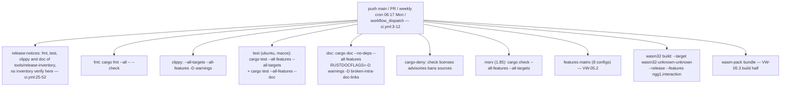
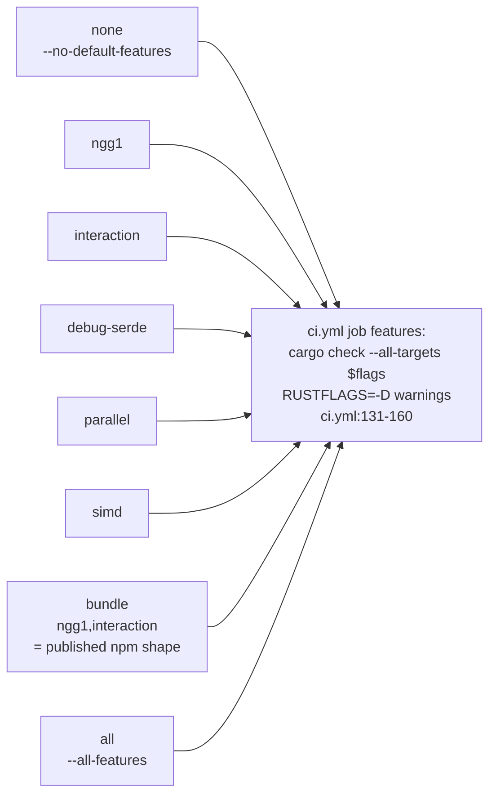
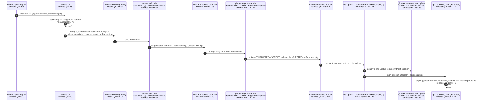
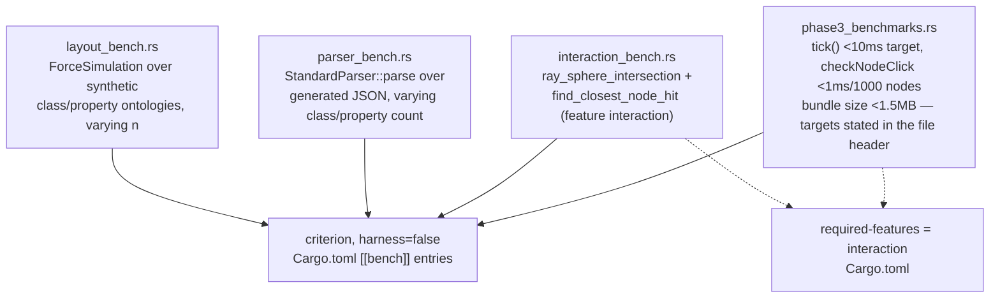
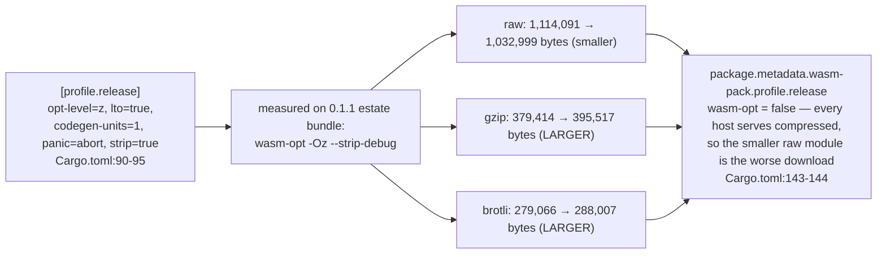
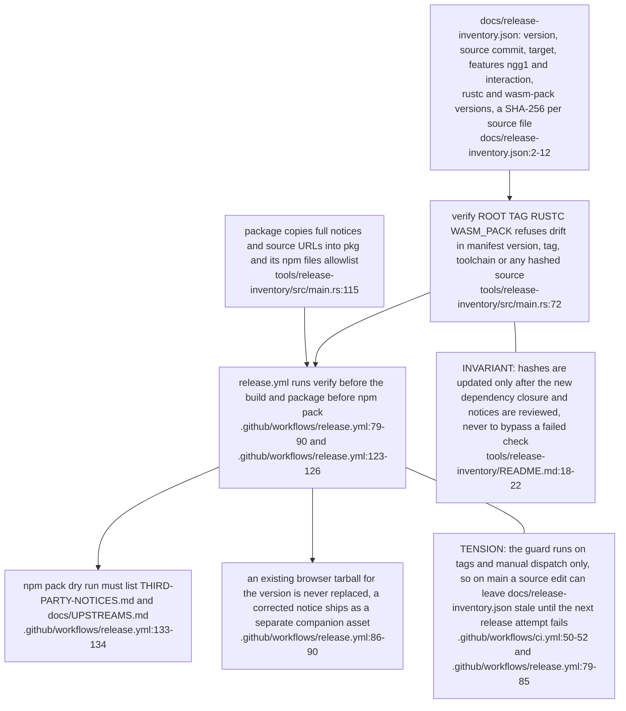

## VW-05.1 CI — job graph on push/PR/weekly cron

- `concurrency: cancel-in-progress` scoped to `${{ github.workflow }}-${{ github.ref }}` (ci.yml:14-16) — a new push on the same ref cancels an in-flight CI run.
- The `release-notices` job checks the release guard crate itself (fmt, tests, clippy, rustdoc with warnings denied) but deliberately does not run its `verify` against the reviewed sources: that runs in `release.yml`, because on `main` it could only fail between a source change and the next licence review (ci.yml:44-52).
- `cargo-deny` is scheduled weekly independent of code changes (ci.yml:11) because it checks a live advisory database — "a green build can go red without a code change" (ci.yml:10 comment).

## VW-05.2 Feature matrix — every optional feature compiles standalone

- `RUSTFLAGS: -D warnings` is set specifically in this job, separate from the `clippy` job — "an import or item that is unused in one feature configuration is invisible to an --all-features run" (ci.yml:156-157 comment). The earlier `markdown-ontology` and `estate-source` rows are gone with the feature (ci.yml:139-147).
- `Cargo.toml` ties one test to its feature with `required-features`: `ngg1_explorer_test` needs `ngg1` (Cargo.toml:109-111), so a plain `cargo test` without that flag silently skips it; the markdown and OWL 2 validator test targets were deleted with their code, and `ontomark_ngg1_migration` runs as the bundle gate instead (.github/workflows/ci.yml:233-239).
- `[lib] crate-type = ["cdylib", "rlib"]` (Cargo.toml:24) — the crate ships both as a WASM-loadable `cdylib` for `wasm-pack` and as an `rlib` for native Rust consumers (tests, benches, the `docs.rs` build with `all-features`).

## VW-05.3 Release — tag push to npm, via GitHub OIDC trusted publishing

- INVARIANT: `id-token: write` mints a short-lived OIDC credential; no long-lived npm token is stored anywhere — the npmjs.com trusted-publisher entry names this repo + workflow file (release.yml:14-21).
- The exact tarball attached to the GitHub release is what `npm publish` ships — "the two artefacts are byte-identical" (release.yml:161-163 comment before the publish step) — so a release asset download and the npm-installed package are provably the same bytes.
- A re-run against an existing tag (`workflow_dispatch` with `tag` input, release.yml:7-12) is safe: publish is skipped, not failed, when that version is already on the registry.
- Since the earlier stamp the release also installs wasm-pack 0.15.0 from a checksum-verified release tarball and builds on rustc 1.99.0 (release.yml:38, release.yml:45-54).

## VW-05.4 Benches — what each measures

- `phase3_benchmarks.rs` is the only bench file that states explicit numeric targets in its own header comment (benches/phase3_benchmarks.rs:1-6): tick <10ms (8ms target), `getGraphData()` serialisation <5ms, `checkNodeClick` <1ms for 1,000 nodes, bundle <1.5MB — these are aspirational annotations in the source, not enforced by any CI assertion (contrast with the bundle-symbol check in VW-04.5, which IS enforced).

## VW-05.5 Release profile — why `wasm-opt` stays off

- `strip = true` already removes the ~190 KB `name` section (Cargo.toml:133-142, the comment above `[package.metadata.wasm-pack.profile.release]`); running binaryen on top of that opt-level-z + LTO build is what produced the gzip/brotli regression above.
- The decision also notes a portability cost: validating rustc's bulk-memory output needs binaryen's `-all` flag, which "ties the build to a binaryen version" — a second reason to leave it off (Cargo.toml:139-141).

## VW-05.6 Reviewed release inventory — the guard between a source change and a browser tarball

**What it shows.** A private Rust tool binds the crate version, tag, features, compilers and every source file to a reviewed inventory, and the release workflow runs it before building and again when packaging, so a browser tarball cannot ship stale licence notices.
**Why it is this way.** The frozen 0.2.0 tarball carried only the project and WebVOWL licences; full third-party notices were added as a separate public asset rather than by overwriting an immutable release (docs/UPSTREAMS.md:3, tools/release-inventory/README.md:18-22).
