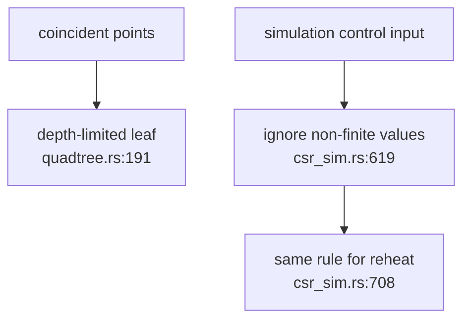
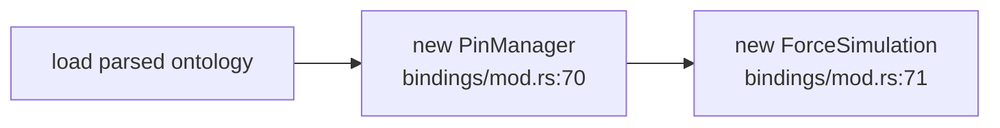
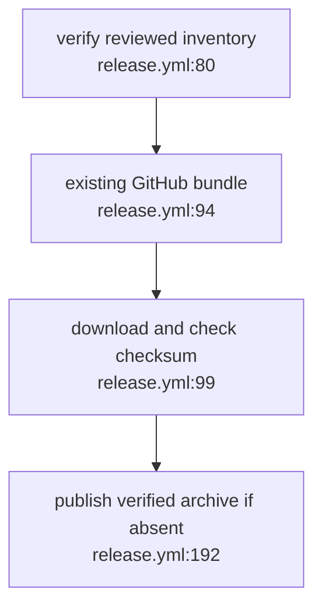

## For developers

This scoped successor covers VW-03.3, VW-04.1 and VW-05.3. Native regressions and local WASM tests passed. The [official release run](https://github.com/DreamLab-AI/vowl-wasm/actions/runs/41589928674) subsequently passed the pinned Rust 1.99.0 build, inventory and tests and uploaded the GitHub bundle; npm publication returned a permission/package E404 and remains open.

## For the business

Coincident graph nodes no longer cause unbounded subdivision. Loading another graph clears interaction state, and a failed npm publication can retry the existing reviewed release bundle.

## VW-06.1 Bound subdivision and reject non-finite controls

**What it shows:** legacy subdivision terminates, while CSR setters preserve valid state when supplied NaN or infinity. **Why it is this way:** a valid graph may contain many identical positions. Invalid controls must not poison future frames.

**Invariant:** the legacy tree stops subdividing at its fixed depth bound (`quadtree.rs:191`).

## VW-06.2 A newly loaded ontology starts a new interaction state

**What it shows:** a reused WebVowl instance does not retain old pins or settled simulation state. **Why it is this way:** node identifiers reused by another graph must not inherit an earlier graph's user interaction.

**Invariant:** successful loading replaces both interaction state holders (`bindings/mod.rs:70`).

## VW-06.3 Reuse the immutable release archive on registry retry

**What it shows:** an existing GitHub release no longer skips the independent npm publication step. **Why it is this way:** retrying registry delivery must preserve the reviewed archive rather than silently rebuild it with a different toolchain.

**Invariant:** archive checksum validation precedes registry publication (`release.yml:102`).
