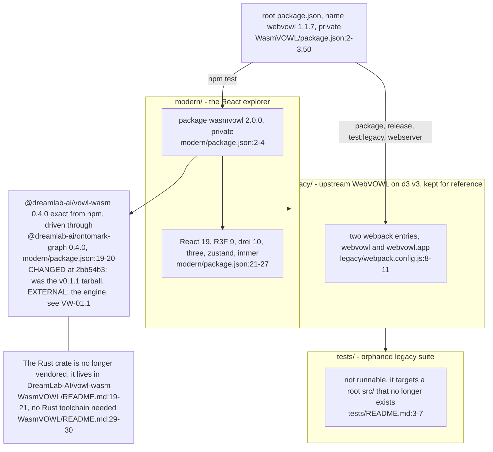
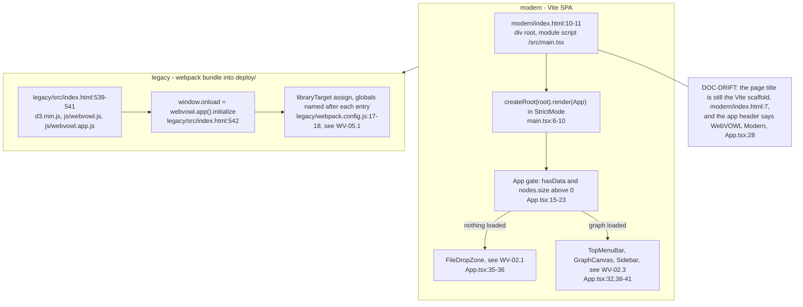
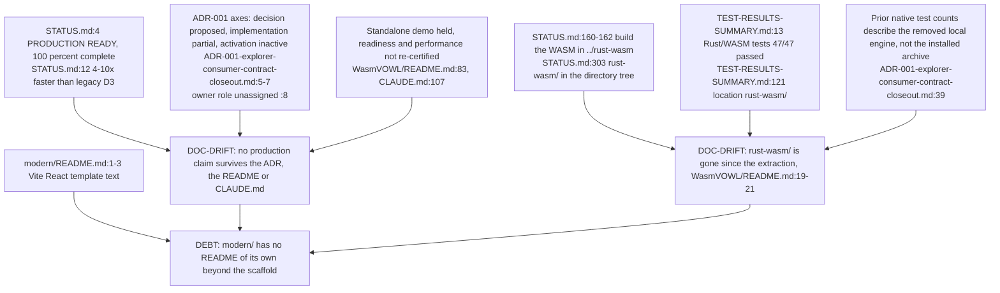

## WV-01.1 Three code bodies under one root, and the engine outside it

Root scripts and their targets are WV-04.1; the legacy body is WV-05.

## WV-01.2 Two entry points, one per code body

## WV-01.3 What the status documents claim, against the held decision record

STATUS.md and TEST-RESULTS-SUMMARY.md are dated 2025-11-10 (`STATUS.md:3`, `TEST-RESULTS-SUMMARY.md:3`) and were not updated by the extraction.
