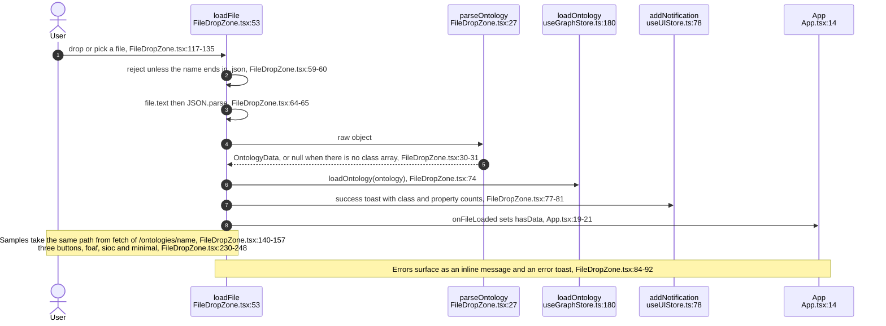
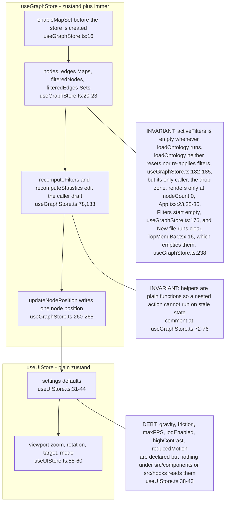
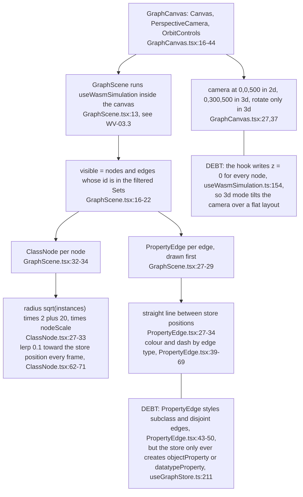
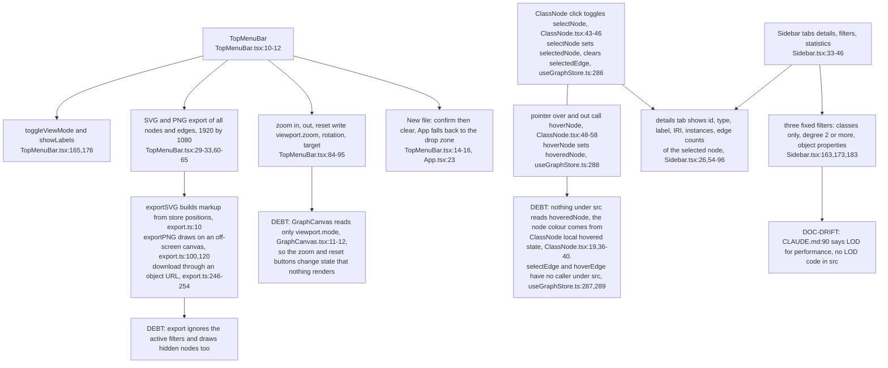

## WV-02.1 Loading a file or a bundled sample into the graph store

Input formats and the mapping inside `loadOntology` are WV-03.1 and WV-03.2.

## WV-02.2 The two stores and who reads them

## WV-02.3 Scene graph inside the R3F canvas

## WV-02.4 Menu, sidebar and export controls

No control writes `linkDistance` or `chargeStrength` (`TopMenuBar.tsx:176` is the only `updateSettings` call), so the hook's settings effect only ever sees the defaults (`useUIStore.ts:36-37`).
