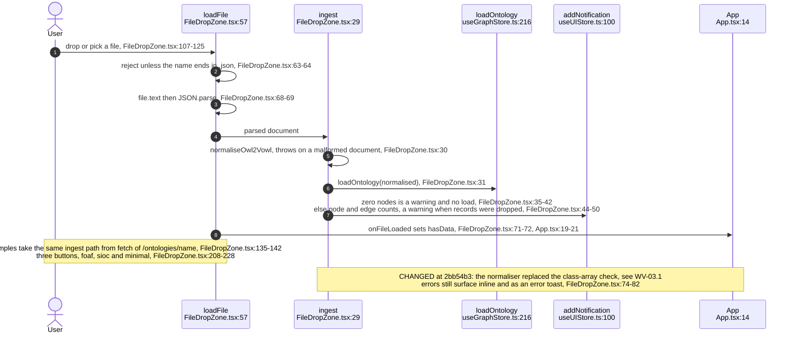
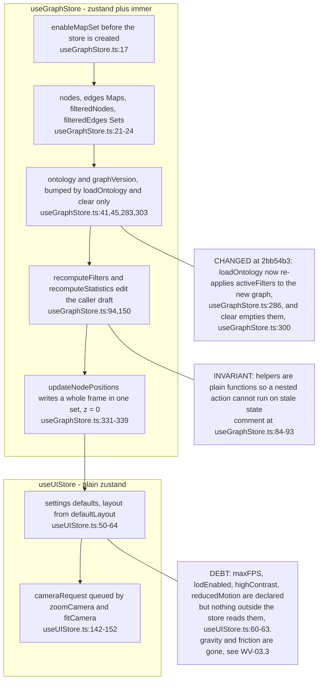
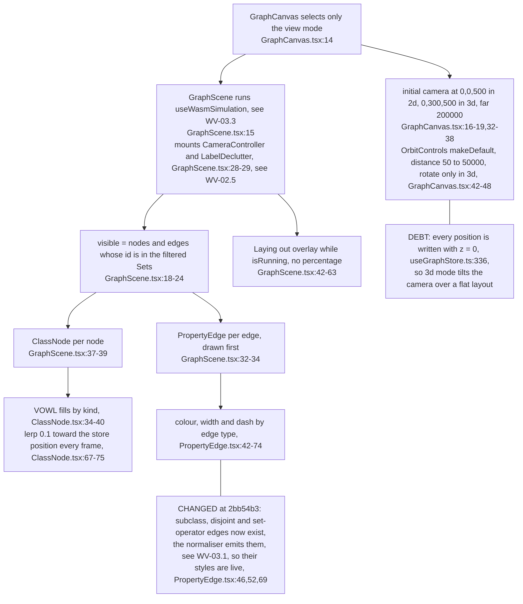
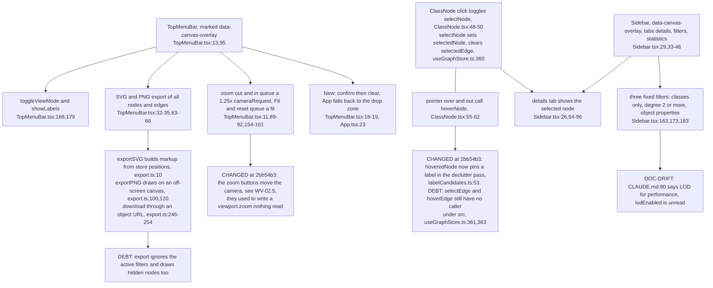
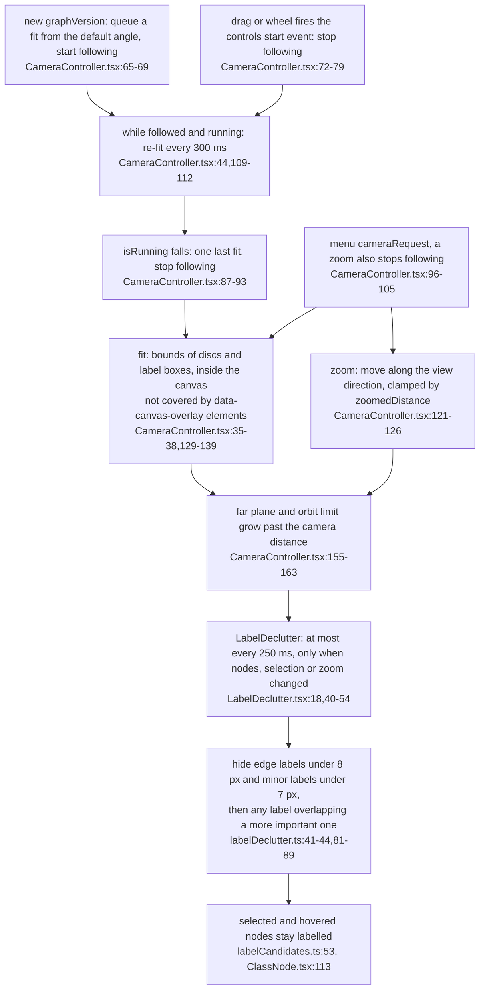

## WV-02.1 Loading a file or a bundled sample into the graph store

Input formats, the normaliser and the layout mapping are WV-03.1 and WV-03.2.

## WV-02.2 The two stores and who reads them

## WV-02.3 Scene graph inside the R3F canvas

## WV-02.4 Menu, sidebar and export controls

`updateLayout` (`useUIStore.ts:159-161`) has no caller in the UI: the layout parameters change only from code or the `?debug` handle (WV-03.3), and `TopMenuBar.tsx:179` is still the only `updateSettings` call.

## WV-02.5 Camera following, menu zoom and label declutter

The camera and declutter landed in WasmVOWL PR #2 (`ab9122e`); the decision record's own account is its "Camera, labels and CI" section (`ADR-001-explorer-consumer-contract-closeout.md:139-152`).
