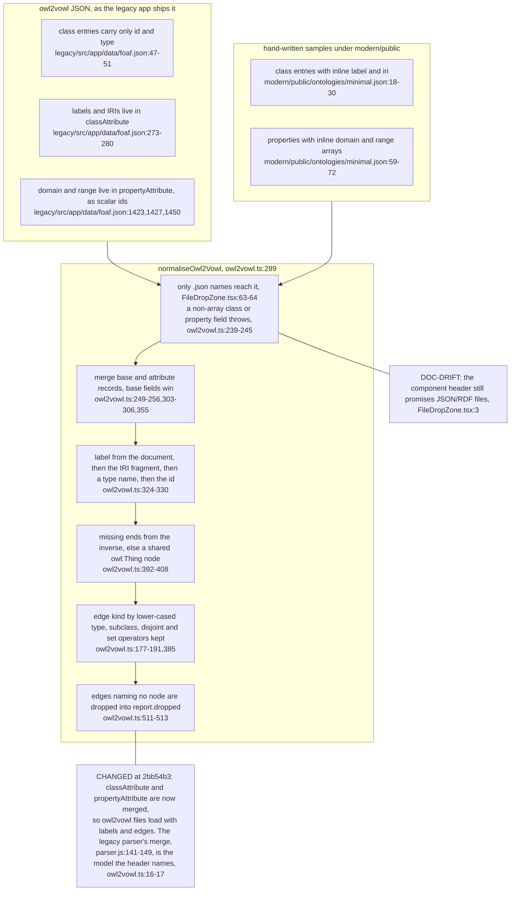
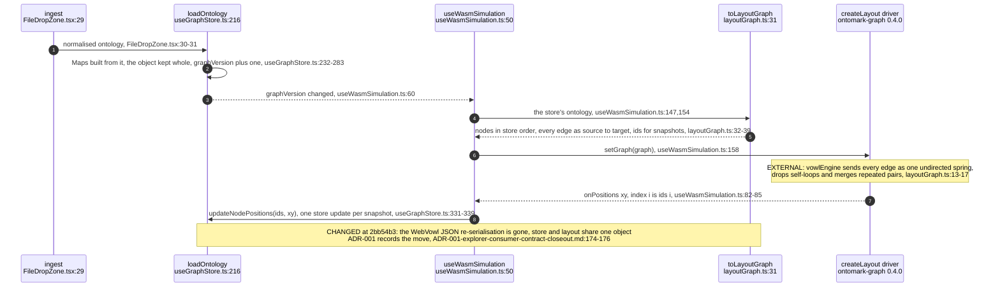
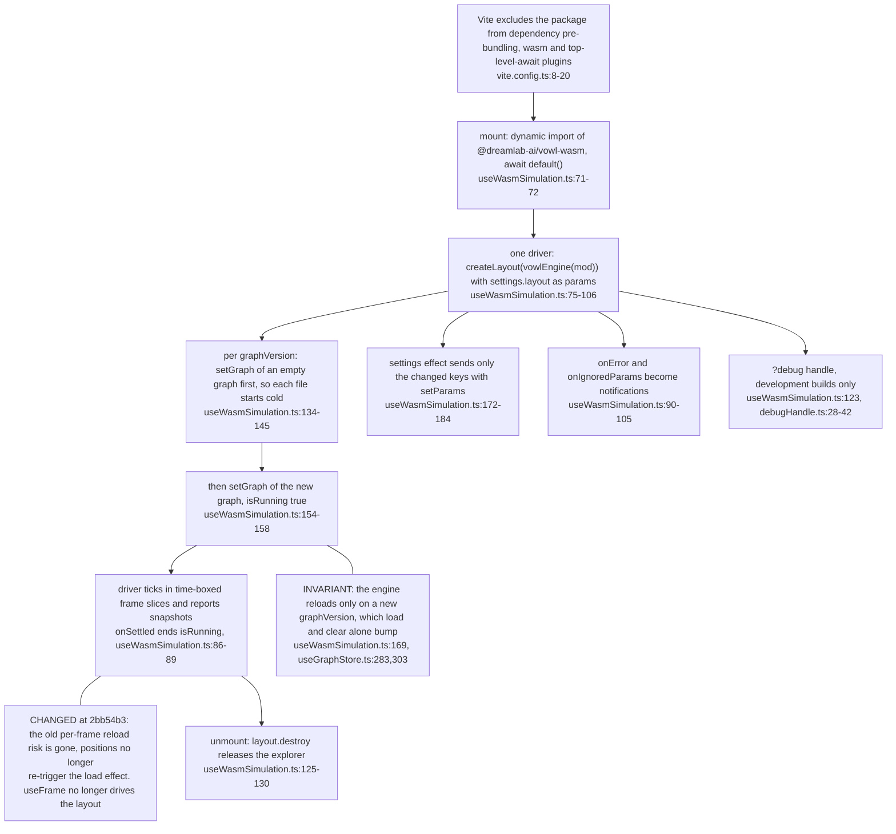
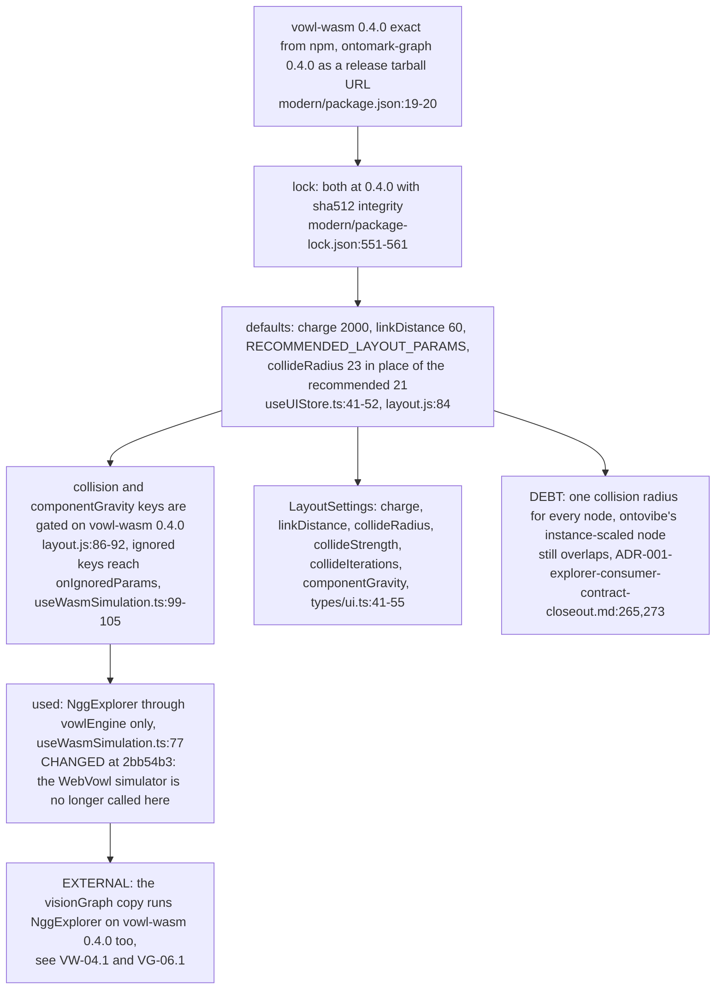

## WV-03.1 Two JSON dialects, one normaliser

owl2vowl's `owl:objectProperty` spelling (`legacy/src/app/data/foaf.json:1128`) now maps to `objectProperty`, because the lookup lower-cases the type (`owl2vowl.ts:385`).

## WV-03.2 One normalised object feeds the store and the layout

The engine types now come from the package (`useWasmSimulation.ts:15-21`), so a drift in the driver's API is a `tsc` error, not a silent mismatch.

## WV-03.3 Hook lifecycle: init, one cold load per file, live settings

## WV-03.4 What the standalone takes from the engine, and which release

