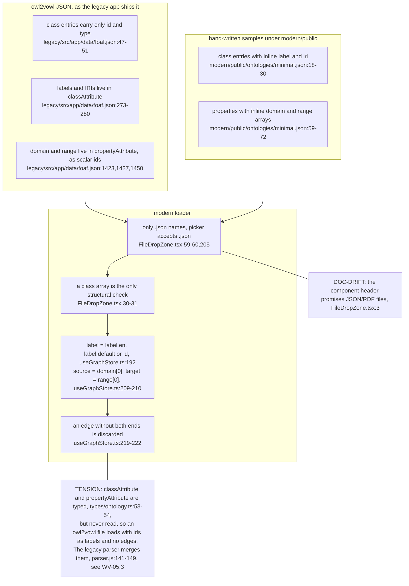
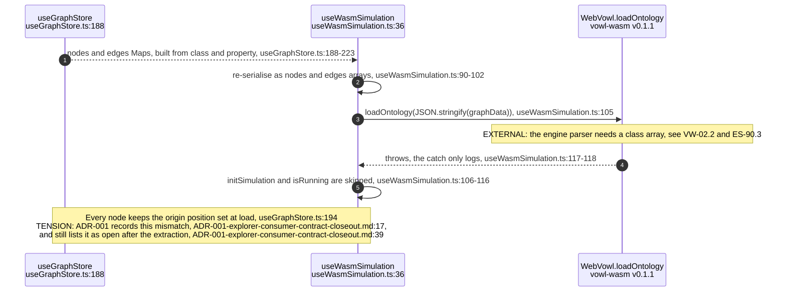
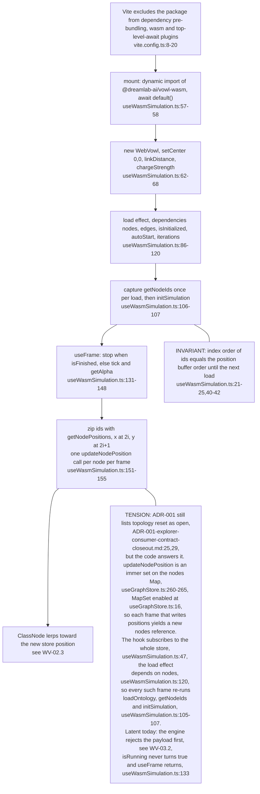
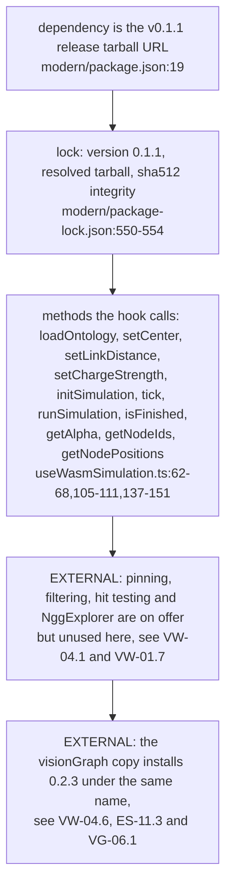

## WV-03.1 Two JSON dialects, one loader

The edge type test matches only `owl:ObjectProperty` (`useGraphStore.ts:211`); owl2vowl writes `owl:objectProperty` (`legacy/src/app/data/foaf.json:1128`), which falls through to `datatypeProperty`.

## WV-03.2 The store schema is not the schema the engine accepts

The engine type the hook calls is declared by hand (`useWasmSimulation.ts:11-29`), not imported from the package's declarations, so `tsc` cannot catch a drift between the two.

## WV-03.3 Hook lifecycle: init, load, tick

## WV-03.4 What the standalone takes from the engine, and which release

