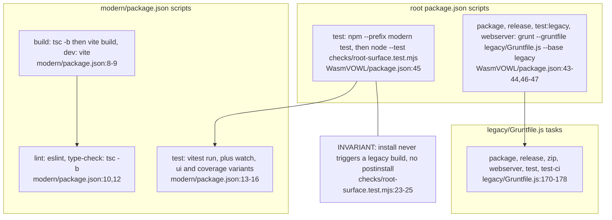
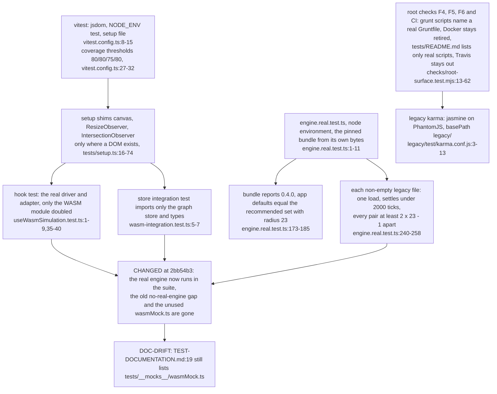
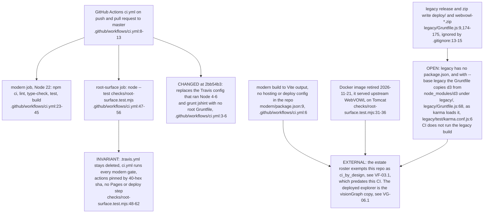

## WV-04.1 Every script, by where it runs

## WV-04.2 What each test layer actually exercises

The decision record's account of the evidence is its NggExplorer section (`ADR-001-explorer-consumer-contract-closeout.md:218-235`); the test guide describes the hook and real-engine layers the same way (`TEST-DOCUMENTATION.md:78,88`).

## WV-04.3 CI and deploy: what exists and what does not

The README's setup is local, `npm ci` then `npm run dev` on port 5173, and its CI paragraph matches the workflow (`WasmVOWL/README.md:41-54,63-65`).
