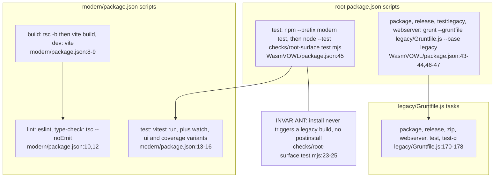
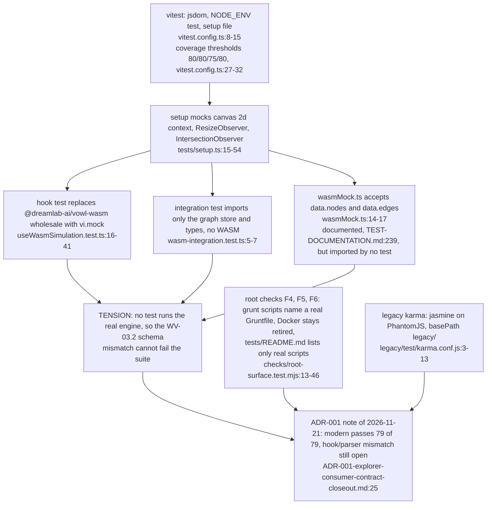
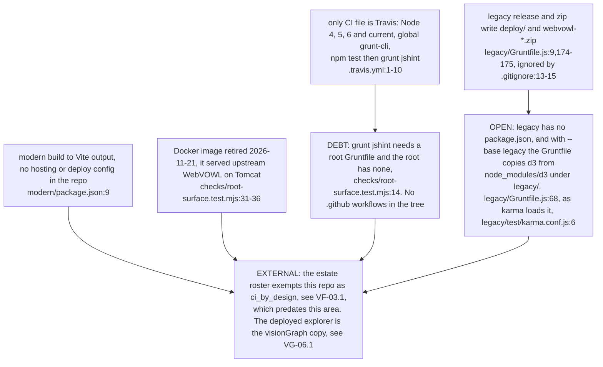

## WV-04.1 Every script, by where it runs

## WV-04.2 What each test layer actually exercises

The hook test's own comment records that its mock previously named a removed `rust-wasm/pkg` path and never applied (`useWasmSimulation.test.ts:12-15`).

## WV-04.3 CI and deploy: what exists and what does not

The README's setup is local only, `npm ci` then `npm run dev` on port 5173 (`WasmVOWL/README.md:41-54`).
