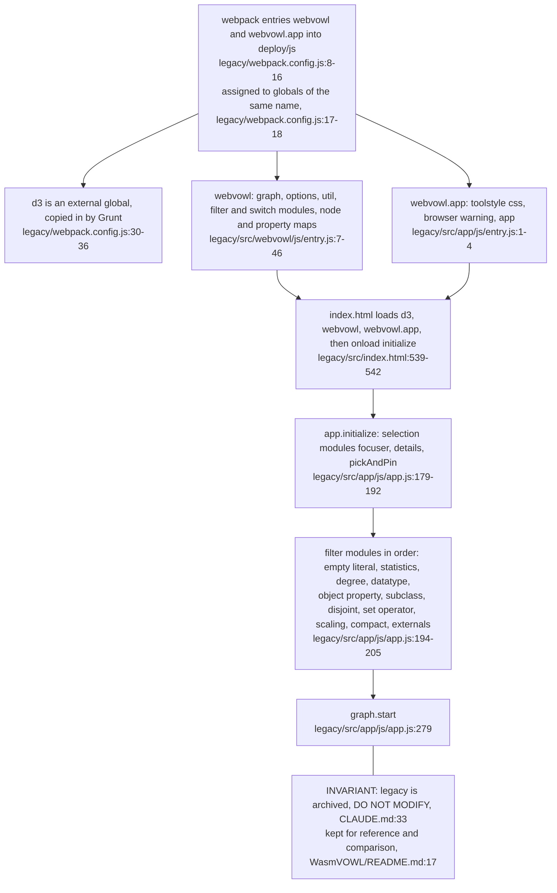
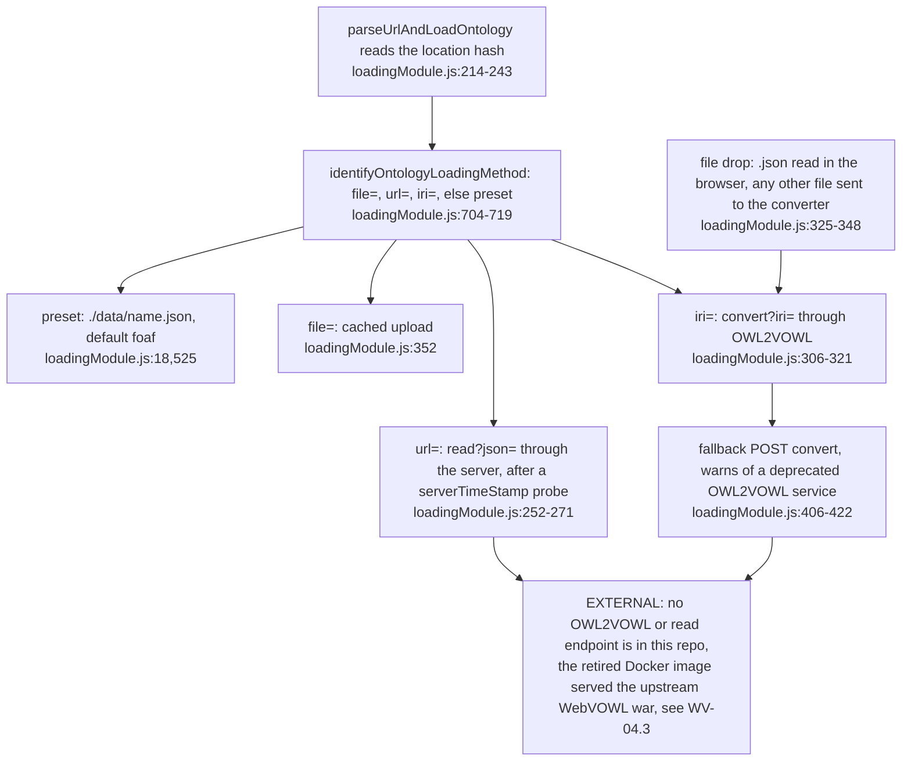
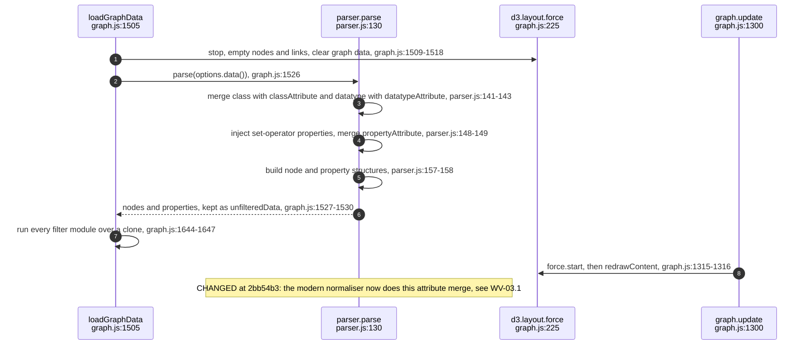
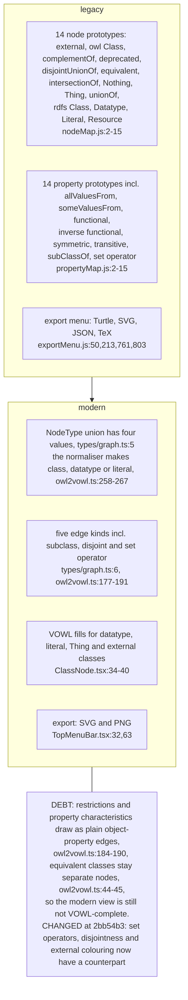
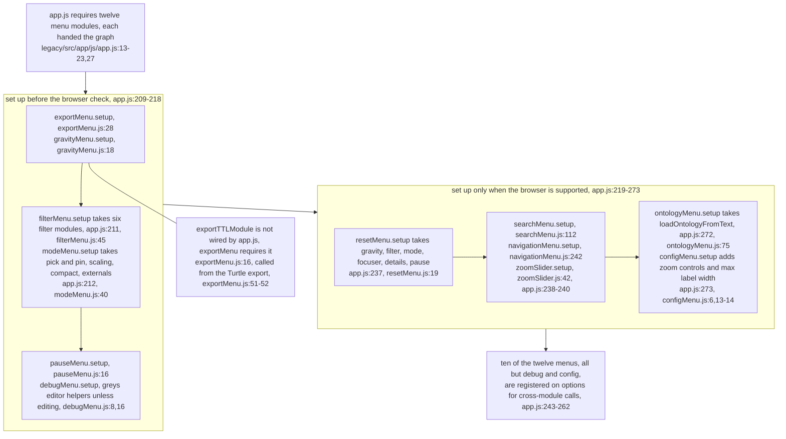
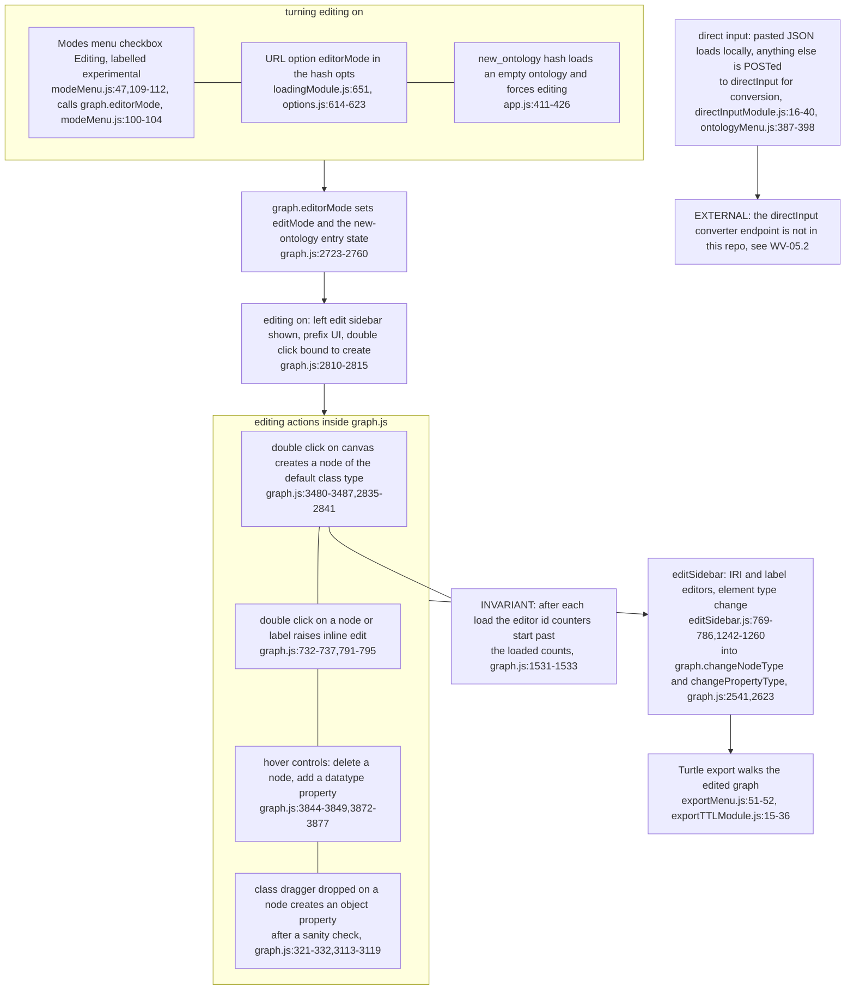

## WV-05.1 Two bundles, two globals, one boot call

## WV-05.2 Four loading methods, two of them need a converter service

## WV-05.3 From owl2vowl JSON to a d3 v3 force layout

## WV-05.4 Notation and export coverage, legacy against modern

The modern counterpart of each legacy stage is WV-02; the VOWL notation engine itself is the vowl-wasm area (VW-02).

## WV-05.5 The menu layer: twelve menus wired by app.js, one export helper

Of these, `exportMenu` already appears in WV-05.4, `modeMenu` and `ontologyMenu` lead into WV-05.6.

## WV-05.6 The experimental editor path

The editor's starting state is set in two places, `editMode = true` in `graph.js:83` and an `editorMode` default of `"false"` in `options.js:333`; this diagram does not claim which wins at boot.
