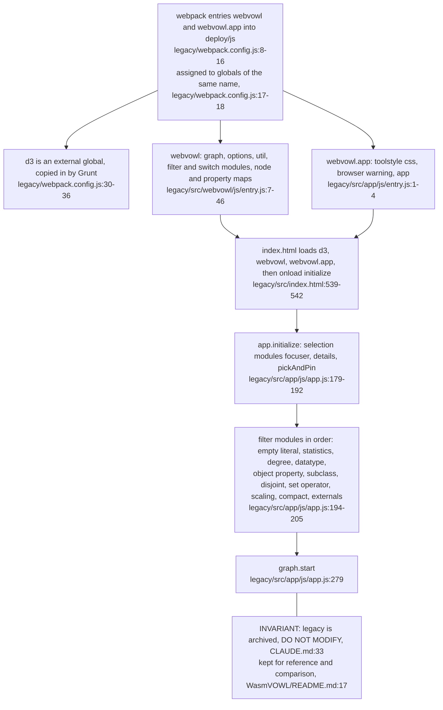
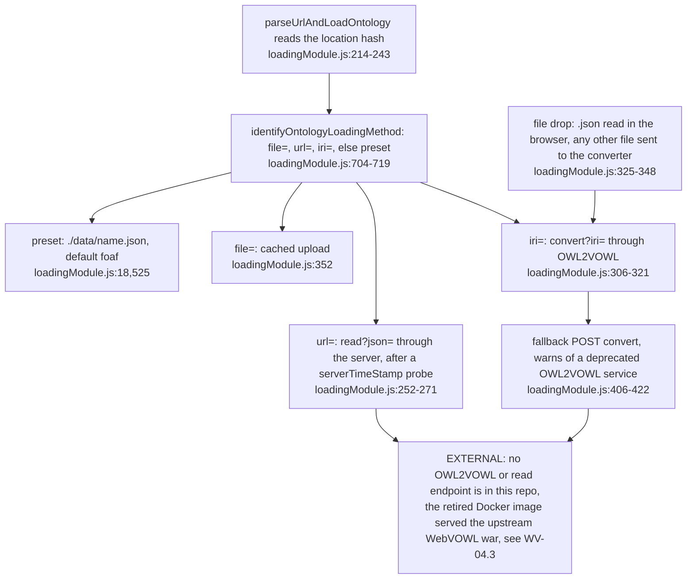
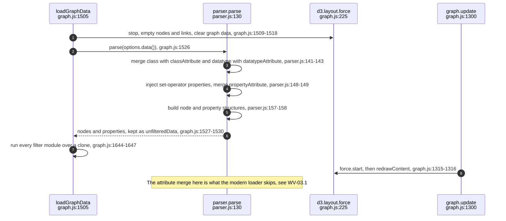
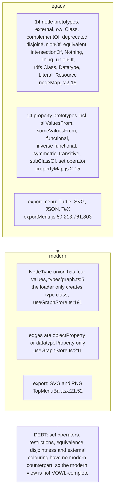

## WV-05.1 Two bundles, two globals, one boot call

## WV-05.2 Four loading methods, two of them need a converter service

## WV-05.3 From owl2vowl JSON to a d3 v3 force layout

## WV-05.4 Notation and export coverage, legacy against modern

The modern counterpart of each legacy stage is WV-02; the VOWL notation engine itself is the vowl-wasm area (VW-02).
